# M4 against M5: the comparison results

Classical solvers (M4) against QAOA on IBM's `ibm_fez` (M5, at reps = 2 and reps = 1), on the eight
T0 cells without CVaR the two studies share: the same 40 instances, scored against the same proven
optima. This page shows the results only; the argument, the sources of every number and the limits
are in the full comparison, `superpowers/specs/2026-10-28-m4-m5-comparison.md` (its section numbers
are given in brackets below).

## Verdict

- **Quality.** At equal reads (1,000 per run), QAOA loses to every classical sampler: 4 to 6 times
  behind tabu in success, two orders of magnitude in feasible samples. The noiseless circuit already
  loses; the device is barely above uniform random bits.
- **Time.** On QPU seconds alone the device is 17 to 2,500 times slower than the exact methods and
  greedy, 9.5 to 93 times slower than annealing, and 1,200 to 27,000 times slower than the fastest
  classical answer end to end. Only tabu run at 1,000 reads, a quality setting that takes 42 to
  74 s, is slower than the device's QPU seconds, on four cells.
- **Depth.** Halving the circuit (reps = 1) lets the device keep more of it, feasibility 3.1 against
  2.0 times uniform, but the shallower circuit is a weaker optimiser; the net does not approach the
  samplers.
- **Scope.** This holds for gate-model QAOA on one Heron processor, on T0 without CVaR. Annealers,
  the CVaR cells and T2–T3 were not measured.

## 1. Quality at 1,000 reads, cell by cell (8.1)

Success at ε = 1% / share of feasible samples, binary encoding. Device columns: jobs within 1% of the
optimum / feasible share.

| cell | greedy | annealing | tabu | noiseless, reps 2 | noiseless, reps 1 | noise model, reps 2 | noise model, reps 1 | device, reps 2 | device, reps 1 |
|---|---|---|---|---|---|---|---|---|---|
| `none` | 1.00 / 98% | 0.75 / 100% | 1.00 / 100% | 0.32 / 8.5% | 0.14 / 2.9% | 0.20 / 1.3% | 0.07 / 1.7% | 0 of 15 / 0.19% | 0 of 5 / 0.36% |
| `D1` | 0.97 / 96% | 0.54 / 100% | 1.00 / 100% | 0.03 / 7.6% | 0.00 / 2.5% | — | — | 0 of 15 / 0.093% | 0 of 5 / 0.16% |
| `D4` | 1.00 / 96% | 0.76 / 100% | 1.00 / 100% | 0.27 / 6.8% | 0.24 / 5.7% | 0.00 / 2.0% | 0.00 / 3.5% | 1 of 15 / 0.71% | 0 of 5 / 1.0% |
| `D1+D4` | 1.00 / 96% | 0.94 / 100% | 1.00 / 100% | 0.56 / 8.3% | 0.41 / 3.2% | 0.60 / 1.6% | 0.60 / 1.6% | 1 of 15 / 0.36% | 1 of 5 / 0.38% |
| `D2` | 0.88 / 20% | 1.00 / 76% | 0.98 / 98% | 0.72 / 5.8% | 0.53 / 2.4% | 0.60 / 1.3% | 0.60 / 1.3% | 1 of 6 / 0.45% | 1 of 2 / 0.65% |
| `D1+D2` | 0.90 / 35% | 0.99 / 69% | 1.00 / 96% | 0.57 / 2.3% | 0.51 / 2.4% | 0.10 / 1.2% | 0.45 / 1.0% | 4 of 12 / 0.81% | 0 of 4 / 1.0% |
| `D2+D4` | 0.95 / 45% | 0.90 / 92% | 1.00 / 100% | 0.57 / 5.6% | 0.40 / 1.6% | killed | 0.60 / 1.7% | 1 of 3 / 1.1% | 1 of 2 / 0.9% |
| `D1+D2+D4` | 1.00 / 41% | 1.00 / 69% | 0.99 / 95% | 1.00 / 14% | 0.97 / 5.7% | 0.93 / 3.3% | 0.73 / 3.2% | 3 of 9 / 1.1% | 2 of 3 / 2.4% |

Averaged over the eight cells:

| solver | success | feasible share | behind tabu, success | behind tabu, feasibility |
|---|---|---|---|---|
| tabu | 1.00 | 98.6% | 1 | 1 |
| greedy | 0.96 | 66% | 1.03 | 1.5 |
| simulated annealing | 0.86 | 88% | 1.16 | 1.1 |
| QAOA, noiseless, reps 2 | 0.51 | 7.4% | 2.0 | 13 |
| QAOA, noiseless, reps 1 | 0.40 | 3.4% | 2.5 | 29 |
| QAOA, noise model, reps 2 | 0.35 | 1.7% | 2.9 | 59 |
| QAOA, noise model, reps 1 | 0.44 | 1.9% | 2.3 | 51 |
| QAOA, `ibm_fez`, reps 2 | 0.16 | 0.51% | 6.1 | 190 |
| QAOA, `ibm_fez`, reps 1 | 0.23 | 0.78% | 4.3 | 130 |

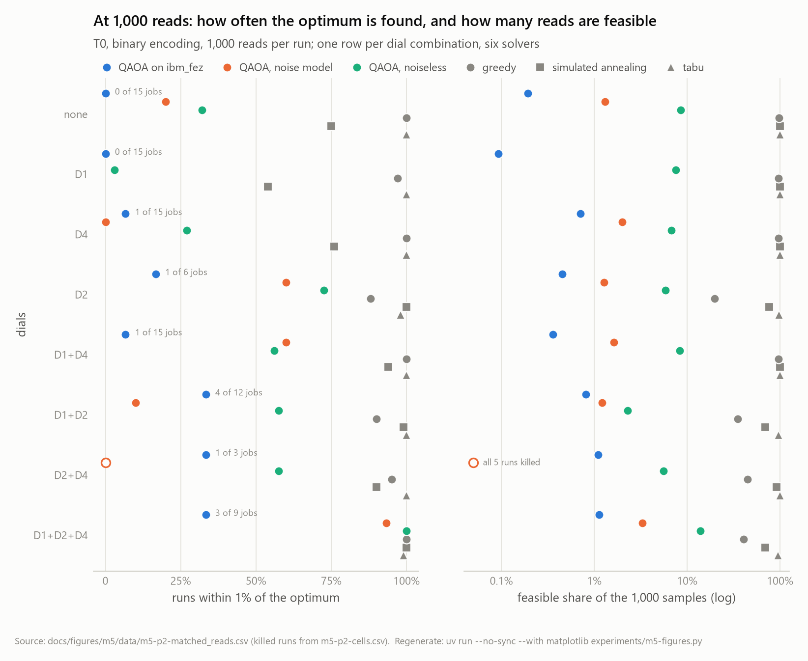

## 2. Time to solution, cell by cell (8.2)

TTS99 at ε = 1%. Classical columns are wall-clock; the device's QPU columns are IBM's QPU seconds
only; the end-to-end clock adds training and the lane's wall time per job.

| cell | CP-SAT (M4) | HiGHS (M4) | best M4 sampler | greedy, 1,000 reads | annealing, 1,000 reads | device QPU, reps 2 | device QPU, reps 1 | device end to end, reps 2 | device end to end, reps 1 |
|---|---|---|---|---|---|---|---|---|---|
| `none` | 0.16 s | 0.52 s | 0.11 s (greedy) | 0.25 s | 3.0 s | censored | censored | censored (training 33 min) | censored (training 8.4 min) |
| `D1` | 0.092 s | 0.46 s | 0.11 s (greedy) | 0.35 s | 6.6 s | censored | censored | censored (training 75 min) | censored (training 16 min) |
| `D4` | 0.094 s | 0.11 s | 0.089 s (greedy) | 0.24 s | 2.3 s | 133 s | censored | 26 min | censored (training 2.1 min) |
| `D1+D4` | 0.053 s | 0.14 s | 0.10 s (greedy) | 0.22 s | 1.4 s | 133 s | 41 s | 24 min | 7.2 min |
| `D2` | 0.052 s | 0.79 s | 0.19 s (greedy) | 0.44 s | 0.76 s | 63 s | 13 s | 8.3 min | 2.4 min |
| `D1+D2` | 0.043 s | 0.63 s | 0.12 s (greedy) | 0.30 s | 0.57 s | 28 s | censored | 5.9 min | censored (training 0.4 min) |
| `D2+D4` | 0.051 s | 0.16 s | 0.20 s (greedy) | 0.42 s | 1.4 s | 23 s | 13 s | 3.0 min | 7.8 min |
| `D1+D2+D4` | 0.057 s | 0.093 s | 0.11 s (greedy) | 0.16 s | 0.82 s | 23 s | 8.4 s | 3.0 min | 1.2 min |

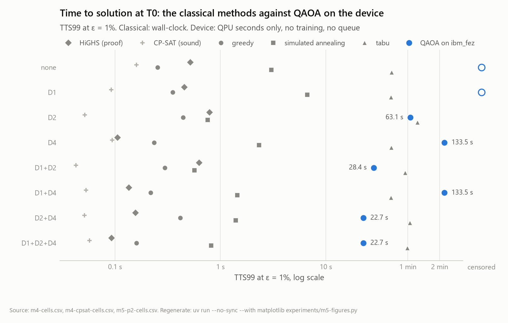

## 3. What one answer costs (8.3)

| cost | classical | QAOA, reps 2 | QAOA, reps 1 |
|---|---|---|---|
| preparation per QUBO | none | training: a median 6 s at 16 qubits (3.3 s at the least) to 66 min (median) or 90 min (max) at 24 | a median 0.8 s at 16 qubits (0.43 s at the least) to 16 min (median) or 24 min (max) at 24 |
| preparation, all 47 QUBOs | none | 17.3 h of training (wall-clock, summed) | 3.6 h |
| per answer | HiGHS solves an instance in 0.03–1.0 s, a cell mean of 0.24–0.40 s (13.7 s for all 40 instances, M5 store); CP-SAT 0.04–0.16 s best | routing, submission, queue and collection: a median 15.3 s of wall time per job, of which 2–3 s of QPU and a median 1.4 s of queue (once 11 min) | 16.2 s per job, of which 2 s of QPU and 1.5 s of queue |
| failures that cost time | none (M4 killed 1 of 292,480 tasks) | 31 simulator tasks killed at 2 h, 62 worker-hours; 1 instance never reached the device | 5 tasks killed at 2 h, 10 worker-hours |
| quota | none | 198 s of a 300 s per 28 days budget for 90 jobs | 62 s for 31 jobs |

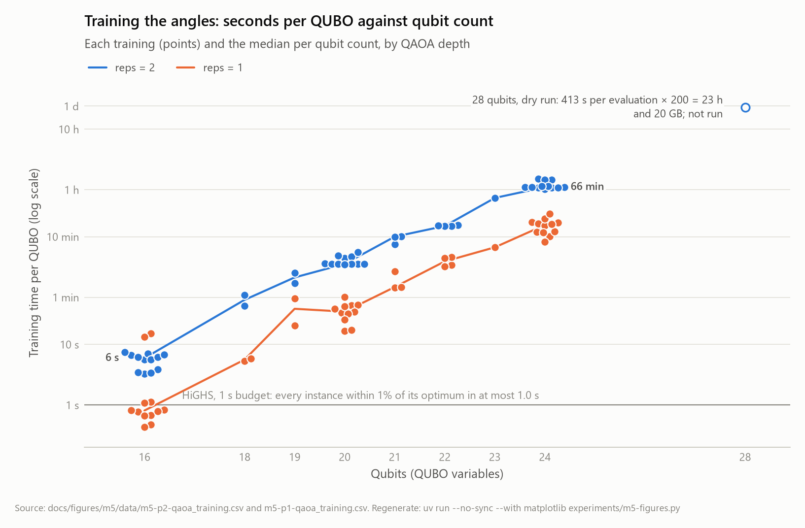

## 4. Against uniform random bits (8.4)

On the 30 device instances, as a multiple of the feasible rate of uniform random bitstrings:

| solver (1,000 reads, the 30 device instances) | feasible share | times uniform |
|---|---|---|
| uniform random bitstrings | 0.26% | 1 |
| QAOA on `ibm_fez`, reps 2 | 0.51% | 2.0 |
| QAOA on `ibm_fez`, reps 1 | 0.80% | 3.1 |
| QAOA noiseless, reps 1 | 3.5% | 14 |
| QAOA noiseless, reps 2 | 7.5% | 29 |
| greedy | 78% | 300 |
| simulated annealing | 88% | 340 |
| tabu | 98% | 380 |

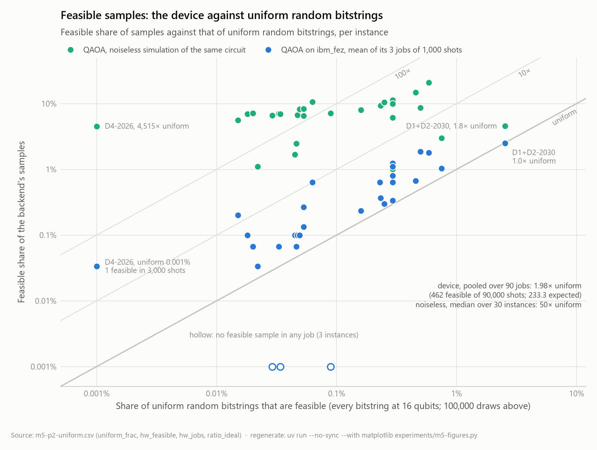

## 5. The noise model against the device (8.5)

| | reps 2 | reps 1 |
|---|---|---|
| ladder means over the 17 instances of at most 20 qubits (killed as 0): noiseless / noise model / device | 0.68 / 0.36 / 0.22 | 0.54 / 0.42 / 0.29 |
| instances simulated in full; noise model above / below / equal to the device | 14; 9 / 3 / 2 | 16; 7 / 3 / 6 |
| feasible band: noise model / device | 0.2–4.9% / 0.03–2.5% | 0.22–4.9% / 0–4.1% |

The noise model is optimistic by about a factor of two in feasibility.

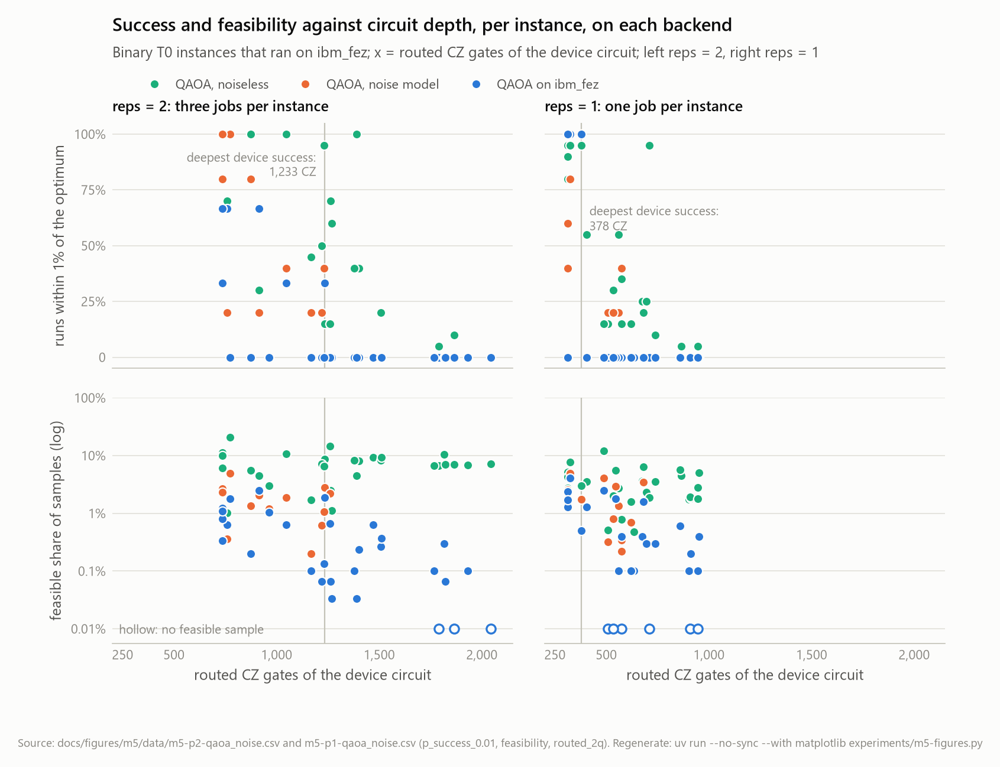

## 6. The depth trade-off, reps = 2 against reps = 1 (8.6)

| | reps 2 | reps 1 |
|---|---|---|
| routed CZ gates (median) | 735–2,044 (1,262) | 313–952 (621) |
| shots free of a CZ error at the median, 0.25% per gate | 4.3% | 21% |
| noiseless success, 31 QUBOs | 0.45 | 0.35 |
| noiseless feasible share, 31 QUBOs | 7.4% | 3.4% |
| noiseless feasibility, times uniform (median per instance) | 50 | 20 |
| device feasibility kept, device / noiseless (median per instance) | 3.3% | 11% |
| device success, 30 shared instances | 0.12 (3 jobs each) | 0.17 (1 job each) |
| device feasibility, times uniform (pooled) | 2.0 | 3.0 |
| deepest circuit with a device success | 1,233 CZ | 378 CZ |

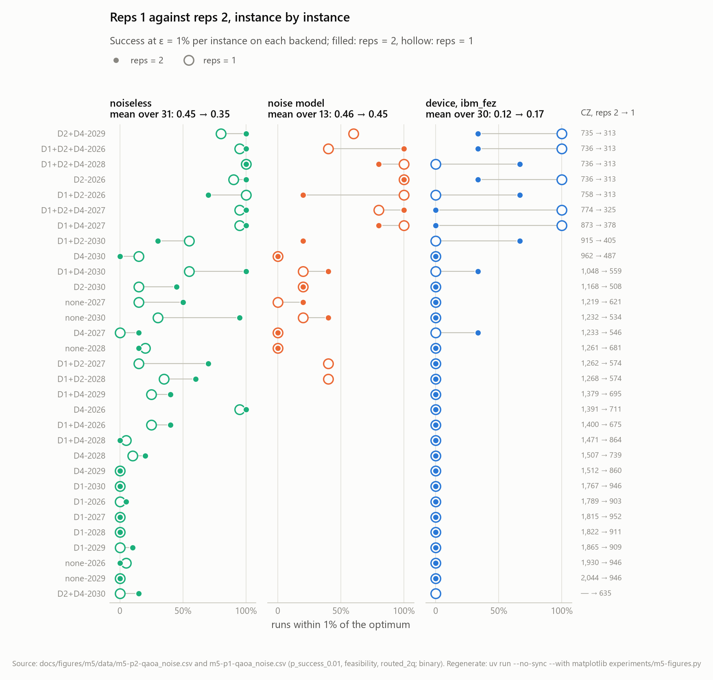

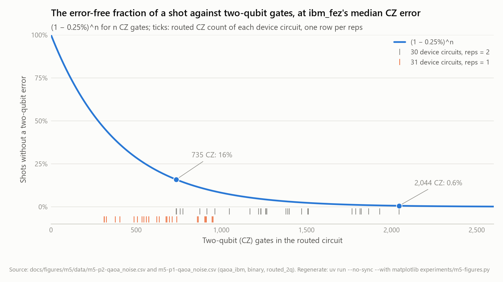

## 7. The claims, settled (8.10)

| # | claim | verdict | evidence |
|---|---|---|---|
| 1 | scoring is sound in both studies | established, and strengthened: the 40 shared instances have identical content hashes and bit-identical brackets in the M4 and M5 stores | 4.1, 4.2 |
| 2 | the classical crossover sits on the easy cells at the smallest budget | established: 5 of 32 cells, all at 0.1 s, none with D2 or D3; reproduced from the CSVs | 5.2 |
| 3 | CVaR breaks the QUBO samplers, and the encoding is not the cause | established (M4): 21–50 times the minimum's magnitude against at most 1.98% regret | 5.4, 5.5 |
| 4 | the one classical defect is contained | established: the sound re-run's bracket check is empty, no other solver depends on CP-SAT | 5.7 |
| 5 | the noiseless QAOA already loses at matched reads | established: mean success 0.51 (reps 2) and 0.40 (reps 1) against 0.86–1.00 for the samplers; feasible share 7.4% and 3.4% against 66–99% | 8.1 |
| 6 | the device's output is barely above uniform random bits | established, with three passes: feasibility 2.0 times uniform (3.0 at reps 1), successes 2.0 and 2.7 times chance; the "every success at most 1,048 CZ" detail of the two-pass draft became "at most 1,233" | 6.8, 6.9, 6.13 |
| 7 | the noise model predicts the device | established to within about a factor of two at both depths (it is optimistic); a parameter-free error-fraction model gets the pooled level within 27%, its instance ranking mostly from the uniform baseline | 8.5 |
| 8 | depth is the limit, not the dynamic range | the range part is established: the range does no harm (−0.16 and −0.24 pooled, none significant within a qubit group, and +0.39 (p = 0.03) and +0.32 (p = 0.08) with the qubit count held fixed). The depth part rests on the rung: halving the depth on the same instances raised the device's feasibility excess (p ≈ 10⁻⁸); across instances at one depth, depth and qubit count move together and the successes cannot separate them | 6.9, 6.11, 7.8 |
| 9 | halving the depth changes the device's answer | partly: the device keeps more (feasibility 3.1 against 2.0 times uniform on the shared instances, p ≈ 10⁻⁸; success 0.17 against 0.12, within noise), the circuit offers less (noiseless 0.35 against 0.45); the comparison with the classical bar is unchanged | 7.8, 8.6 |
| 10 | on both clocks the device is slower by orders of magnitude | established against the fast classical methods: QPU-only 150–2,500 times CP-SAT and 17–1,300 times HiGHS, end to end 1,200–27,000 times the fastest classical answer; tabu at 1,000 reads, a quality setting, is slower than the device's QPU seconds on four cells and faster end to end on all | 8.2, 8.3 |
| 11 | within reach, the answer to the parent question is negative | established for gate-model QAOA on a Heron processor on the T0 cells without CVaR; not testable here for annealers, for the CVaR cells, or for T1–T3 | 8.1–8.9, 10 |
| 12 | every number regenerates | established for every classical and simulator number, from the stores and their commits; the device's numbers regenerate from the stores, and a re-run on the device would be new data | 4.5, 12 |

## More figures

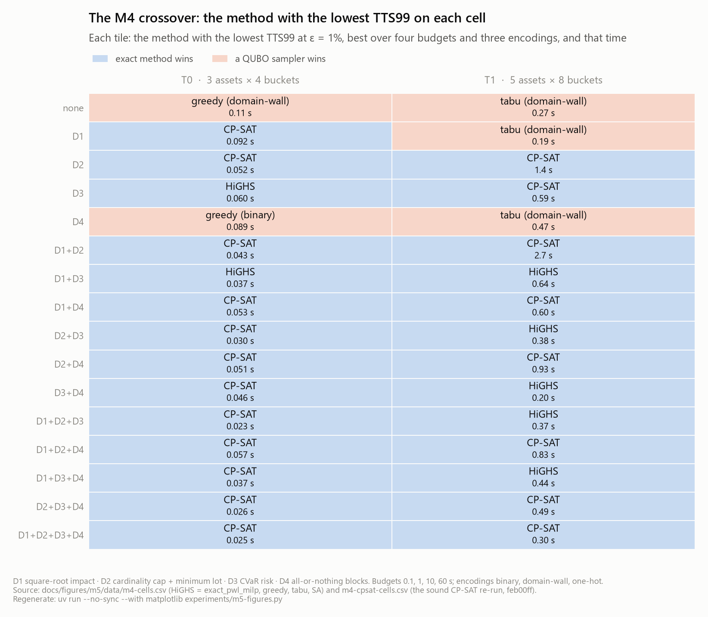

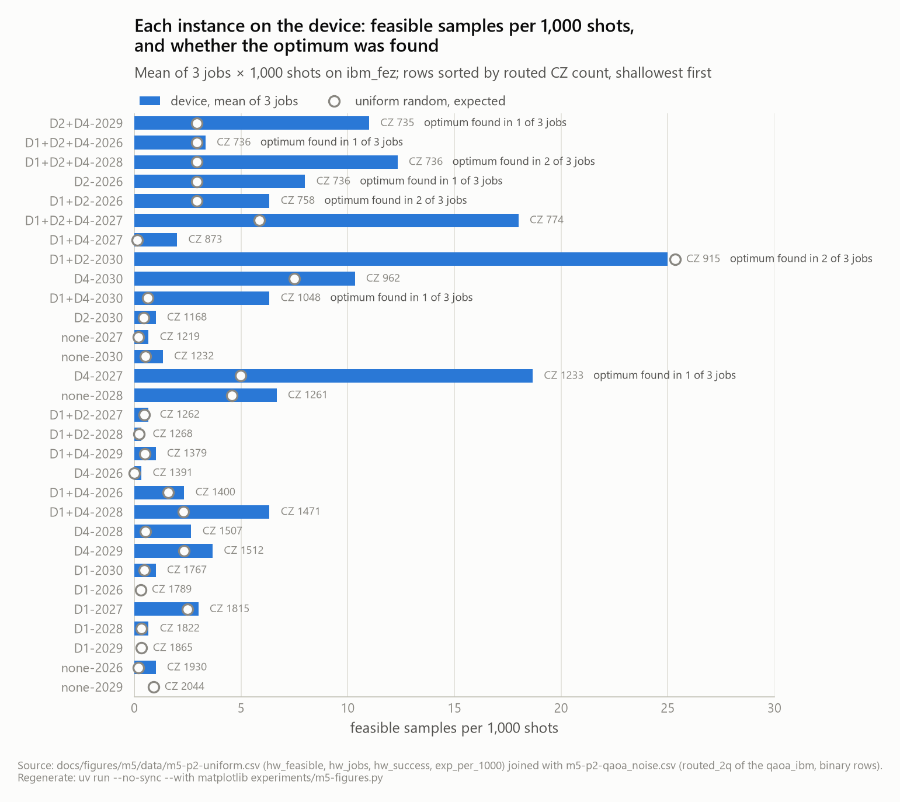

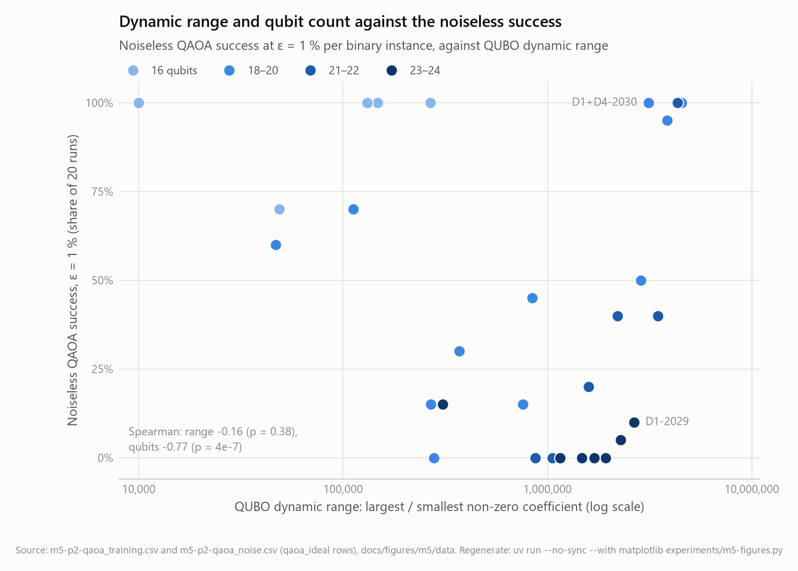

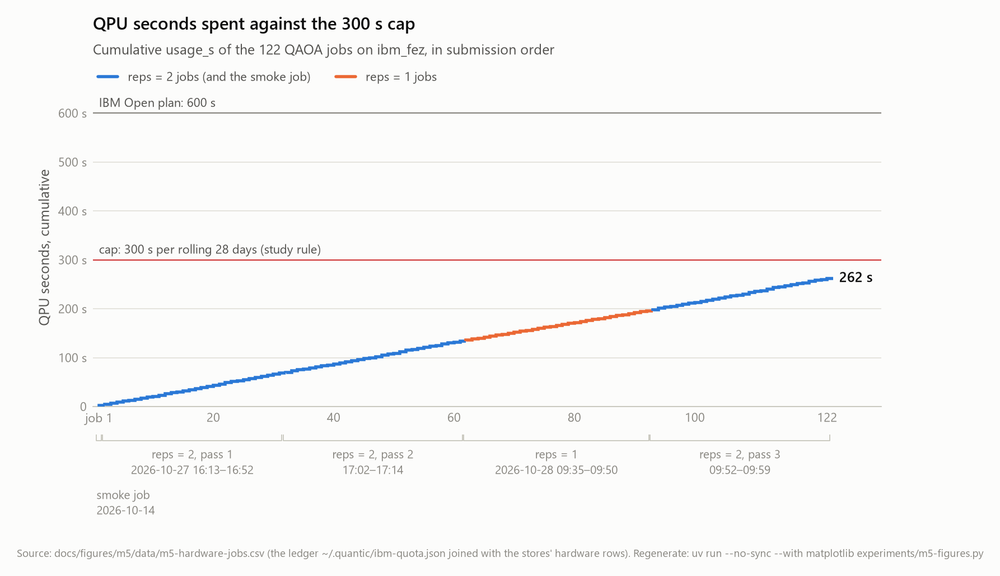

---

Built from the full comparison's tables, unchanged. Figures: `docs/figures/m5/`, regenerated by
`uv run --no-sync --with matplotlib experiments/m5-figures.py`.
