# Classical against quantum on discrete liquidation: the M4 crossover study and the M5 QAOA studies compared

**Written:** 2026-10-28
**Branch:** `feat/m5-qaoa-ibm`
**Studies:** the M4 classical crossover (`2026-10-08-m4-crossover-result.md`) and M5, QAOA on IBM Quantum at two depths (`2026-10-27-m5-qaoa-result.md`)
**Figures:** `docs/figures/m5/`, regenerated by `uv run --no-sync --with matplotlib experiments/m5-figures.py`
**Computations:** `experiments/m4_m5_comparison/` (its `README.md` maps each script to the sections that quote it)

---

**Reading guide.**
- *What this is:* the full comparison of the project's classical benchmark (M4) with its two quantum studies (M5 at reps = 2 and reps = 1) on the liquidation problems they share, with the argument, every number's source, and the figures in detail.
- *Who it is for:* anyone who has to decide what the studies establish, from the owner choosing the next step to a reviewer checking a claim against its data.
- *How it is organised:* section 1 is the summary and the argument in one page; sections 2–4 set the question, the problem and the harness; 5–7 report the three studies; 8 compares them; 9 describes every figure; 10–11 give the limits and the next steps; 12 is provenance and glossary.
- *Where the data are:* the report tables under `docs/figures/m5/data/`; the study stores (not committed) at the paths in section 12.1.
- *How to regenerate:* section 12.2; every number in this document comes from a design or result document, a report table or a script in `experiments/m4_m5_comparison/`.

**Contents**

- [1. Summary of findings](#1-summary-of-findings)
- [2. The question, and what would count as an answer](#2-the-question-and-what-would-count-as-an-answer)
- [3. The problem and the hardness dials](#3-the-problem-and-the-hardness-dials)
- [4. The common harness: instances, references, metrics, reproducibility](#4-the-common-harness-instances-references-metrics-reproducibility)
- [5. Study M4, the classical crossover: setup and findings](#5-study-m4-the-classical-crossover-setup-and-findings)
- [6. Study M5, QAOA on IBM at reps = 2: setup and findings](#6-study-m5-qaoa-on-ibm-at-reps--2-setup-and-findings)
- [7. The reps = 1 rung](#7-the-reps--1-rung)
- [8. The comparison, cell by cell and cost by cost](#8-the-comparison-cell-by-cell-and-cost-by-cost)
- [9. Figures, each with full details](#9-figures-each-with-full-details)
- [10. Threats to validity and limitations](#10-threats-to-validity-and-limitations)
- [11. What next](#11-what-next)
- [12. Appendix: provenance, reproduction, data, glossary](#12-appendix-provenance-reproduction-data-glossary)

---

## 1. Summary of findings

**On the discrete liquidation problems this project could put on quantum hardware, nothing quantum competes. On the eight T0 cells without CVaR, QAOA on IBM's `ibm_fez` loses to every free classical method on quality at equal reads, by a factor of 4 to 6 in success behind tabu and two orders of magnitude in feasibility. On time, on QPU seconds alone, it loses to the exact methods and greedy by a factor of 17 to 2,500, to annealing at the same reads by 9.5 to 93 and to tabu at M4's 0.1 s budget by 1.6 to 990, and to the fastest classical answer by 1,200 to 27,000 end to end; only tabu run at the same 1,000 reads, a quality setting that takes 42 to 74 s, is slower than the device's QPU seconds, on four cells. The device's output is barely distinguishable from uniform random bits, and the noiseless circuit is already below every classical sampler. Halving the circuit's depth helps the device a little and the algorithm not at all. The classical bar M4 set is not close to being reached: exact methods prove these optima in under a second, and greedy descent finds them in nearly every run.**

### The findings

- **One problem, one harness.** The 40 instances M4 and M5 share carry the same content hash and bit-identical brackets in both stores, so every number below is scored against the same proven optimum (4.1, 4.2).
- **The classical bar (M4).** The exact methods win 27 of the 32 T0–T1 cells; a sampler wins five, all at the 0.1 s budget and none with cardinality (D2) or CVaR (D3), by factors of 1.06 to 4.1 (5.2). On the eight cells M5 shares, the fastest classical answer takes at most 0.11 s, and on six of them it is a proof (8.2).
- **CVaR is where the classical samplers fail.** Without CVaR every sampler reaches its QUBO's minimum on every T0 cell at 60 s, except tabu under one-hot on three cells. With CVaR none does, ending a median 21 to 50 times the minimum's magnitude above it (14 to 67 cell by cell), while the encoding's own regret is at most 1.98% of the optimum as a cell median (3.46% on the seed-2026 `T0-D3` instance; M3b gate result). These cells need 260 to 296 qubits and were out of any quantum study's reach (5.4, 5.5, 3.7).
- **Noiseless QAOA already loses at matched reads.** At 1,000 reads its mean success over the eight cells is 0.51 (reps = 2) and 0.40 (reps = 1), against 0.86 to 1.00 for the samplers. Its feasible share is 7.4% and 3.4%, against 66% to 99%. The failure is the penalty-encoded constraints (6.6, 8.1).
- **The device is barely above random bits.** 90 jobs of 1,000 shots at reps = 2 returned feasible schedules in 0.51% of shots, 2.0 times what uniform random bitstrings give (3.0 times at reps = 1). 11 jobs reached 1% of the optimum, where chance gives about 5.5, 7 of them on the six 16-qubit instances, where chance succeeds in 22% of jobs (6.8, 7.6).
- **Depth limits the device, and simple arithmetic roughly predicts it.** Every device success is on a circuit of at most 1,233 CZ gates (378 at reps = 1), but the deeper circuits are also the larger instances, where chance alone finds almost nothing; the clean test is the reps = 1 rung, which halved the depth on the same instances and raised the device's feasibility beyond shot noise (p ≈ 10⁻⁸). A model with no fitted parameter, in which the device returns the noiseless circuit in the shots free of CZ and readout errors (0.25% and 1% per operation) and uniform bits in the rest, overestimates the pooled feasibility by 23–27%; its per-instance ranking (Spearman 0.89–0.90) comes mostly from the instances' uniform feasible fractions (6.9, 7.8).
- **The noise model was a fair but optimistic forecast.** `FakeFez` put the mean success at 0.36, between 0.68 noiseless and 0.22 on the device at reps = 2, and its feasible rate at about twice the device's, higher on 12 of the 14 instances it simulated in full (8.5).
- **The dynamic range does not explain the noiseless success; the qubit count does.** Spearman −0.16 for the range against −0.77 for qubits at reps = 2, and −0.24 against −0.82 at reps = 1; with the qubit count held fixed the range's rank correlation turns positive (+0.39 and +0.32), so it does no measurable harm (6.11, 7.8).
- **Halving the depth: more survives, less is there.** At reps = 1 the device keeps 11% of the noiseless circuit's feasibility instead of 3.3%. But the circuit's own mean success over the 31 QUBOs falls from 0.45 to 0.35. The device's success on the shared instances moves from 0.12 to 0.17, within shot noise (p = 0.54), four of its five successes on 16-qubit instances, against greedy's 0.995 (7.8, 8.6).
- **On time the device is one to four orders of magnitude behind the exact methods and greedy.** Its QPU-only TTS99 is 23 to 133 s at reps = 2 and 8.4 to 41 s at reps = 1. Across both rungs that is 150 to 2,500 times CP-SAT's, 17 to 1,300 times HiGHS's and 30 to 610 times greedy's at the same reads; annealing at the same reads is 9.5 to 93 times faster than the device. Tabu at the same 1,000 reads takes 42 to 74 s and trails the device's QPU seconds on four cells at each depth: matched reads fix the quality comparison, not the time one, and the same tabu at M4's 0.1 s budget is 1.6 to 990 times faster than the device. On an end-to-end clock that adds training and the lane's 15 s per job, the device needs 1.2 to 26 minutes per cell against fractions of a second (8.2).
- **The classical preparation of QAOA costs more than the classical solution.** Training the angles took 17.3 h at reps = 2 and 3.6 h at reps = 1 (wall-clock, summed over trainings), against 13.7 s of HiGHS on all 40 instances (39 proofs and one 1 s time-out holding the optimum). Every one of the 94 trainings took longer than HiGHS on the same instance, at least 8 times longer at reps = 2 and 2 times at reps = 1, each against its own store's HiGHS run (1.2 times against the reps = 2 store's) (6.10, 7.7, 8.3).
- **The dial that hardens the problem for classical heuristics at scale makes it smaller for QAOA at T0.** D2 is M4's largest harmful dial at T1 for tabu and annealing (D3 edges it for greedy). At T0 it shrinks the feasible set of its 16-qubit instances to 12 or 24 schedules, which raises QAOA's success (+0.42 noiseless) for the same reason it raises random sampling's (8.7).
- **T1 is out of reach for gate-model QAOA on two counts.** No statevector trainer can hold its 54 to 120 qubits. Its circuits would need roughly 7 × 10^3 to 5 × 10^4 CZ gates, leaving 2 × 10^−8 or fewer of shots error-free at reps = 2 (8.9).
- **The quota held.** 122 jobs used 262 of the 300 s per 28 days the study allowed itself, and IBM's own counter agrees (12.3).
- **No threat identified overturns the verdict.** The closest the device comes to a classical sampler is a factor of 3.7 in mean cell success (annealing) and about 84 in pooled feasibility (greedy); in time, on QPU seconds alone, it trails tabu at M4's 0.1 s budget by 1.6 (one reps = 1 cell, two jobs), annealing at 1,000 reads by 9.5 and HiGHS by 17, and is ahead only of tabu run at 1,000 reads. Every identified bias favours QAOA or is small against those factors, apart from machine load against that 1.6, on the QPU-only clock alone. The open questions are outside the measured region: annealers, CVaR cells, T2–T3 (10).

### The argument in one page

1. **The question.** Where, as a function of problem structure and size, do quantum solvers compete with the best free classical solvers on discrete liquidation? A negative answer is a valid outcome if it is as well evidenced as a positive one (2.1, 2.2).
2. **The standard of evidence.** Scores against proven optima, feasibility counted and never repaired, the strongest free classical opponent, both clocks, and every number regenerable from a store (2.2, 4).
3. **The problem is hard only where the dials make it hard.** The convex textbook problem would be a foregone conclusion, so four dials add structure. CVaR (D3) and cardinality (D2) are the two that matter (3.3).
4. **M4 set the bar.** Exact methods prove every T0–T1 optimum within 60 s and win every cell with D2 or D3. Heuristic samplers win only five easy cells at 0.1 s, and fail hardest on CVaR (5.2, 5.4). *Inference:* a quantum solver could matter only on the easy cells at sub-second times, or beyond T1, or on the CVaR cells.
5. **M5 could reach only the first of those.** Gate-model circuits of at most 24 qubits hold the eight T0 cells without CVaR: the four easy ones and, beside them, the four with D2, which the exact methods win. The CVaR cells need 260 to 296 qubits, T1 54 or more, and IBM was the only quantum access available (3.7, 6.4, 2.5). *Inference:* the measurable claim is about QAOA on those eight cells.
6. **Same instances, same scorer, same reads.** The shared 40 instances are identical in both studies (4.1), and QAOA and the samplers each draw 1,000 samples through one decoder (4.3, 4.6). *Inference:* the quality comparison at matched reads is like for like.
7. **Noiselessly, QAOA already loses.** 0.51 against 0.86–1.00 in success, 7.4% against 66–99% in feasibility (8.1). *Inference:* even a perfect device would not change the comparison for this algorithm.
8. **The device loses what the noiseless circuit had.** Its feasibility is 2.0 times uniform against the circuit's 29 (pooled; per-instance medians 2.1 and 50), and its success 2.0 times chance (6.8). A parameter-free error-fraction model puts its pooled feasibility within about 25% (7.8). *Inference:* the device behaves roughly as its error rates predict, and nothing in the data suggests hidden quantum performance.
9. **Making the circuit shallower trades one loss for another.** The device keeps more, the circuit offers less, and the net does not approach the samplers (7.8). Half the shots free of a two-qubit error needs at most 276 CZ gates (212 at 16 qubits once readout is counted), or a CZ error 3 to 7 times lower (8.6). *Inference:* no depth available on this device rescues this algorithm.
10. **Time only widens the gap.** The device's QPU seconds alone are 150 to 2,500 times CP-SAT's, before 17.3 h of training and 15 s of lane time per job (8.2, 8.3).
11. **No identified threat reverses any of this.** Sample sizes, calibration, routing, mitigation, training budget, caps, kills, baselines and protocol were each checked for size and direction (10).
12. **Answer.** Within the reach of this project's quantum access, gate-model QAOA on a 2026 Heron processor does not compete with the best free classical solvers anywhere. The question stays open where it was not measured: annealing hardware, constraint-preserving circuits, the CVaR cells and T2–T3. Section 11 ranks those next steps by what they would settle.

## 2. The question, and what would count as an answer

This section states the question the project set itself, the standard of evidence it fixed before any solver ran, the ladder of instances on which the question can be put, the constraints that decided what the two studies could reach, what each study was asked to establish, and the decisions that bear on comparing them. It ends with the claims the rest of the document has to make good. Everything here is taken from the design and result documents named in brackets; the problem itself is section 3's and the harness section 4's.

### 2.1 The question as the parent design states it

The parent design (`docs/superpowers/specs/2026-09-22-quantum-liquidation-lvar-design.md`, section 1) sets one question for the platform:

> Where, as a function of problem structure and size, do quantum and hybrid solvers compete with the best free classical solvers on realistic multi-asset discrete liquidation problems?

A **crossover** is the unit of the answer: a point in the plane of problem structure and problem size on one side of which the best free classical solver reaches a given solution quality sooner than a quantum or hybrid solver, and on the other side of which it does not. The project measures structure with four hardness **dials** (D1 to D4, each an on/off switch; parent design, section 4) and size with a four-tier ladder (T0 to T3; section 5.5), so a crossover is located **cell** by cell, a cell being one tier crossed with one dial combination (2.3). The deliverable is "an honest crossover study", and the design states the standard in the same paragraph: "A negative result — 'quantum does not compete in any regime we can reach' — is a valid and publishable outcome, and the platform is designed so that outcome is as well-evidenced as a positive one" (parent design, section 1).

The **vertical** is B, combinatorial liquidation and liquidity-adjusted value at risk (L-VaR), the first of three planned verticals (parent design, header). What is in and out of it:

| scope | content | source |
|---|---|---|
| in | microstructure analytics core; the discrete multi-asset liquidation problem with four composable sources of hardness; QUBO/Ising encoding with pluggable integer encodings and first-class penalty derivation; a solver layer spanning exact classical, classical metaheuristic, quantum annealing, hybrid and gate-based (QAOA); benchmark harness, metrics, results store, figures; a local dashboard | parent design, section 2, "In scope" |
| out of scope | vertical A, multi-asset optimal routing; vertical C, high-dimensional non-linear PDE (reframed as tensor-network against deep BSDE, "a different project"); live trading, order management or exchange connectivity ("a research platform, not an execution system"); production-grade latency engineering | section 2, "Explicitly out of scope (deferred to later specs)"; section 16 |
| non-goals within B | proving quantum advantage ("the platform must be capable of *detecting* it if present, and equally capable of demonstrating its absence"); supporting paid QPU access as a requirement ("every core result must be reproducible on free tiers") | section 2, "Non-goals within vertical B" |

Two design facts frame every number that follows. First, the textbook discrete Almgren–Chriss problem is convex, so a benchmark against it would be "a foregone conclusion"; the hardness has to come from the microstructure, which is what the dials supply (parent design, section 4). Second, the 2^4 = 16 dial combinations are a factor of the experiment, so the study measures *which* hardness features move the crossover, not merely whether one exists (section 4).

### 2.2 The standard of evidence

The parent design fixed four success criteria before any solver existed (section 1), and the build order assigned each to a milestone (section 14):

| # | criterion (parent design, section 1) | delivered by |
|---|---|---|
| 1 | a reproducible harness: any published figure regenerates exactly from a pinned dataset hash, seed set and environment fingerprint | M4's store and report, which M5 reuses (M4 design, sections 5 to 7; M5 design, section 8) |
| 2 | a QUBO/Ising encoding whose correctness is *proven* against exact classical optima on small instances, for every combination of hardness features | the M3 gates: energy equality on every encoded case (M3a gate result, 16 of 16 tests), and the decoded QUBO minimum equal to the exact optimum on all 16 T0 combinations under three encodings (M3b gate result, 18 of 18) |
| 3 | a crossover table spanning classical, hybrid and real-QPU solvers across the ladder, reporting solution quality, feasibility rate and time-to-target | M4 for the classical columns on T0–T1; M5 for the first quantum column on T0 |
| 4 | results in basis points of notional execution cost | `ObjectiveBreakdown.in_bps`, reported per run (M4 design, section 7.2) |

Criterion 2 is the precondition the two studies rest on: because the encoder's energy equals the declared objective on every case and the QUBO's minimum decodes to the proven optimum on T0, a sampler's shortfall is the sampler's, not the formulation's. M3b adds two qualifications. The one that recurs in M4: the gate encoded the CVaR cells at 20 **zeta bits**, the width of the binary-expanded ζ register that the CVaR gadget carries, while the studies run at 8, where the QUBO's minimum is not the optimum on five of the eight T0 CVaR cells of the seed-2026 ladder, by 0.23% to 3.46% of the optimum (M3b gate result, "Regret at the study's eight zeta bits"); over the studies' five seeds, six of the eight cells have a non-zero median regret. The other: in 17 of the 48 cases the minimum was taken over the states that decode, not over every state, eleven under one-hot and six under domain-wall (M3b gate result, "What passing establishes, and what it does not"). Section 3.5 has the register; M4 reports the regret as its own number (5.5).

The metrics are fixed in the parent design (section 9.1) and implemented in `src/quantic/bench/metrics.py`. The ones every later section uses:

| metric | definition | source |
|---|---|---|
| **bracket** | a proven lower and upper bound on an instance's optimum. The parent design planned piecewise-linear under- and over-estimators of the concave impact term; as built, one HiGHS MILP over the exact per-entry cost table on the lot grid, where the two estimators coincide, with variance by outer-approximation cuts and CVaR as Rockafellar–Uryasev, `lower` its dual bound and `upper` the evaluator at its schedule. The bracket is **closed** when its width is within `_BRACKET_RTOL`, and then the gap is read against it | parent design, section 7.3; M3b design, sections 7.2 and 10; `metrics.scored` |
| **feasibility** | the share of returned samples whose decoded schedule satisfies every constraint; nothing is repaired, and an infeasible sample counts as a failure | parent design, sections 6.5 and 9.1; M4 design, D6 |
| **gap** | `(total − lower) / \|lower\|` of a feasible run's evaluated objective against the bracket's lower bound; round-off within `1e-9` is zero | `metrics.scored`; M4 result, "How to read a crossover cell" |
| **success at ε** | the run's schedule is feasible without repair and its total is at most `upper + max(ε·\|lower\|, 1e-9·\|upper\|)`; ε ∈ {0, 0.1%, 1%, 5%}, with 1% the headline | `metrics.EPSILONS`, `metrics.scored`; M4 design, section 7.1 |
| **TTS99** | time to reach the target with 99% confidence, `t_run · ln 0.01 / ln(1 − p)`, with `p` the share of runs that succeed at ε and `t_run` the measured run time; `p = 1` gives `t_run`; `p = 0` is **censored** and reported as a lower bound, `budget × runs`, never as infinity or an invented number; bootstrap intervals over runs | parent design, section 9.1; `metrics.tts99`, `metrics._success` |
| **two wall-clocks** | pure QPU access time *and* end-to-end time including compilation, queue and network round-trip, both always reported: "Quoting only the former is the most common overclaim in this literature; quoting only the latter buries the physics" | parent design, section 9.1 |
| **dynamic-range ratio** | `max\|coefficient\| / minimum meaningful objective gap`, stored on every encoded instance; "No result is interpretable without it" | parent design, section 6.4 |
| **cost in bps** | the best feasible schedule's objective divided by the notional, times 10,000 | parent design, section 9.1 |

From these the design derives what a valid answer must satisfy, and the studies add one floor of their own:

- **Against proven optima, not best-found.** Optimality gaps on T0 and T1 are stated against the MILP bracket, "proven bounds rather than on 'the best solution anyone happened to find'" (parent design, section 7.3). On T2 and T3 the reference would be best-known (section 5.5); neither study reached them.
- **Against the strongest free classical opponent.** CP-SAT is named "the real opponent", and "benchmarking against weak classical baselines is a primary failure mode of this literature" (parent design, section 7.2; risk table, section 15). The closed-form Almgren–Chriss schedule is the floor "any interesting result must beat" (section 7.2), not the bar.
- **Feasibility counted, never repaired.** "Scoring an infeasible quantum solution against a feasible classical one is the error that invalidates most published comparisons in this area. The architecture makes it impossible to do accidentally" (parent design, section 6.5).
- **Both clocks.** For the device, M5 reports TTS99 on IBM's QPU usage seconds and the training and queue seconds beside it (M5 design, D6; M5 result, section 8).
- **Regenerable.** Every row pins dataset hash, seeds, package versions, machine fingerprint, penalty, encoding and repair strategy, and the full timing breakdown (parent design, section 9.3); `quantic bench report <store> --out <dir>` regenerates the report tables of both results, and three scripts the rest: the uniform baseline, the per-job hardware table and the appendix splice (M4 result, "Reproduce"; M5 result, "Reproduce").
- **Above random, a floor added in M5.** A sample distribution is credited with optimisation power only if it beats uniform random bitstrings passed through the same decoder and scorer; `experiments/m5-uniform-baseline.py` computes that floor per instance (M5 result, section 3). The M4 samplers never needed it; the device does (2.7, claim 6).

Finally, performance is a finding and never a gate condition. The M4 gate checks harness correctness on 32 instances and "none asserts that a solver is fast or good" (M4 design, section 9); M5 "does not assume a quantum advantage" (M5 design, section 1); and the parent design's risk table lists "quantum solvers lose decisively in every regime" as "an accepted possible outcome, not a failure" (section 15).

### 2.3 The crossover and the instance ladder

Terms, as section 3 uses them: a **tier** is a problem shape, assets × buckets × bits per entry; a **dial** is one of D1 (concave square-root impact), D2 (cardinality cap plus minimum lot), D3 (L-VaR as CVaR in place of variance) and D4 (all-or-nothing block trades) (parent design, section 4); a **cell** is a tier crossed with a dial combination, written `T1-D2+D3`; an **instance** is a cell at one generator seed, written `T0-D2-2030`; the studies use seeds 2026 to 2030, so five instances per cell (M4 result, "What was run"). An **encoding** maps each integer entry to bits: binary (log), one-hot or domain-wall (parent design, section 6.1).

The ladder is sized from the hardware ceiling, not the other way round (parent design, sections 3.2 and 5.5):

| tier | shape N × T × B | variables, as designed | ground truth | what the tier is for | designed to run on |
|---|---|---|---|---|---|
| T0, validate | 3 × 4 × 2 | ~24 + auxiliaries | brute force **and** exact MILP | the correctness gate and the only tier every solver can run | everything |
| T1, QPU-native | 5 × 8 × 3 | ~120–180 | exact MILP bracket | the tier an annealer should hold natively | real Advantage2 QPU |
| T2, QPU-edge | 8 × 8 × 3 | ~190–250 | best-known | the edge of dense embedding | borderline embedding |
| T3, hybrid-only | 30 × 12 × 4 | ~1,500+ | best-known | the size a desk would recognise | Leap Hybrid, classical |

What a backend can hold, as designed and as measured:

| backend | capacity as designed (parent design, section 3.2) | what the gates and studies measured |
|---|---|---|
| D-Wave Advantage2, Zephyr | ~230 logical variables under dense (clique) embedding | at 8 zeta bits, 58 of the 192 tier × dial × encoding cells fit under the 230 ceiling; no CVaR (D3) cell fits at any tier under any encoding, including T0; no T3 cell fits; under one-hot at T1 and under both table encodings at T2 only the D2-on cells fit, and under domain-wall at T1 also `D4` and `D1+D4` (M3a gate result, "Variable budget": its table shows the domain-wall exception, its summary sentence omits it). Untested: no Leap account (M5 design, section 2). |
| D-Wave Advantage, Pegasus | ~180 logical variables | untested |
| IBM Open plus QAOA | ~20–30 variables "realistically meaningful" | T0 cells without CVaR are 16–28 qubits in binary and 16–36 in domain-wall (M5 design, section 2); at the study's `max_qubits = 24` cap, 31 of the 40 binary QUBOs and 16 of the 40 domain-wall ones run (M5 result, "What was run"). CVaR cells carry 260–296 variables at T0 and T1 QUBOs exceed 40 qubits: out of a gate-model circuit's reach (M5 design, section 2; M5 result, "What next should take from it"). |
| exact classical ground truth | ~30–40 variables by brute force; further by MILP | brute force on all 80 T0 instances; the MILP bracket closed on all 160 T0–T1 instances, widest 1.0e-6 absolute (M4 result, "The references") |

Two consequences shape the comparison. The classical crossover study (M4) covers T0 and T1 in full, 32 cells, because that is where the bracket is proven (M4 design, section 2: "T2 and T3. Their reference is best-known, not a bracket; they enter with M5"). The quantum study (M5) covers the eight T0 cells without CVaR, because those are the only QUBOs within a gate-model circuit (M5 design, D2). The two studies therefore overlap on exactly those eight cells, and the parent design's T2–T3 question, where exact methods stop closing brackets, is not measured by either (M4 result, "What M5 should take from it"; M5 result, "What next should take from it").

### 2.4 The hard constraints that shaped the studies

| constraint | as the parent design states it | effect on M4 | effect on M5 |
|---|---|---|---|
| free classical software only | paid backends are not a requirement (section 2); Gurobi is "optional, licence-dependent" (section 7.2); the exact baseline takes "the free route", a PWL-MILP bracket on HiGHS (section 7.3) | HiGHS through `scipy.optimize.milp`, OR-Tools CP-SAT, `dwave-samplers` for annealing, tabu and steepest descent; Gurobi out (M4 design, D4, section 11) | the same bracket from HiGHS; Qiskit and Qiskit Aer for the circuits (M5 result, "What was run") |
| quantum access on free tiers; no accounts at design time | "No existing accounts. The platform targets free tiers only" (section 3.1): D-Wave Leap ~1 min/month of Advantage2 QPU and ~20 min/month hybrid, IBM Quantum Open ~10 min/month on 100+ qubit devices, local simulators unlimited | none | IBM is the only account the owner has (M5 design, D1, 2026-10-09); the cap is 300 s per rolling 28 days, half the Open plan's 10 minutes (D4) |
| the QPU budget as architecture | "The ~1 minute/month real QPU budget is an architectural constraint, not an operational detail" (section 3.1); embedding cache, simulator gate and a quota ledger that "hard-fails rather than silently exhausting the month's allowance" (section 7.5) | none | an angle cache in place of the embedding cache (M5 design, section 5.4); a simulator gate, one 32-shot run of the exact routed circuit under the device's noise model, before any quota is spent (D5, section 7.2); a ledger outside any store that counts pending jobs at their cap and refuses a submission below 10 s of headroom (section 7.1); a stored hardware result is never repeated (D7) |
| hardware sizing ceiling | dense QUBO; ~230 logical variables on Advantage2, ~20–30 for QAOA (section 3.2) | T0–T1 only, where brackets close | T0 without CVaR; `max_qubits = 24` (`experiments/m5-qaoa.toml`), below the design's default of 28 (M5 design, section 9), because training at 28 qubits measured 413 s per evaluation and 20 GB, about 23 h per QUBO (M5 result, section 4) |
| market data as exported bundles; a synthetic generator with known ground truth | sections 3.3 and 8.3; the generator "unblocks M0–M3" | instances are the synthetic ones of the M3 gates, from `bench/instances.py`; calibrating from a real bundle "is not part of M4" (M4 design, section 5.1) | the same instances, built by `bench.instances` (M5 design, section 2) |
| local compute | a workstation, 32+ cores, 64 GB+, "sufficient for statevector simulation to ~32 qubits" (section 3.4) | Intel Core i9-9900, 63.9 GB; 14 worker processes (`cpu_count − 2`); 292,480 tasks in 110.6 h (M4 result, "What was run"; M4 design, section 5.3) | the same machine; 6,184 tasks in about 56 h, 14 workers for the classical phase and 2 for training and sampling; 17.3 h of training (wall-clock, summed) for 47 angle sets; the reps = 1 rung's 1,334 tasks in about 13.9 h (M5 result, "What was run", section 4, "The reps = 1 rung") |

### 2.5 What M4 and M5 were each asked to establish

The build order gives each milestone a "done when" (parent design, section 14): M4, "a complete classical crossover table on T0–T1"; M5, "first real Advantage2 result obtained with monthly quota intact". The same section states the reason for the order: "M4 already produces a publishable result — a classical-only crossover study across the hardness dials — before a single qubit is touched. If quantum hardware disappoints, the project still has an outcome."

**M4, the classical bar before any qubit.** Its purpose: "Measure, on T0 and T1, how every free classical solver does on the liquidation problem, against proven optima, in a store from which every number regenerates" (M4 design, section 1). It was asked for three outputs (M4 design, section 7.3): a crossover table per budget, rows tier × dials, columns solvers, each cell "median gap / feasibility rate / TTS at ε = 1%"; each dial's main effect and pairwise interactions on each solver's median gap at the largest budget, computed exactly because 16 combinations is the full 2^4 factorial; and a bracket cross-check between CP-SAT and the MILP, "which should be an empty list". The study runs 160 instances (T0 and T1, all 16 dial combinations, seeds 2026–2030) with budgets of 0.1, 1, 10 and 60 s per run (M4 design, section 10). Because the per-run budget is an experimental variable, the study has no total wall-clock limit (M4 design, D3). M4 was also asked to hand M5 a bar and a protocol, and did: keep 8 zeta bits; binary first, domain-wall second, drop one-hot; compare a QPU against simulated annealing on binary at T0 and tabu on domain-wall and greedy on binary at T1, at matched wall-clock budgets; report it against HiGHS's TTS99 "only as the bar"; and expect the realistic comparison on the easy cells (`none`, `D1`, `D4`) at sub-second budgets, not on the hard ones (M4 result, "What M5 should take from it").

**M5, the first quantum result under a hard quota.** The parent design's M5 was annealing: `dwave_qpu` on Advantage2 with cached embeddings as "the scarce resource", plus the Leap hybrid samplers, with QAOA as a fourth entry "Aer to ~28 variables, IBM Runtime on hardware" (parent design, section 7.4). On 2026-10-09 the milestone was re-scoped to IBM QAOA only: "It is the only account the owner has (2026-10-09). The parent spec's M5 'done' criterion, a first Advantage2 result, is replaced by a first IBM result" (M5 design, D1); D-Wave is "deferred until one exists, with its own spec" (M5 design, section 2). The question M5 answers: "on the T0 liquidation QUBOs that fit in a gate-model circuit, how does QAOA compare with the classical QUBO samplers and the exact methods? It is measured noiseless, under a simulated device noise model, and on a real IBM device" (M5 design, section 1). The algorithm is CVaR-QAOA at `reps = 2`, α = 0.25, angles trained by COBYLA on the exact noiseless statevector and shared by the three backends so that "noise costs" can be isolated (M5 design, D3, section 5). Its "done" (M5 design, section 13): the suite passes; every simulator task of `experiments/m5-qaoa.toml` has run and every hardware task's gate has passed; at least one real `qaoa_ibm` result is stored with the ledger under 300 s; and the result document reports the matched-reads comparison, the noise ladder, the effect of the dynamic range, the QPU seconds spent, and how far the hardware lane got.

**The reps = 1 rung.** A second configuration, `experiments/m5-qaoa-p1.toml`, runs the same CVaR-QAOA at one layer, "half the circuit depth" of the main study, on the same cells, by owner decision of 2026-10-27, to ask whether "a shallower circuit survive[s] the device better"; the samplers are not run again, because at matched reads they do not depend on `reps` (`experiments/m5-qaoa-p1.toml`, header). Section 7 reports it.

What the two studies were asked for, side by side:

| | M4 | M5 (reps = 2) | M5 (reps = 1 rung) |
|---|---|---|---|
| config, commit | `experiments/m4-crossover.toml` at `4d420cf`; CP-SAT re-run `experiments/m4-cpsat-rerun.toml` at `feb00ff` (M4 result) | `experiments/m5-qaoa.toml` at `b8c1244` (M5 result) | `experiments/m5-qaoa-p1.toml` at `d9a3de6` (M5 result) |
| cells | 32: T0 and T1 × all 16 dial combinations | 8: T0 × the dial combinations without D3 | the same 8 |
| instances | 160 | 40, of which 30 reach hardware at ≤ 24 qubits in binary (M5 result, "What was run", section 6) | the same 40, of which 31 reach hardware |
| solvers | `exact_pwl_milp` (HiGHS), `cpsat`, `simulated_annealing`, `tabu`, `greedy`, `almgren_chriss` | `qaoa_ideal`, `qaoa_noisy`, `qaoa_ibm`; the three samplers at matched reads; HiGHS at 1 s | `qaoa_ideal`, `qaoa_noisy`, `qaoa_ibm`; HiGHS at 1 s |
| comparison protocol | wall-clock budgets 0.1, 1, 10, 60 s per run | 1,000 reads per run for every sampler and QAOA backend, no clock (M5 design, section 6, "Matched reads") | the same |
| time measure | measured wall-clock per run | QPU usage seconds for `qaoa_ibm`; none for the simulators (M5 design, D6) | the same |
| reference | proven bracket on every instance; brute force on T0 | proven bracket and brute force on every instance; QUBO minimum per encoding | the same |
| asked to establish | the classical crossover across the dials; the bar for M5 | where QAOA sits against that bar, noiseless, noisy and on the device, within 300 s of QPU | whether half the depth changes the device's answer |

### 2.6 Decisions that matter for the comparison

| decision | where | why it matters when the studies are compared |
|---|---|---|
| research and benchmark platform, not a production tool | parent design, section 16 | correctness and reproducibility are prioritised over latency; a solver's wall-clock is a measured quantity, not an engineered one |
| free-tier backends only | parent design, section 16 | "forces results that others can reproduce without budget"; it is also why the quantum column is QAOA on the IBM Open plan and not an annealer |
| single-market equities, synthetic instances with known parameters | parent design, section 16; M4 design, section 5.1 | both studies run on the same generated instances, so the eight shared cells are identical objects, down to the instance hash |
| all four hardness dials, as a 2^4 factor | parent design, section 16 | the classical crossover is a dial effect (D2 and D3 move it); the quantum study could run only the half of the factor without D3 |
| the per-run budget is an experimental variable; no total wall-clock | M4 design, D3 | M4's crossover is read across budgets, which M5 cannot supply: "a QAOA run is a shot count at fixed angles, not a time budget, so it has no 0.1 s, 1 s, 10 s or 60 s column and no crossover row" (M5 result, section 8). The comparison that holds is at matched reads, section 4 |
| samplers scored against the optimum *and* against the QUBO's own minimum; zeta bits 8 | M4 design, D5, section 4.3 | separates "the sampler failed" from "8 bits cost this much"; M5 keeps 8 bits on M4's finding that the encoding costs at most about 2% as a cell median (M4 result, "What M5 should take from it"; 3.46% on the seed-2026 `T0-D3` instance, M3b gate result) and has no zeta register at all on its cells, which carry no CVaR |
| no repair of sampler output | M4 design, D6; parent design, section 6.5 | feasibility is a headline metric in both studies, and the device's near-zero feasibility is a result, not a preprocessing problem |
| `HEURISTIC` status for a method that never proves | M4 design, D7 | every sampler and every QAOA backend reports `HEURISTIC`; only HiGHS and CP-SAT claim brackets, and only they are cross-checked |
| IBM Quantum is the only hardware backend; D-Wave deferred | M5 design, D1 | the quantum column answers for gate-model QAOA on a Heron processor, not for annealing; the parent design's hardware target is untested |
| QAOA on T0 cells without CVaR, binary and domain-wall; one-hot dropped | M5 design, D2, section 2 | the eight overlapping cells are the four without D2, M4's easy cells, which hold its two T0 sampler wins, and the four with D2, which the exact methods win; nothing quantum is measured on the cells where M4's samplers fail |
| angles trained on the noiseless simulator; one sample pass per job on hardware | M5 design, D3 | the device runs exactly the circuit the simulators ran, so the noise ladder is like for like; the training cost is classical and is reported as a separate clock |
| quota cap 300 s per rolling 28 days; simulator gate at 32 shots; no repeats of a stored hardware result | M5 design, D4, D5, D7 | the hardware sample is small by construction: three 1,000-shot jobs per instance at reps = 2 (198 s) and one at reps = 1 (62 s), 262 s in all with the smoke job (M5 result, "What was run") |
| TTS99 for `qaoa_ibm` on QPU usage seconds; none for the simulators | M5 design, D6 | the device's TTS99 is the pure-QPU clock of the parent design's pair; the end-to-end clock is reconstructed in section 8 from the stored training and queue seconds |
| `max_qubits = 24`, below the design's 28 | `experiments/m5-qaoa.toml`; M5 result, section 4 | 9 of the 40 binary QUBOs (27 and 28 qubits, all with D2) are left out of the quantum study, not recorded as failures |

### 2.7 The claims the rest of the document has to establish

Each claim is a testable statement, with the figure the source documents currently give and the section that must verify it from the report tables.

1. **Scoring is sound in both studies.** Every scored cell is read against a closed, proven bracket: all 160 M4 brackets close, the widest at 1.0e-6 absolute, and brute force agrees with the MILP on all 80 T0 instances (M4 result, "The references"); in M5 no reference is missing, every bracket is closed, and `encoding_regret` is 0 on every QAOA cell (M5 result, "The references"). Sections 4 and 5.
2. **The classical crossover sits on the easy cells and at the smallest budget.** A sampler beats both HiGHS and the sound CP-SAT on 5 of the 32 cells, all at the 0.1 s budget and none with D2 or D3; from 1 s up no sampler wins any cell; HiGHS proves every optimum within 60 s (M4 result, "Verdict"). Section 5.
3. **CVaR is what breaks the QUBO samplers, and the encoding is not the cause.** Without CVaR every sampler under every encoding reaches the QUBO minimum on every T0 cell at 60 s, except tabu under one-hot on three cells; with CVaR none does on any, ending a median 21 to 50 times the minimum's magnitude above it, while the encoding's regret at 8 zeta bits is at most 1.98% of the optimum as a cell median (M4 result, "Verdict", findings 1 and 2). Section 5.
4. **The one classical defect is contained.** CP-SAT's false `OPTIMAL` on `T0-D2-2030` is fixed by `78fc519`, the re-run's bracket check is empty, and no other solver's number depends on CP-SAT (M4 result, "CP-SAT and the presolve defect"). Section 5.
5. **The noiseless QAOA already loses at matched reads.** At 1,000 reads on the 30 hardware instances, reps = 2 CVaR-QAOA at its trained angles reaches 1% of the optimum in 46% of runs with 7.5% feasible samples, against 54–100% of runs per cell for simulated annealing, 97–100% for greedy and 100% for tabu on the same instances, and HiGHS solves each instance in 0.03–1.0 s, proving 39 of the 40 optimal (M5 result, "Verdict", finding 1; `samplers_on_hw.py`). Section 6.
6. **The device's output is barely above uniform random bits.** 90 jobs returned a feasible schedule in 0.51% of shots, 23 jobs returned none, 11 jobs were within 1% of the optimum where uniform bitstrings would have managed about 5.5; the feasible rate is 2.0 times the uniform rate against 29 times for the noiseless circuit (pooled; per-instance medians 2.1 and 50); every success is on a circuit of at most 1,233 CZ gates, and the 48 jobs at 1,261 gates or more, all on 20–24-qubit instances where chance gives 0.18 successes, found nothing (M5 result, "Verdict", sections 2 and 3). Section 6.
7. **The noise model predicts the device.** On the 17 hardware instances of at most 20 qubits (three of them killed, counted as 0), the `fake_fez` model gives a success rate of 0.36 against 0.68 noiseless and 0.22 on the device, and places the feasible rate in the right band, at about twice the device's (M5 result, section 2). Section 6.
8. **Depth is the limit, not the dynamic range.** Routed circuits carry 735–2,044 CZ gates at a median CZ error of 0.25%; the QUBOs' dynamic range of 10^4 to 4.5 × 10^6 shows no harmful effect on noiseless success once qubit count is accounted for (pooled Spearman −0.16, p = 0.38, against −0.77 for qubit count; with qubits held fixed, +0.39) (M5 result, "Verdict", finding 5). Section 6.
9. **Halving the depth does, or does not, change the device's answer.** The reps = 1 rung at `d9a3de6` tests whether the feasible rate and success on `ibm_fez` exceed the reps = 2 figures of claim 6, and at what cost to the noiseless circuit (M5 result, "The reps = 1 rung"; `experiments/m5-qaoa-p1.toml`). Section 7.
10. **On both clocks the device is slower by orders of magnitude.** Where a hardware TTS99 exists at all (six of eight cells at reps = 2) it is 22.7 to 133 s of QPU time, against 0.17–0.74 s for greedy and 0.03–1.0 s for HiGHS; the end-to-end clock adds 3 s to 90 min of training per QUBO and a median 15 s of lane time per job, "about an order of magnitude larger" (M5 result, "Verdict", section 8). Section 8.
11. **The answer to the parent question, within reach, is negative.** On every cell either study could run, the best free classical solver reaches ε = 1% sooner than any quantum solver measured, on either clock; the T2–T3 question and the annealing hardware the parent design aimed at are unmeasured, not answered (M4 result, "What M5 should take from it"; M5 result, "Verdict", "What next should take from it"). Sections 8, 10 and 11.
12. **Every number regenerates.** Each report table in both results is produced by `quantic bench report <store> --out <dir>`, and the M5 result's uniform-baseline and per-job tables by `experiments/m5-uniform-baseline.py` and `experiments/m5-hardware-jobs.py`, from stores that regenerate from their commits with `quantic bench run <config> --store <path>`; a hardware lane run again produces new device data, not the same numbers, and needs a saved IBM account and the owner's go-ahead (M4 result, "Reproduce"; M5 result, "Reproduce"). Section 12.

## 3. The problem and the hardness dials

Both studies run on the same problem, the same instances and the same encodings. The exact solvers (HiGHS, CP-SAT, brute force) read the instance's constraints natively; the QUBO samplers of M4 and the QAOA of M5 read a quadratic unconstrained binary form of it. This section states the problem as the code models it, the four hardness dials and what each one costs, the encodings and penalties that turn an instance into a QUBO, the zeta register, the diagnostics every result carries, and the sizes that decide which cells a given solver can run at all. Sources are the design and result documents named in brackets and the code under `src/quantic/`; the sizes in 3.7 were recomputed from the repository for this document.

Terms used throughout: a **tier** is a problem shape (T0 to T3); a **dial** is one of four on/off sources of hardness (D1 to D4); a **cell** is a tier crossed with a dial combination, such as `T1-D2+D3`; an **instance** is one cell at one seed, such as `T0-D2-2030`, and the studies use seeds 2026 to 2030, so five instances per cell; a **witness** is a feasible schedule the generator attaches to every instance. An entry `x[i,t]` of a schedule is called a cell in the code (`CellPlan`); here it is an entry, to keep "cell" for the study grid.

### 3.1 The liquidation problem as modelled

**Decision variables.** `x[i,t]` is the number of lots of asset `i` sold in bucket `t`, for `N` assets and `T` buckets; `X[i]` is the initial position in lots; `h[i,t] = X[i] - sum over s <= t of x[i,s]` is the holding left after bucket `t` (parent design, section 5.1; `Instance.remaining_lots` in `problem/instance.py`). A lot is 100 shares and a bucket is 1,800 s (`_DEFAULT_LOT_SIZE` in `problem/generator.py`; `BUCKET_NS` in `bench/instances.py`). Lots become shares exactly once, at the objective boundary (M2a design, section 4).

| tier | assets × buckets | bits per entry `B` | lots per entry, at most (`2^B - 1`) | `N × T × B` | position `X[i]` drawn from | reference | ran in |
|---|---|---|---|---|---|---|---|
| T0 | 3 × 4 | 2 | 3 | 24 | 1 to 12 (1 to 6 under D2) | brute force and exact MILP, proven | M4, M5 |
| T1 | 5 × 8 | 3 | 7 | 120 | 1 to 56 (1 to 28 under D2) | exact MILP bracket, proven | M4 |
| T2 | 8 × 8 | 3 | 7 | 192 | 1 to 56 (1 to 28 under D2) | best known | neither |
| T3 | 30 × 12 | 4 | 15 | 1,440 | 1 to 180 (1 to 90 under D2) | best known | neither |

Shapes and bit widths are `problem/liquidation.py`; the position ceilings are `TierSpec.max_position_lots`, which is `T × (2^B - 1)` without D2 and `buckets_per_asset_cap × (2^B - 1)` with it, where the cap is `(T × ceil(N / 2)) // N` buckets per asset (2 at T0, 4 at T1); the tighter bound is what guarantees a feasible witness exists under cardinality (M2a design, section 7.2). `N × T × B` is the parent design's sizing column before auxiliaries (section 5.5); the realised counts are in 3.7.

**Objective.** Four additive terms, each returned separately by `problem/objective.py` so that an encoding error names the term that broke (M2a design, section 6). With `q = x[i,t] × lot` in shares, `p_i` the price, `V_i` the bucket volume in shares, `sigma_i` the bucket volatility, and `cum_before` the shares of `i` traded strictly before `t`:

| term | formula, per entry `(i, t)`, summed over all entries | shape | source |
|---|---|---|---|
| spread | `half_spread_i × q` | linear | `objective.evaluate`; parent 5.2 term 1 |
| temporary impact, D1 off | `(Y_i sigma_i p_i / (2 V_i)) × q^2` | convex quadratic | `micro/impact/almgren_chriss.py`: linear price impact `eta sigma q/V` with `eta = Y_i`, cost one half of it |
| temporary impact, D1 on | `(Y_i sigma_i p_i / (delta_i + 1)) × (q / V_i)^delta_i × q`, `delta_i = 0.5` | concave in `q` | `micro/impact/sqrt_law.py`: power-law price impact, cost `1 / (delta + 1)` of it (the two-thirds rule at `delta = 0.5`) |
| permanent impact | `(gamma_i sigma_i p_i / V_i) × (cum_before + q / 2) × q` | quadratic across buckets; a constant under full liquidation | `objective.evaluate` (midpoint convention); the sum is `gamma sigma p (X lot)^2 / (2 V)`, so the MILP carries it as a constant (M3b design, section 7.2) |
| risk, D3 off | `lam × sum over t of h_t' Sigma_price h_t`, `h_t` in shares, `Sigma_price = diag(p) Sigma diag(p)` | convex quadratic | `objective._risk_cost`; M2a design, section 4 and 6 |
| risk, D3 on | `lam × CVaR_alpha(x, zeta)`, section 3.2 | piecewise linear in the losses | `objective.cvar_of` |

`sigma_i` is already at the bucket horizon, so the parent design's `tau` does not appear (M2a design, section 4). The objective is in currency; `ObjectiveBreakdown.in_bps` divides by the notional `sum over i of X[i] × lot × p_i` and multiplies by 10,000, which is how the result documents quote costs in basis points.

**Base constraints and the integer domain.** Full liquidation, `sum over t of x[i,t] = X[i]` for every `i` (`constraints/full_liquidation.py`); non-negativity, enforced by the `Schedule` type; integrality, every entry a whole number of lots; and the per-entry cap `0 <= x[i,t] <= min(2^B - 1, X[i])`, the second bound because full liquidation makes any larger value infeasible (`encoding/layout.py`, `_cell_values`). So without any dial an entry ranges over `{0, ..., 3}` at T0 and `{0, ..., 7}` at T1, and the feasible set is every integer grid with the right row sums. At T0, seed 2026, the feasible sets hold from 12 to 38,440 schedules depending on the dials (M3b gate result, "The exact optimum, two ways"); the smallest are the D2 cells.

**Parameters.** The instances are synthetic, not calibrated from market data: the question is how solvers behave across the dials, and the synthetic ladder spans them (M4 design, section 5.1). From `bench/instances.py`, `synthetic_params`:

| parameter | value | role |
|---|---|---|
| `delta` | 0.5 | the D1 exponent (square-root law) |
| `Y` (`y_coef`) | 0.8 | temporary impact coefficient, and `eta` of the linear arm |
| `gamma` | 0.1 | permanent impact coefficient |
| `sigma_bucket` | 0.005 | fractional volatility per bucket |
| `V` (`bucket_volume_shares`) | 400,000 shares | bucket volume |
| price | `100 + i` | so 100, 101, 102 at T0 |
| half-spread | 0.01 currency per share | spread term |
| covariance | `(A A') / N × 1e-5`, `A` an `N × N` standard normal matrix seeded by `N` | log-return covariance at the bucket horizon |
| `alpha` | 0.95 | CVaR tail level (`_DEFAULT_ALPHA`, `problem/generator.py`) |
| scenarios | 300 raw, reduced to 15 | `N_RAW`, `N_TARGET` in `bench/instances.py` |

The risk aversion `lam` is not a free parameter: for every instance it is set so that the risk term equals the three cost terms at the witness (`generator._balanced_lam`), because an arbitrary `lam` makes one side of the trade-off vanish (M2a design, section 7). One instance in the study, `T0-D3+D4-2026`, has `X = (1, 1, 1)`, a witness that holds nothing after the first bucket, and therefore `lam = 0`: it is a D3 cell with no risk term in it (M3a gate result, second review, M4; confirmed on the rebuilt instance).

### 3.2 Risk: variance or CVaR, and why CVaR is a dial

Dial D3 replaces the variance of the mark-to-market loss on the holdings still outstanding with its conditional value at risk. The loss in scenario `s` is

`L_s(x) = - sum over t, i of h[i,t] × lot_i × p_i × r[s,t,i]`

with `r[s,t,i]` the fractional price shock of asset `i` in bucket `t` (`problem/scenarios.py`, `ScenarioSet.losses`). Scenarios perturb prices only, and with shocks independent across buckets `Var(L_s) = sum over t of h_t' Sigma_price h_t`, exactly the variance term's quadratic form (M2b design, section 4.2). D3 therefore changes how one loss distribution is summarised and nothing else, which is what lets the factorial design attribute a shift to D3 rather than to an interaction (M2b design, section 3).

CVaR is evaluated in Rockafellar-Uryasev form with an explicit `zeta`:

`CVaR_alpha(x, zeta) = zeta + 1 / (1 - alpha) × sum over s of w_s × max(L_s(x) - zeta, 0)`, `risk = lam × CVaR_alpha`

(`problem/risk.py`; `objective.cvar_of`). The weighted form matters because the reduced scenarios are not equiprobable. `zeta` is a decision variable, never a field of the instance: `evaluate` raises if it is omitted under CVaR, and the minimising value, the weighted empirical VaR, is `objective.optimal_zeta` (M2b design, section 7.3). The exact solvers minimise over a continuous `zeta` (one free variable and one `u_s >= L_s - zeta` row per scenario in the MILP, M3b design, section 7.2); the QUBO carries `zeta` on a binary grid (3.5). A feasible sample from any sampler is scored at `optimal_zeta`, the true objective, whatever `zeta` bits it returned (`solvers/qubo/sampler.py`).

Scenarios are drawn as `r[s,t,:] ~ N(0, Sigma)` independently across buckets, 300 of them per tier and seed, and reduced to 15 weighted representatives by Dupacova fast-forward selection, which keeps real paths rather than centroids because CVaR is a tail statistic and an averaged path has a thinner tail (M2b design, section 6). The Wasserstein-1 distance of the reduction and the CVaR discrepancy at the witness are recorded on every CVaR instance (`ReductionReport`). All eight D3 combinations of one tier and seed share one reduced set.

Why it is a dial, in the terms of the parent design: it is the liquidity-adjusted risk metric of actual interest (L-VaR), it is scenario-based so it adds `S` rows to a classical model, and in a QUBO it costs a binary-expanded `zeta` plus auxiliaries per scenario, so `S` inflates the variable count directly (parent design, sections 4 and 5.4). The M4 result showed where the cost lands: HiGHS carries the 15 rows easily (best TTS99 under 2 s on every CVaR cell), CP-SAT, which carries them in scaled integers, is slower than HiGHS on five of the eight T1 CVaR cells, by up to four orders of magnitude, and the samplers do not cross the auxiliary landscape (M4 result, sections 1 and 4; section 5 of this document).

### 3.3 The four dials and the 2^4 design

The textbook discrete problem (quadratic impact, variance risk) is a convex MIQP and solved to proven optimality at these sizes; benchmarking a quantum solver against it is a foregone conclusion, so the hardness comes from the microstructure (parent design, section 4). Each dial is an independent switch; `Dials.label` gives the names used in every table (`problem/dials.py`).

| dial | what the generator adds | where it lives | why it is hard classically | what it costs in the QUBO |
|---|---|---|---|---|
| D1, concave impact | `delta = 0.5` power-law temporary impact instead of linear | objective, temporary term | concave objective: minimisation is NP-hard and MIQP solvers lose their bound; the exact baseline needs a cost table on the lot grid instead (M3b design, section 4) | exact under one-hot and domain-wall (cost table); a fitted quadratic approximand under binary (3.4) |
| D2, discrete participation | cardinality: at most `k` names trade per bucket; venue minimum: `x[i,t] = 0` or `x[i,t] >= m_i` | constraints `Cardinality(k)`, `MinParticipation(m)` | semi-continuous variables, big-M binaries, no convex relaxation (parent design, section 4); the feasible set shrinks to as few as 12 schedules at T0 | free under one-hot and domain-wall (forbidden values absent from the table); under binary an indicator bit, a residual expansion and a penalty per entry; cardinality slack bits per bucket under every encoding |
| D3, CVaR risk | `CVaRRisk(alpha = 0.95)` over 15 weighted scenarios instead of `VarianceRisk` | objective, risk term | scenario rows and a big-M structure in integer models; an LP in the MILP (M3b design, section 4) | the zeta register and two auxiliary grids per scenario: 248 extra bits at 8 zeta bits (3.5) |
| D4, block trades | a seeded quarter of the witness's non-zero entries (at least one) become indivisible blocks of exactly their witness size | constraint `BlockTrades` | pure binary structure (parent design, section 4) | one bit per block entry, no penalty: exactness is structural (M3a design, section 6) |

**The dials bind.** Under D2 the generator first concentrates the witness so that each bucket hosts at most `ceil(N / 2)` names, then sets `k` to the busiest bucket of that witness and `m_i` to the smallest non-zero entry of row `i`: the tightest values the witness satisfies, because a loose `k` would make D2 a no-op that still appears in every results row (M2a design, section 7.2; `problem/generator.py`). On the study's instances this gives `k` of 1 or 2 and `m_i` of 1 to 3 at T0, `k` of 1 to 3 and `m_i` of 1 to 7 at T1; D4 carves 1 to 3 blocks per T0 instance and 1 to 10 per T1 instance (recomputed from `bench.instances.tier_instances`, seeds 2026 to 2030). Every instance carries its witness and `generate` asserts it feasible, so an infeasible answer from any solver is the solver's (M2a design, section 3).

**Violations are magnitudes.** Each constraint reports a non-negative violation, zero exactly when satisfied: lots short or over per asset (full liquidation), names over `k` per bucket (cardinality), lots short of `m_i` per entry (minimum), distance to the nearer of 0 and the block size (blocks). `problem/feasibility.py`'s `classify` is the single verdict every solver and metric uses, and a schedule is feasible if and only if its total violation is zero.

**The 2^4 design.** The 16 combinations are the full factorial of the four dials (parent design, section 4), so the screening the parent design asked for in section 9.2 is computed exactly: each dial's main effect and each pairwise interaction on each solver's median gap at the largest budget are factorial contrasts over the 16 cells of a tier (M4 design, section 7.3; `m4-dial_effects.csv`). M4 ran all 16 combinations at T0 and T1 (160 instances); M5 ran the 8 combinations without D3 at T0 (40 instances), because no D3 QUBO fits a gate-model circuit (3.7).

### 3.4 From instance to QUBO: encodings and penalties

A QUBO is a function `z' Q z + c` of binary variables `z`, to be minimised; every constraint becomes a quadratic penalty, so the formulation is unconstrained and every bitstring is a candidate. The encoder (`encoding/encode.py`) names every bit in one registry, expands the objective term by term (`encoding/expand.py`), adds the penalties (`encoding/penalty.py`) and, under D3, the CVaR gadget (`encoding/cvar.py`). Each entry `x[i,t]` is represented by one of three integer encodings, chosen per run (parent design, section 6.1; `encoding/integer.py`):

| encoding | bits per entry with values `0..M` | value | exact cost table | validity penalty | D2 under it | notes |
|---|---|---|---|---|---|---|
| binary (log) | `bit_length(M)` | `x = sum over b of c_b z_b` with bounded coefficients `1, 2, ..., 2^(k-2), M - 2^(k-1) + 1`, covering exactly `[0, M]` | no | none (no state outside the range exists) | indicator `y` plus residual bits over `[0, M - m_i]`, with penalty `sum over b of z_b (1 - y)`; under cardinality every entry takes the indicator form | fewest bits; the map is not injective, so only `decode(encode(x)) = x` holds; D1 needs an approximand |
| one-hot | `M + 1` (one per admissible value) | `x = sum over v of v z_v` | yes: any `f(x)` is linear in the bits | `(sum over v of z_v - 1)^2` | free: forbidden values are left out of the table | most bits; the M4 result found it the least feasible encoding, with the largest dynamic range without CVaR, and M5 dropped it |
| domain-wall | `M` (one fewer than one-hot) | `w_j = 1[x >= v_j]`, `x = v_0 + sum over j of (v_j - v_(j-1)) w_j` | yes | products `w_(j+1) (1 - w_j)`, zero on monotone states only; couplings strictly local | free, as one-hot | Chancellor's encoding, empirically better on annealers (parent design, section 6.1) |

A block entry is one bit under every encoding, `x = lots_k × b_k`, and an entry whose cap is 0 has no bits. Under D2 at T0 the binary and domain-wall layouts name the same number of bits (both `1 + bit_length(M - m_i)` against `M - m_i + 1` for value sets `{0} union {m_i..M}` with `M <= 3`), which is why those two columns coincide on every T0 D2 cell in 3.7.

**Hard constraints as penalties** (`encoding/penalty.py`; parent design, section 6.2):

| constraint | penalty term | extra bits |
|---|---|---|
| full liquidation | `P × sum over i of (sum over t of x[i,t] - X[i])^2` | none |
| cardinality | `P × sum over t of (sum over i of y[i,t] + sum over j of c_j s[t,j] - k)^2`, slack `s` over `[0, k]` with bounded coefficients | `bit_length(k)` per bucket |
| minimum lot, binary only | `P × sum over b of z[i,t,b] (1 - y[i,t])` per entry | the indicator `y` per entry |
| minimum lot, table encodings | none: the forbidden values are absent | none |
| blocks | none: the entry is one bit | none |
| validity, one-hot and domain-wall | the terms in the table above, strength `P` | none |

Under one-hot the indicator `y[i,t]` is `1 - z_(v=0)`; under domain-wall it is `w_1`; under binary it is the explicit `y` bit (M3a design, section 6). Every residual above is an integer-valued square, so a one-unit breach costs at least `P`.

**Penalty derivation.** The strength is derived, not tuned: `P = max(2 × (max_single_cell_gain + risk_gain), 1)`, one value for validity, full liquidation, minimum lot and cardinality (`derive_penalties`, `safety_factor = 2.0`). `max_single_cell_gain` is read off the expanded objective matrix: the largest sum, over one entry's bits, of the absolute coefficients in their rows and columns, an upper bound on what flipping that entry can gain in spread, impact and variance. `risk_gain` is non-zero only under D3, where the lot bits are coupled to the risk term through the gadget's penalty rather than the objective matrix, and is bounded from the problem: `lam` times the largest partial-sum swing of any one entry's loss coefficients, plus two gadget resolutions and a cost gap (`CVaRGadget.risk_gain_bound`; M3a gate result, Finding B, steps two and three). The strategy and every strength are recorded on the results row (`PenaltyStrengths.describe`). The parent design's second strategy, adaptive search on a reference sampler, was never used (M3a design, section 3, which left it to M4; M4 did not adopt it). Too small a penalty reports infeasible samples as wins; too large a one swamps the objective's dynamic range (parent design, section 6.3), and the derived strengths are 130 to 500 times the worst true one-entry gain on variance instances (M3a gate result, "What is still open").

**The D1 approximand under binary.** Under the square-root impact law an entry's temporary cost grows as `x^1.5`, which has no exact quadratic form in the value bits, so for each entry the encoder fits `b x + c x^2` by least squares over the admissible lot values, with no constant term, and reports the exact per-value error (`ApproximandReport`; M3a design, section 5). On the seed-2026 T0 ladder the worst per-entry error is 0.02 on four of the eight D1 cells and zero on the rest, and the optimum was unmoved on all eight (M3b design, section 3). The exact solvers can take the same cost table (`cell_cost`) so that a binary sampler is compared with the optimum of the function its QUBO declares (M3b gate result, "What M4 picks up").

**What the gates proved.** The M3a gate: on all 64 instances of the seed-2026 ladder under every materialisable encoding, the QUBO's energy at the encoded witness equals `evaluate` term by term, the penalty block is zero there, and leaving one lot unsold raises the energy; 16 of 16 checks pass on 160 encoded cases (M3a gate result, verdict). The M3b gate: on all 16 T0 combinations, brute force and the MILP agree on the optimum to 1e-9 relative, and under all three encodings, with the CVaR cells at 20 zeta bits, the QUBO's minimum decodes to a feasible schedule whose true objective is that optimum, with regret 0 in all 48 cases, the minimum taken over the states that decode in 17 of them (M3b gate result, verdict). What the gates do not prove is that the study's own 8-bit CVaR QUBOs have the optimum as their minimum: they do not, on five of the eight T0 CVaR cells at seed 2026 and on six as a five-seed median (3.5, 5.5).

### 3.5 The zeta register and its bit count

`max(L_s - zeta, 0)` is not quadratic, so the gadget uses the standard device, `u_s >= L_s - zeta` with `u_s` minimised, which stays quadratic only with a slack `g_s`:

`cost: lam × (zeta + 1 / (1 - alpha) × sum over s of w_s u_s)`, `penalty: P_cvar × sum over s of (u_s - L_s + zeta - g_s)^2`

(`encoding/cvar.py`; M3a design, section 7). `zeta`, every `u_s` and every `g_s` live on binary grids of `n` bits with a common step: the zeta grid runs from the smallest possible loss to the largest, bounded entry by entry from the instance alone (`h[i,t]` in `[0, X_i]`), in `2^n` levels, so its step is the instance's loss span over `2^n - 1`, which at eight bits is the span over 255: 1.7 to 15 currency at T0 (M3a gate result, Finding B). The register therefore costs `n × (1 + 2S)` bits: 248 at `n = 8`, `S = 15`, against 12 to 48 lot and slack bits at T0 (12 to 28 under binary), which is why a T0 D3 QUBO has 260 to 296 variables (3.7). Because `L_s` has real coefficients, the residual is never exactly zero; the gadget declares a `resolution`, the worst-case distance of its value from continuous Rockafellar-Uryasev (`cost_gap + P_cvar × S × (step / 2)^2`), and the gate asserts it (M3a design, section 7). Its own strength is derived from its own trade-off, `P_cvar = 2 × lam × max_s w_s / ((1 - alpha) × step)`, the value at which dropping `u_s` a step below its target costs more than it saves; at the hard constraints' strength the penalty's leftover was 13 to 129 times the whole objective at T0 and the energy ranked schedules by where their losses fell on the grid, Spearman 0.018 against the objective, 0.985 after the fix (M3a gate result, Finding B, step one).

**Why eight bits.** Eight is the encoder's default and the study's width (`encode(n_zeta_bits=8)`; `STUDY_ZETA_BITS = 8` in `solvers/qubo/sampler.py`; `zeta_bits = 8` in `experiments/m4-crossover.toml`). The M3b gate measured what it costs and what exactness would cost:

| width | QUBO minimum is the optimum, T0 CVaR cells | regret of the minimum | variables, `T0-D3`, binary | dynamic range |
|---|---|---|---|---|
| 8 bits | 3 of 8 (the regret is zero on `D3+D4`, `D1+D3+D4`, `D1+D2+D3`) | 0.23% to 3.46% of the optimum on the other five (`D3` 3.46%, `D2+D3` 2.48%, `D1+D3` 1.98%, `D2+D3+D4` 0.56%, `D1+D2+D3+D4` 0.23%) | 272 | 1.5e6 |
| 16 bits | 8 of 8 | 0 | not reported | not reported |
| 18 bits | 8 of 8, and from here the distortion's spread (0.0067) is below the smallest gap between schedules (0.0069), so agreement follows from the arithmetic rather than the draw | 0 | not reported | not reported |
| 20 bits, the gate's width | 8 of 8 under all three encodings | 0 | 644 | 2.4e12 |

(M3b design, sections 3.2 and 3.3; M3b gate result, "Regret at the study's eight zeta bits".) Agreement is not monotone in the width below 16 bits, and each bit costs 31 variables at 15 scenarios. A 20-bit QUBO is an object for enumeration, not for a sampler, and at 8 bits no D3 cell fits the dense-embedding ceiling already (M3b design, section 3.3). M4 then showed that the 8-bit encoding loses at most 1.98% of the optimum (median of seeds, worst cell) while the samplers lose 20 to 50 times the minimum's magnitude on the same cells, and recommended keeping 8 (M4 result, section 2 and "What M5 should take from it"). M5 has no D3 cell, so its QUBOs carry no zeta register at all (M5 result, "What was run"); the width is a fact about M4's CVaR cells only.

### 3.6 The dynamic-range diagnostic and the decode-and-classify policy

**Dynamic range.** Every encoded instance records `max |Q_ij| / min non-zero |Q_ij|`, the constant excluded (`encoding/diagnostics.py`, `dynamic_range_ratio`); the parent design defined it against the minimum meaningful objective gap (section 6.4), and the implemented denominator is the smallest non-zero coefficient instead. D-Wave couplers carry about four to five bits of effective precision, so the ratio says whether the problem's structure survives an analogue floor (parent design, section 6.4). From `m4-cells.csv` (each cell's value is the median over its five instances):

| tier | CVaR | binary | domain-wall | one-hot |
|---|---|---|---|---|
| T0 | off | 6.8e5 (1.1e5 to 3.1e6) | 5.1e5 (1.1e5 to 2.3e6) | 2.0e6 (1.6e5 to 1.0e7) |
| T0 | on | 5.9e6 (2.5e6 to 1.6e7) | 5.9e6 (identical to binary, cell by cell) | 5.4e6 (2.0e6 to 1.6e7) |
| T1 | off | 5.0e8 (7.7e7 to 1.2e9) | 1.8e8 (7.6e7 to 1.2e9) | 3.2e9 (2.3e7 to 8.8e9) |
| T1 | on | 1.3e8 (5.1e7 to 2.4e8) | 1.3e8 (identical to binary) | 7.6e7 (1.6e7 to 2.4e8) |

Each entry is the median over the eight cells of its row, with the range of cell values in brackets. With CVaR the extremes are set mostly by the gadget's own coefficients, not by the hard constraints or the lot encoding, which is why binary and domain-wall coincide there (M3a gate result, Finding B, step three). Every value is orders of magnitude above what an annealer resolves, so an annealer would see a coarsened QUBO at T1 (M4 result, "What M5 should take from it"). M5's QUBOs span 1.0e4 to 4.5e6, their scaled Ising forms 2.5e4 to 5.0e6 (`m5-p2-qaoa_training.csv`; M5 result, section 5); on a gate-model device the range enters the trained angles, not the hardware, and M5 found no harmful effect of it on noiseless success once the qubit count is accounted for (pooled Spearman -0.16, p = 0.38, against -0.77 for the qubit count; within the 16-, 20- and 24-qubit groups +0.39, +0.11 and +0.11, none significant; M5 result, section 5). The number is reported, never corrected (M5 design, section 5.1).

**Decode and classify.** Every bitstring a sampler or circuit returns is decoded once and judged (`encoding/decode.py`):

| class | meaning | scored? |
|---|---|---|
| `rejected` | the bits are not a schedule: no one-hot bit or several set in an entry, a hole in a domain wall, residual bits set under a clear indicator | no |
| `repairable` | the bits decode to a schedule that breaches at least one constraint (`classify` reports a non-zero violation) | no |
| `feasible` | `classify` reports zero violation | yes, by `evaluate` at `optimal_zeta` |

Nothing is repaired: the parent design made repair a named, recorded strategy (section 6.5), M4 chose none (M4 design, decision D6), and a repaired variant would be a separately named solver. A run's answer is its best feasible sample; a run with no feasible sample fails at every tolerance; and the feasibility rate of a cell is the share of samples, not runs, classified feasible (M4 design, section 7.2; `solvers/qubo/sampler.py`). The QAOA backends go through the same loop with a 1,000-shot batch in place of a sampler's reads (M5 design, section 6). This is the policy that makes the M4 and M5 feasibility columns comparable with each other and with the exact solvers, whose schedules are classified by the same function.

### 3.7 Sizes: variables and qubits per tier, dial and encoding

A QUBO variable is one qubit: the M5 Ising map `x_i = (1 - z_i) / 2` takes the QUBO to `sum h_i Z_i + sum J_ij Z_i Z_j` on as many qubits as the QUBO has variables, with coefficients scaled by the largest (`solvers/quantum/ising.py`). The counts below are `encoding.diagnostics.variable_count` on the study's own instances (`bench.instances.tier_instances`, seeds 2026 to 2030) at eight zeta bits, recomputed for this document by `sizes.py` (section 12); they agree exactly with the `n_vars` columns of `m5-p2-qaoa_training.csv` and `m5-p2-uniform.csv` on every QUBO M5 trained, and with the seed-2026 budget of the M3a gate result. Each entry is the range over the five seeds.

**T0 (3 × 4, up to 3 lots per entry):**

| dials | binary | domain-wall | one-hot |
|---|---|---|---|
| `none` | 20 to 24 | 24 to 36 | 36 to 48 |
| `D1` | 24 | 32 to 36 | 44 to 48 |
| `D2` | 16 to 28 | 16 to 28 | 28 to 40 |
| `D4` | 18 to 22 | 23 to 32 | 34 to 42 |
| `D1+D2` | 16 to 28 | 16 to 28 | 28 to 40 |
| `D1+D4` | 18 to 22 | 22 to 30 | 33 to 39 |
| `D2+D4` | 16 to 28 | 16 to 28 | 27 to 39 |
| `D1+D2+D4` | 16 to 27 | 16 to 27 | 27 to 38 |
| `D3` | 268 to 272 | 276 to 284 | 288 to 296 |
| `D1+D3` | 268 to 272 | 276 to 284 | 288 to 296 |
| `D2+D3` | 264 to 276 | 264 to 276 | 276 to 288 |
| `D3+D4` | 260 to 270 | 260 to 280 | 271 to 290 |
| `D1+D2+D3` | 264 to 276 | 264 to 276 | 276 to 288 |
| `D1+D3+D4` | 269 to 270 | 276 to 278 | 286 to 287 |
| `D2+D3+D4` | 264 to 275 | 264 to 275 | 275 to 286 |
| `D1+D2+D3+D4` | 264 to 272 | 264 to 272 | 275 to 283 |

Without CVaR a T0 QUBO has 16 to 28 variables under binary and 16 to 36 under domain-wall (M5 design, section 2); with CVaR, 260 to 296 under every encoding, the 248-bit gadget plus the lot bits, so the auxiliaries outnumber the decision variables by an order of magnitude (M3a design, section 13). Under binary the `D2` cells range widest, because the drawn positions decide how many values a venue minimum removes: `T0-D2-2026` (positions 3, 2, 6; `k = 1`; minima 3, 2, 3) has one bit per entry and one slack bit per bucket, 16 in all, while a D2 instance with `m_i = 1` keeps every value and gains an indicator per entry.

**What M5 could run.** M5 planned a QUBO only if its variable count was at most `max_qubits = 24` (`experiments/m5-qaoa.toml`; `bench/quantum_plan.py`), against a design default of 28 and a trainer that needed 66 min per QUBO at 24 qubits and 23 h at 28 (M5 result, section 4). That kept 31 of the 40 binary QUBOs and 16 of the 40 domain-wall ones (M5 result, "What was run"). Per dial, from `m5-p2-qaoa_training.csv`:

| dials | binary: qubits of the QUBOs kept (instances) | binary left out | domain-wall: kept | domain-wall left out |
|---|---|---|---|---|
| `none` | 20, 20, 20, 24, 24 (5) | 0 | 24 (1) | 4 (28 to 36) |
| `D1` | 24 × 5 (5) | 0 | none | 5 (32 to 36) |
| `D2` | 16, 20 (2) | 3 (28) | 16, 20 (2) | 3 (28) |
| `D4` | 18, 19, 21, 22, 22 (5) | 0 | 23, 24 (2) | 3 (28 to 32) |
| `D1+D2` | 16, 20, 20, 20 (4) | 1 (28) | 16, 20, 20, 20 (4) | 1 (28) |
| `D1+D4` | 18, 19, 21, 21, 22 (5) | 0 | 22, 24 (2) | 3 (29 to 30) |
| `D2+D4` | 16, 24 (2) | 3 (27 to 28) | 16, 24 (2) | 3 (27 to 28) |
| `D1+D2+D4` | 16, 16, 16 (3) | 2 (27) | 16, 16, 16 (3) | 2 (27) |

So the hardware ran on 16 to 24 qubits, binary only (`solvers.qaoa_ibm`, `encodings = ["binary"]`), and the full-shot noise model was planned on the 27 QUBOs of at most 20 qubits (`noisy_max_qubits = 20`) and completed on 21, the runs on the other six killed at the 2 h limit (6.5). The qubit count is also what the M5 result found decisive: the six 16-qubit instances have 12 or 24 distinct feasible schedules among 65,536 bitstrings, and the hardware successes sat on the shallower circuits, which are also the smaller instances (M5 result, sections 2 and 3; section 6 of this document).

**T1 (5 × 8, up to 7 lots per entry):**

| dials | binary | domain-wall | one-hot |
|---|---|---|---|
| `none` | 112 to 120 | 248 to 280 | 288 to 320 |
| `D1` | 112 to 120 | 240 to 280 | 280 to 320 |
| `D2` | 88 to 112 | 88 to 120 | 128 to 160 |
| `D4` | 100 to 102 | 205 to 220 | 236 to 250 |
| `D1+D2` | 72 to 112 | 72 to 120 | 112 to 160 |
| `D1+D4` | 90 to 106 | 166 to 220 | 199 to 250 |
| `D2+D4` | 87 to 107 | 87 to 114 | 124 to 151 |
| `D1+D2+D4` | 54 to 95 | 54 to 107 | 92 to 145 |
| `D3` | 368 | 504 to 528 | 544 to 568 |
| `D1+D3` | 352 to 368 | 440 to 528 | 480 to 568 |
| `D2+D3` | 328 to 352 | 328 to 368 | 368 to 408 |
| `D3+D4` | 338 to 350 | 430 to 468 | 463 to 498 |
| `D1+D2+D3` | 328 to 360 | 328 to 376 | 368 to 416 |
| `D1+D3+D4` | 336 to 350 | 432 to 468 | 464 to 499 |
| `D2+D3+D4` | 320 to 349 | 320 to 349 | 358 to 386 |
| `D1+D2+D3+D4` | 326 to 346 | 326 to 346 | 364 to 382 |

The smallest T1 QUBO in the study, `D1+D2+D4` under binary at 54 variables, is more than twice M5's 24-qubit cap and nearly twice its 28-qubit design limit; the plain `T1-none` is 112 to 120. The M5 design put T1 and above out of scope at "88 or more variables" (M5 design, section 2), and T1 circuits would route to roughly 7 × 10^3 to 5 × 10^4 two-qubit gates where 735 already lose most of the signal (section 8.9). For the annealer the parent design targeted and never reached, the relevant ceiling is dense embedding at about 230 logical variables: at eight zeta bits no D3 cell fits at any tier, every T0 and T1 D3-off cell fits under binary, under one-hot at T1 only the D2 cells fit (and one `D1+D4` instance, at 199), because D2 removes bits there, and under domain-wall also `D4` and `D1+D4` (M3a gate result, "Variable budget"). T2 and T3 (192 and 1,440 decision bits before auxiliaries) ran in neither study.

### 3.8 The Almgren-Chriss reference

`almgren_chriss` is the parent design's "what a desk does today" reference, which any interesting result must beat (parent design, section 7.2). It solves the continuous problem one name at a time with linear temporary impact and variance risk on that name's own holdings, no lots, no venue minimum, no cardinality, no blocks: holdings after bucket `t` follow `X sinh(kappa (T - t)) / sinh(kappa T)` with `cosh kappa = 1 + lam sigma^2 / (2 k)`, `k` the linear temporary cost per share squared and `sigma^2` the name's own price variance per bucket (`solvers/classical/almgren_chriss.py`, `kappa_for`). The formula knows variance only: under CVaR, or when `lam = 0`, it is given no risk aversion and trades a straight line, which is what a desk without a CVaR model would do. Each name's trajectory is then rounded to the admissible row of the lot grid nearest it in summed absolute lot differences, a small dynamic programme that respects the per-entry cap, the venue minimum and the blocks (`nearest_row`). Rows are chosen name by name, so cardinality can be breached, and the result then says so through its feasibility report; nothing is repaired further, and the status is always `HEURISTIC`, with no bracket (M4 design, section 4.1).

It is the desk baseline because it is the textbook schedule rounded to what the venue accepts, costs one closed form per name, and ignores exactly the structure the dials add. M4 measured where that leaves it: never feasible when D2 is on, 0 of 80 instances at T0 and T1, because its rows are rounded name by name, so names pile into the same buckets, the first ones under variance and the last ones under CVaR, and break the cardinality cap, the one constraint it breaks on all 80; with D2 off always feasible, with a median gap of 17.6% at T0 and 18.4% at T1, about 0.35 bps of notional, smallest under D4 and largest under CVaR, whose tail the variance trajectory does not see (M4 result, section 3). It ran once per instance in M4 (`budgets_s = [1]`, which it ignores) and did not run in M5, whose instances are M4's and whose reference cost is the same number (M4 result, "What was run"; M5 result, "What was run").

## 4. The common harness: instances, references, metrics, reproducibility

M5 did not build a second benchmark. It plugged three quantum solvers into the harness M4 built: the same instance builder, the same references, the same decoder and feasibility verdict, the same metrics code, the same store and the same report. This section says what that harness is and what its numbers mean, and then states the one protocol difference that the comparison has to respect: M4 gives every solver a time budget, M5 gives every solver a read count. Definitions are quoted from the code that computes them (`src/quantic/bench/metrics.py`, `report.py`, `keys.py`, `runner.py`), not from the design documents, where the two differ.

### 4.1 Instances

An instance is fixed by three coordinates: tier, dial combination and generator seed. `bench.instances.tier_instances(tier, seed)` builds all sixteen dial combinations of one tier at one seed from the synthetic market parameters of section 3.1, with one raw scenario set (300 draws, reduced to 15) per tier and seed shared by the eight CVaR combinations. Seed 2026 is `GATE_SEED`, the ladder on which the M3a and M3b gates were proven, so the studies' seed-2026 instances are the gates' instances; seeds 2027 to 2030 are new draws of the same ladder (`bench/instances.py`, module docstring). The construction is deterministic: a worker process rebuilds an instance from its coordinates rather than receiving it (M4 design, section 5.3), and the instance's content hash is written on every row it produces (`keys.py`, module docstring).

| | M4 crossover | M5, reps = 2 | M5, reps = 1 |
|---|---|---|---|
| tiers | T0, T1 | T0 | T0 |
| dial combinations | all 16 | the 8 without D3 | the same 8 |
| seeds | 2026 to 2030 | 2026 to 2030 | 2026 to 2030 |
| instances | 160 | 40 | 40 |
| source | `experiments/m4-crossover.toml` | `experiments/m5-qaoa.toml` | `experiments/m5-qaoa-p1.toml` |

**The overlap is the same 40 objects.** The 40 T0 instances without CVaR are in both studies, and they are the same instances to the bit: for this document the reference rows of the M4 store (`D:\CC\quantic-study\results\m4-crossover.duckdb`, commit `4d420cf`) and of the M5 store (`D:\CC\quantic-m5\results\m5-qaoa.duckdb`, commit `b8c1244`) were compared instance by instance; all 40 carry the same content hash and the same bracket, lower and upper bound identical as floating-point numbers (`experiments/m4_m5_comparison/same_instances.py`). Every M4 number on those cells and every M5 number is therefore scored against the same proven optimum of the same problem.

### 4.2 References: every number is scored against a proven optimum

References are rows of the store like any run, of kind `reference`, computed once per instance with no budget (`keys.py`, `expand`):

| reference | what it is | where | time limit |
|---|---|---|---|
| `ref:exact_pwl_milp` | the bracket `[lower, upper]` on the optimum from one HiGHS MILP with one binary per admissible lot value, so any per-entry cost is exact and the parent design's piecewise-linear estimators coincide; variance by outer-approximation cuts, CVaR as continuous Rockafellar–Uryasev; `lower` is the dual bound, `upper` the evaluator at its schedule (M3b design, sections 7.2 and 10) | every instance, both studies | 1 h (`REFERENCE_DEADLINE_S`) |
| `ref:brute_force` | the optimum by enumeration of every feasible schedule | every T0 instance, both studies | 1 h |
| `ref:qubo_minimum` | the minimum energy of the instance's QUBO under one encoding, by enumeration, and the true objective of the schedule it decodes to | T0, per encoding (`qubo_minimum_tiers = ["T0"]`) | 1 h |
| `ref:qaoa_angles` | the trained QAOA angles of one QUBO (section 6.1), with their training seconds | M5 only, one per distinct QUBO and `reps` | 4 h (`train_deadline_s`) |

A bracket is **closed** when its width is at most `1e-6 × max(1, |upper|)` (`_BRACKET_RTOL = 1e-6` in `solvers/base.py`); a gap is read against a closed bracket only, and an open one reports its width instead. Both studies have no open bracket and no missing reference: in M4 all 160 brackets close, the widest at 1.0e-6 absolute and 3.5e-8 relative, and brute force agrees with the MILP on all 80 T0 instances (M4 result, "The references"); in M5 every bracket closes and no reference is missing (M5 result, "The references"). "Scored against a proven optimum" means exactly this: the target of every success test below is the upper end of a bracket no wider than one part in a million; at T0 brute force has also found that optimum, and at T1 the bracket is HiGHS's alone (brute force runs at T0 only, `bench/keys.py`).

The QUBO minimum gives a second reference, used to split two failures that would otherwise look alike. The **energy gap** of a run is `(best energy − QUBO minimum) / max(1, |QUBO minimum|)`: how far the sampler stopped above the minimum of the function it was given. The **encoding regret** of a cell is `(true objective of the QUBO minimum's schedule − lower) / |lower|`: what the formulation itself loses, whatever the sampler does (`metrics.scored`). M4 needed both because at eight zeta bits the regret is not zero on CVaR cells (section 3.5). On every M5 cell the regret is 0: the QUBO's minimum is the optimum, so any gap is the sampler's or the circuit's (M5 result, "The references").

### 4.3 The decode, the verdict, and the metrics

Every bitstring a sampler, a simulator or the device returns goes through one loop, `solvers/qubo/sampler.py`: decode with `encoding.decode`, classify with `problem.feasibility.classify`, and score a feasible schedule with `problem.objective.evaluate` (section 3.6). Nothing is repaired. A run's answer is its best feasible sample; a run with no feasible sample fails at every tolerance. The QAOA backends are `QuboSampler`s that draw their 1,000 shots through the same loop (M5 design, section 4, "QAOA sampler"), which is what makes a feasibility figure mean the same thing in every column of every table in this document.

The metrics are computed per **cell of the report**: tier × dial combination × solver × encoding × budget × sample cap, pooling over solver seeds and instance seeds together (`metrics.CELL`, module docstring). A cell of the report is finer than a cell of the study grid (section 2.3); where the difference matters the text says "report cell".

| metric | definition (`metrics.py`) | notes |
|---|---|---|
| **feasibility** | for samplers and QAOA: feasible samples over all samples, summed over the cell's runs (`n_feasible_samples / n_samples`); for exact solvers, the share of runs that return a feasible schedule | a share of samples, not of runs, wherever samples exist |
| **gap** | `(total − lower) / \|lower\|` of a feasible run on a closed bracket; a value within `1e-9` of zero is set to zero; `gap_median` is the median over the cell's feasible runs | a larger negative gap is kept, because it would mean a wrong bound |
| **success at ε** | the run's schedule is feasible and its total is at most `upper + max(ε × \|lower\|, 1e-9 × \|upper\|)`; ε ∈ {0, 0.1%, 1%, 5%} (`EPSILONS`) | ε = 1% is the headline everywhere; `p_success` is the share of the cell's runs that succeed |
| **TTS99** | `t_run × ln 0.01 / ln(1 − p)`, with `p` the success share at ε and `t_run` the mean of the runs' `total_s`; `p = 1` gives `t_run`; `p = 0` gives no value (censored) | the expected time for independent repeats to succeed at least once with probability 99% |
| **censored bound** | when `p = 0`: `budget × runs`, the time the cell spent without one success, printed as "censored, > x s" | an unbudgeted cell (every QAOA cell) gets a bound of 0 s, that is none: it reads only as "censored" |
| **bootstrap interval** | 1,000 resamples of the cell's success indicators, TTS99 of each, 2.5% and 97.5% quantiles (`inverted_cdf`); one generator per cell, seeded from a hash of the cell's key | a cell without a sample cap keeps its M4-era key, so every M4 interval regenerates unchanged in an M5-era report (`metrics.cells`) |
| **energy gap, encoding regret** | as in 4.2, medians over the cell | QUBO samplers and QAOA only |
| **cost in bps** | `bps_best`: the lowest `total_bps`, the objective over the notional times 10,000, among the cell's feasible runs | section 3.1 |
| **dynamic range** | the median over the cell of `max \|Q_ij\| / min non-zero \|Q_ij\|` | section 3.6 |

Killed runs are failures in `p` (they have no feasible schedule) and are left out of `t_run` (they have no run time). The best encoding of a sampler in a crossover table is the one with the lowest TTS99 at ε = 1%, censored cells after every uncensored one and ordered by their censored bound, then ties broken by median gap (`report.best_encoding`).

### 4.4 The store, the run key, resume and kills

Each study writes one DuckDB file. Its tables are `runs` (one row per task: coordinates, pins, store status, the `Result`, objective terms, bracket, feasibility, sample counts, diagnostics, timings), `samples` (one row per distinct bitstring of a sampler run, with its count, energy, class and total) and `traces` (best energy over time) (M4 design, section 6). M5's schema 2 added twelve nullable columns to `runs`: `params`, `identity`, `backend`, `device`, `job_id`, `qpu_s`, `queue_s`, `routed_depth`, `routed_2q`, `angle_key`, `reps` and `shots`, and a store status `pending` for a hardware job submitted but not collected (M5 design, section 8). Trained angles are kept in files in a directory beside the store (`<store>.angles`), one file per angle key, because only the main process writes the store and training happens in workers (`bench/angles.py`).

**The run key** is a SHA-256 over the task's coordinates (kind, tier, dials, instance seed, solver, encoding, zeta bits, solver seed, budget, sample cap, and for QAOA a parameter string of `reps`, α, `maxiter` and the device), the git commit and the hash of `uv.lock` (`keys.Task.key`). The same key always names the same computation; a new commit names new keys, so rows from different code never share one, and a report refuses a store holding rows from two commits unless `--commit` chooses one (`report._choose_commit`). The **task identity** is the same hash without the commit and the lock hash; the hardware lane uses it so that no later commit pays for a stored hardware result again, and a deliberate repeat (`--repeat-hardware`) is stored under the key `<key>#r<n>` beside the earlier row (M5 design, section 7.4; progress ledger, Task 11). The report always includes every hardware row, whatever commit is chosen.

**Resume.** A run reads the keys already stored and skips them; each finished task is written in its own transaction, so an interruption loses only the tasks in flight, and re-running the same command finishes the study (M4 design, section 5.4). Both studies used this: M4 ran in three stretches, M5's main study in four, and the reps = 1 rung's simulation and hardware lane as two runs of the same configuration (M4 result, "What was run"; M5 result, "What was run"; progress ledger).

**Kills.** A budgeted run is killed at `3 × budget + 30 s`; a reference at 1 h; a QAOA run at 2 h (`run_deadline_s = 7200`) and a training at 4 h (`runner.deadline_s`; `config.QuantumSettings`). A killed task is written with store status `killed`, counts as done (it is not retried by resume) and as a failure in its cell (`n_killed`). M4 killed one of its 292,480 tasks; M5 killed 31 of 6,184 at reps = 2 and 5 of 1,334 at reps = 1 (M4 result; M5 result; sections 6 and 7).

**Dirty trees.** A run refuses to start when tracked files differ from the commit its rows would name, unless `--allow-dirty`, which is then recorded on every row (M4 design, section 5.2). Every study row in this document was written from a clean tree: `4d420cf` and `feb00ff` (M4), `b8c1244`, `55c1009` and `d9a3de6` (M5).

### 4.5 The report, and the rule that every number regenerates

`quantic bench report <store> --out <dir> [--commit <sha>] [--ledger <path>]` writes, as CSV and Markdown (`bench/report.py`):

| table | content | study |
|---|---|---|
| `cells` | every metric of 4.3 for every report cell | both |
| `crossover_<budget>s` | one table per budget: rows tier × dials, one column per solver, each sampler at its best encoding, each entry "median gap / feasibility / TTS99" at ε = 1% | both (M5 has budgets 1 s for HiGHS and 3,600 s for the matched-read samplers, which is not a time budget, see 4.6) |
| `dial_effects` | each dial's main effect and pairwise interactions on each solver's median gap at the largest budget, exact contrasts over the full 2^4 factorial | M4 (M5 has half the factorial, so its rows say "skipped") |
| `bracket_check` | every CP-SAT run whose bracket does not meet the reference's, with the count compared | M4 (M5 runs no CP-SAT) |
| `references` | every reference that did not end `ok` | both; empty in every store of this document |
| `matched_reads` | QAOA and the samplers at the same read count, per cell and encoding | M5 |
| `qaoa_noise` | per instance and encoding, the same angles on each backend: runs, success at 1%, feasibility, routed depth and two-qubit count, QPU seconds | M5 |
| `qaoa_training` | per trained QUBO: qubits, dynamic range of the QUBO and of its Ising form, training seconds, final CVaR, COBYLA evaluations | M5 |
| `quota` | the IBM ledger's jobs, with the seconds used in the 28-day window at report time | M5, from `--ledger` or the default ledger when it exists |

The project's standard is that every number in a result document regenerates from a store, and every store from its commit (parent design, section 9.3; section 2.2). For the studies compared here:

- the M4 tables regenerate with `quantic bench report` from either M4 store, and each store with `quantic bench run <config> --store <path>` from its commit (M4 result, "Reproduce");
- the M5 tables regenerate the same way, except that the hardware lane needs a saved IBM account and the owner's go-ahead, and a re-run would be a new set of device jobs, not the same numbers (M5 result, "Reproduce");
- the uniform-random baseline of sections 6 and 7 regenerates from a store with `experiments/m5-uniform-baseline.py <store> <out.csv>`;
- the figures of section 9 regenerate from the report CSVs copied into `docs/figures/m5/data/`, with `uv run --no-sync --with matplotlib experiments/m5-figures.py`;
- the comparison's own computations are short scripts in `experiments/m4_m5_comparison/`, over the same CSVs or, for a few, the stores and angle caches; section 12 lists them.

### 4.6 The protocol difference: M4's time budgets against M5's matched reads

The two studies ask their samplers different questions, and every cross-study number in section 8 has to say which question it answers.

| | M4 crossover | M5 (both rungs) |
|---|---|---|
| what bounds a sampler run | a wall-clock budget: 0.1, 1, 10 or 60 s | a read count: `max_samples = 1000`, with a nominal 3,600 s budget that no run approaches |
| how reads are drawn | batches of 1, 2, 4, ... up to 64 reads, each seeded from (seed, batch index), until the clock runs out; at least one batch | the same batches, until 1,000 reads are drawn |
| sampler seeds per instance | 50 | 20 |
| encodings | binary, domain-wall, one-hot | binary, domain-wall |
| runs per sampler report cell | 250 (5 instances × 50 seeds) | 100 (5 instances × 20 seeds) |
| what `t_run` measures | the run's wall-clock on the study machine, close to the budget | the wall-clock of 1,000 reads on the study machine: greedy 0.15 to 0.56 s, annealing 0.57 to 1.23 s, tabu 41.6 to 65.3 s as cell means (`m5-p2-cells.csv`, `t_run_s`; single runs 0.03 to 1.1 s, 0.23 to 2.6 s and 34 to 119 s) |
| exact methods | HiGHS and CP-SAT at all four budgets | HiGHS at 1 s, as the bar (cell means 0.24 to 0.40 s; single runs 0.03 to 1.0 s) |
| a QAOA run | none | 1,000 shots of one circuit at fixed trained angles, drawn as one batch |
| QAOA's time | none | `qaoa_ibm`: the job's QPU usage seconds as reported by IBM; `qaoa_ideal`, `qaoa_noisy`: no TTS99 at all |

The reason is decision D6 of the M5 design: a QAOA run is a shot count at fixed angles, not a search that improves with time, and the simulators' seconds are the cost of simulating a quantum computer on a classical one, which says nothing about the quantum computer's speed. So the simulators' TTS99 columns are deliberately null (`report.without_simulated_tts`), and the device's TTS99 uses IBM's own QPU charge for the job (`bench/hardware.py` stores it as both `qpu_s` and `total_s`). M5 therefore compares quality at equal reads: every sampler and every QAOA backend draws 1,000 samples from the same QUBO, through the same decoder and the same scorer (M5 design, section 6, "Matched reads").

What this allows, and what it does not:

1. **Success and feasibility at 1,000 reads are like for like** across the samplers and the three QAOA backends of M5, and across the two rungs: same instances, same QUBOs, same decoder, same read count. These are the comparisons sections 6 to 8 lean on hardest.
2. **The samplers' TTS99 at 1,000 reads is a wall-clock on the study machine**, measured while other workers ran beside it; the matched-read runs are a different estimator from M4's TTS99 at a budget, even on the same cell. Section 8 sets them side by side as two readings of the classical bar, never as one number.
3. **The device's TTS99 is QPU seconds only.** It leaves out the classical training of its angles, the routing, the queue and the network, which the parent design requires to be reported beside it (section 2.2). Section 8 reports both clocks: the QPU-only TTS99 and an end-to-end time assembled from the stored training, queue and QPU seconds.
4. **M4's crossover is read across budgets and M5's is not**: a QAOA run has no 0.1 s or 60 s column and no row in a crossover table (M5 result, section 8). The cross-study comparison is therefore made cell by cell at T0 on the eight shared cells, with the M4 crossover as the bar the quantum columns would have to beat, not as a table they enter.
5. **Both studies' wall-clocks come from one machine** (Windows 11, Intel Core i9-9900 at 3.10 GHz, 63.9 GB; M4 result and M5 result, "What was run"), so classical seconds across the two studies are comparable in kind, but not to the last digit. HiGHS at the same 1 s budget on the same eight T0 cells takes a cell mean of 0.13 to 0.79 s per run in the M4 store and 0.24 to 0.40 s in the M5 store, cell by cell between 0.46 and 2.7 times the M4 figure, because the machine's load differed (`m4-cells.csv` and `m5-p2-cells.csv`, `t_run_s`; `experiments/m4_m5_comparison/highs_load.py`). Section 10 treats load as a threat to validity: it moves a classical time by a factor of up to about three either way, against gaps of 17 to 2,500 between the fast classical methods and the device (section 8.2).

## 5. Study M4, the classical crossover: setup and findings

M4 measured every free classical solver of the project on T0 and T1, against proven optima, before any qubit was used. It is the bar of this document: the cells, the times and the failure modes M5 is compared with. This section gives what ran, the verdict, each finding with its numbers, and what M4 handed to M5. Numbers are from the M4 result (`docs/superpowers/specs/2026-10-08-m4-crossover-result.md`) and its report tables, copied as `docs/figures/m5/data/m4-*.csv`; the tables marked "computed" were built for this document from those CSVs by `experiments/m4_m5_comparison/m4_t0.py` and `m4_best.py`.

### 5.1 What ran

| | crossover study | CP-SAT re-run |
|---|---|---|
| config | `experiments/m4-crossover.toml` | `experiments/m4-cpsat-rerun.toml` |
| commit | `4d420cf` (clean) | `feb00ff` (clean), after the presolve fix `78fc519` |
| lock hash | `207fa6f1aca2477e6e0beea0d557bf3717453658d872437afbaf58757b0c919d` | same |
| tasks | 292,480: 292,000 runs and 480 references | 3,440: 3,200 runs and 240 references |
| killed, errors | 1, 0 | 0, 0 |
| wall clock | 110.6 h of running, 2026-10-02 20:21 to 2026-10-08 05:40, in three stretches (paused twice by the owner) | 8 min, 2026-10-08 18:21 to 18:29 |
| throughput | 44 tasks/min on 14 workers | 470 tasks/min |
| store | 37.7 GB DuckDB, not committed | small, not committed |

(M4 result, "What was run".) The grid: T0 (3 assets × 4 buckets) and T1 (5 × 8), all 16 dial combinations, seeds 2026 to 2030, 160 instances.

| family | solver | runs | per instance |
|---|---|---|---|
| exact | `exact_pwl_milp` (HiGHS through `scipy.optimize.milp`) | 640 | 4 budgets |
| exact | `cpsat` (OR-Tools 9.15.6755) | 3,200 in each store | 5 seeds × 4 budgets |
| QUBO sampler | `simulated_annealing`, `tabu`, `greedy` (steepest descent), from `dwave-samplers` | 96,000 each | 3 encodings × 50 seeds × 4 budgets, 8 zeta bits |
| desk reference | `almgren_chriss` | 160 | once, 1 s (it ignores budgets) |
| references | `ref:brute_force` (T0), `ref:exact_pwl_milp`, `ref:qubo_minimum` (T0, per encoding) | 80, 160, 240 | no budget |

Budgets are 0.1, 1, 10 and 60 s per run. All 160 brackets close and brute force agrees on all 80 T0 instances (section 4.2). The one kill is a tabu run (domain-wall, `T1-D3-2029`, seed 49, 60 s budget) that passed its 210 s limit; it counts as a failure in its report cell (M4 result, "The kill").

### 5.2 The verdict: the crossover

> The exact classical methods win every cell with cardinality (D2) or CVaR (D3) on. The QUBO samplers win a few cells without them, by small factors, at the smallest budget. (M4 result, "Verdict")

The crossover is read off TTS99 at ε = 1%, each solver at its best budget and, for a sampler, its best encoding. Against HiGHS and the sound CP-SAT, a sampler is fastest on 5 of the 32 cells, all at the 0.1 s budget:

| cell | winner | its TTS99 | best exact method | factor |
|---|---|---|---|---|
| `T1-none` | tabu, domain-wall | 0.273 s | CP-SAT, 0.657 s | 2.4 |
| `T1-D1` | tabu, domain-wall | 0.185 s | CP-SAT, 0.764 s | 4.1 |
| `T1-D4` | tabu, domain-wall | 0.474 s | CP-SAT, 0.507 s | 1.07 |
| `T0-none` | greedy, domain-wall | 0.107 s | CP-SAT, 0.16 s | 1.5 |
| `T0-D4` | greedy, binary | 0.0887 s | CP-SAT, 0.0943 s | 1.06 |

(Computed from `m4-cells.csv` and `m4-cpsat-cells.csv`; the same five cells and values as the M4 result's verdict.) Against the original, unsound CP-SAT the count is 7. None of the five has D2 or D3. From 1 s up no sampler wins any cell. On every cell with D2 or D3 an exact method wins, by factors from about 2 (T0 cells with D2 and no CVaR, e.g. `T0-D1+D2+D4`: CP-SAT 0.0572 s against greedy 0.114 s) to about 10^5 (T1 cells with CVaR, e.g. `T1-D3`: CP-SAT 0.59 s against tabu 7.3 × 10^4 s), and on four T1 CVaR cells no sampler reaches 1% at all; at T1, averaged over the 16 cells, the best sampler and encoding (tabu, domain-wall) is within 1% on 25% of its runs (M4 result, "Verdict"). HiGHS proves the optimum on all 160 instances within the 60 s budget, with TTS99 at 60 s under 35 s on every T1 cell and under 2 s on 25 of the 32 cells.

The full picture, both tiers, each solver at its best budget (and encoding):

**T0** (computed):

| dials | HiGHS | CP-SAT (sound) | greedy | tabu | simulated annealing | winner |
|---|---|---|---|---|---|---|
| `none` | 0.519 s (1 s) | 0.16 s (60 s) | 0.107 s (0.1 s, domain-wall) | 0.147 s (0.1 s, domain-wall) | 0.88 s (0.1 s, binary) | greedy |
| `D1` | 0.455 s (60 s) | 0.0919 s (10 s) | 0.106 s (0.1 s, domain-wall) | 0.181 s (0.1 s, domain-wall) | 3.85 s (0.1 s, binary) | CP-SAT |
| `D2` | 0.791 s (1 s) | 0.0516 s (0.1 s) | 0.193 s (0.1 s, domain-wall) | 1.67 s (0.1 s, binary) | 0.36 s (0.1 s, domain-wall) | CP-SAT |
| `D3` | 0.0597 s (0.1 s) | 0.0712 s (60 s) | 243 s (1 s, binary) | 743 s (1 s, binary) | 114 s (1 s, binary) | HiGHS |
| `D4` | 0.106 s (0.1 s) | 0.0943 s (10 s) | 0.0887 s (0.1 s, binary) | 0.164 s (0.1 s, domain-wall) | 0.932 s (0.1 s, binary) | greedy |
| `D1+D2` | 0.628 s (1 s) | 0.0426 s (1 s) | 0.121 s (0.1 s, one-hot) | 1.2 s (0.1 s, domain-wall) | 0.223 s (0.1 s, domain-wall) | CP-SAT |
| `D1+D3` | 0.0371 s (0.1 s) | 0.0492 s (10 s) | 30 s (1 s, binary) | 33.5 s (0.1 s, binary) | 14.9 s (1 s, binary) | HiGHS |
| `D1+D4` | 0.136 s (60 s) | 0.053 s (0.1 s) | 0.104 s (0.1 s, domain-wall) | 0.134 s (0.1 s, domain-wall) | 0.442 s (0.1 s, binary) | CP-SAT |
| `D2+D3` | 0.0651 s (0.1 s) | 0.0296 s (60 s) | 17.1 s (1 s, one-hot) | 200 s (1 s, binary) | 10.6 s (0.1 s, one-hot) | CP-SAT |
| `D2+D4` | 0.156 s (1 s) | 0.0513 s (60 s) | 0.195 s (0.1 s, binary) | 8.31 s (0.1 s, domain-wall) | 0.761 s (0.1 s, domain-wall) | CP-SAT |
| `D3+D4` | 0.112 s (0.1 s) | 0.0458 s (1 s) | 11.4 s (0.1 s, domain-wall) | 3.66 s (0.1 s, one-hot) | 3.72 s (0.1 s, binary) | CP-SAT |
| `D1+D2+D3` | 0.0389 s (60 s) | 0.0234 s (10 s) | 21 s (1 s, domain-wall) | 106 s (1 s, binary) | 19.6 s (1 s, domain-wall) | CP-SAT |
| `D1+D2+D4` | 0.093 s (0.1 s) | 0.0572 s (0.1 s) | 0.114 s (0.1 s, binary) | 2.72 s (0.1 s, binary) | 0.246 s (0.1 s, domain-wall) | CP-SAT |
| `D1+D3+D4` | 0.0976 s (60 s) | 0.0373 s (1 s) | 73.7 s (1 s, binary) | 695 s (1 s, binary) | 35.9 s (0.1 s, domain-wall) | CP-SAT |
| `D2+D3+D4` | 0.432 s (1 s) | 0.0262 s (0.1 s) | 22.6 s (1 s, binary) | 119 s (0.1 s, domain-wall) | 18.4 s (1 s, one-hot) | CP-SAT |
| `D1+D2+D3+D4` | 0.12 s (0.1 s) | 0.0254 s (1 s) | 21.9 s (1 s, one-hot) | 23.7 s (0.1 s, one-hot) | 11.8 s (0.1 s, one-hot) | CP-SAT |

**T1** (computed; "censored" means no budget and encoding reached 1% in any run):

| dials | HiGHS | CP-SAT (sound) | greedy | tabu | simulated annealing | winner |
|---|---|---|---|---|---|---|
| `none` | 2.97 s (10 s) | 0.657 s (1 s) | censored | 0.273 s (0.1 s, domain-wall) | censored | tabu |
| `D1` | 2.67 s (1 s) | 0.764 s (1 s) | 46.9 s (0.1 s, binary) | 0.185 s (0.1 s, domain-wall) | censored | tabu |
| `D2` | 9.34 s (1 s) | 1.4 s (0.1 s) | 1,170 s (1 s, binary) | censored | censored | CP-SAT |
| `D3` | 0.616 s (1 s) | 0.59 s (1 s) | censored | 72,900 s (60 s, binary) | censored | CP-SAT |
| `D4` | 1.41 s (60 s) | 0.507 s (1 s) | 237 s (0.1 s, domain-wall) | 0.474 s (0.1 s, domain-wall) | censored | tabu |
| `D1+D2` | 3.38 s (1 s) | 2.66 s (0.1 s) | 62.6 s (0.1 s, domain-wall) | 70,800 s (60 s, domain-wall) | 3,160 s (60 s, binary) | CP-SAT |
| `D1+D3` | 0.64 s (1 s) | 4.82 s (1 s) | censored | censored | censored | HiGHS |
| `D1+D4` | 2.11 s (1 s) | 0.601 s (1 s) | 6.53 s (0.1 s, binary) | 0.992 s (0.1 s, domain-wall) | 2,870 s (60 s, binary) | CP-SAT |
| `D2+D3` | 0.376 s (60 s) | 0.392 s (1 s) | censored | censored | censored | HiGHS |
| `D2+D4` | 0.97 s (1 s) | 0.93 s (0.1 s) | 11,600 s (10 s, binary) | censored | censored | CP-SAT |
| `D3+D4` | 0.202 s (60 s) | 54.4 s (1 s) | 69,500 s (60 s, binary) | 16,000 s (10 s, binary) | censored | HiGHS |
| `D1+D2+D3` | 0.373 s (1 s) | 1.01 s (1 s) | censored | censored | censored | HiGHS |
| `D1+D2+D4` | 2.16 s (0.1 s) | 0.83 s (1 s) | 5.21 s (0.1 s, domain-wall) | censored | 148 s (0.1 s, one-hot) | CP-SAT |
| `D1+D3+D4` | 0.436 s (60 s) | censored | censored | censored | 17,200 s (10 s, domain-wall) | HiGHS |
| `D2+D3+D4` | 0.537 s (1 s) | 0.49 s (10 s) | censored | censored | censored | CP-SAT |
| `D1+D2+D3+D4` | 1.78 s (60 s) | 0.304 s (10 s) | 23,100 s (60 s, one-hot) | censored | censored | CP-SAT |

So the crossover at T0 and T1 sits where neither D2 nor D3 is on. There a fast heuristic finds the optimum before an exact solver has finished proving it; turning on D2 or D3 moves every cell back to the exact side. D1 (concave impact) and D4 (block trades) split: the samplers keep `T1-D1`, `T1-D4` and `T0-D4`, the exact methods take `T0-D1` and both `D1+D4` cells (M4 result, "Verdict"). At T0 the samplers do reach the optimum, only slowly: simulated annealing on binary has 93% of its runs within 1% at 60 s.

The eight cells M5 shares with M4 are the first eight rows of the T0 table without D3. On them greedy wins `none` and `D4`, CP-SAT the other six, and the fastest classical answer is never slower than 0.11 s.

### 5.3 The T0 rows in full, at the smallest and the largest budget

Each entry is median gap / feasibility / TTS99 at ε = 1% (section 4.3), each sampler at its best encoding at that budget; CP-SAT is the sound re-run (`m4-crossover_0.1s.csv`, `m4-crossover_60s.csv`, `m4-cpsat-crossover_*.csv`, assembled by `m4_t0.py`).

**0.1 s budget:**

| dials | HiGHS | CP-SAT (sound) | greedy | tabu | simulated annealing |
|---|---|---|---|---|---|
| `none` | 0.47% / 100% / 1.16 s | 0.00% / 100% / 0.231 s | 0.00% / 65% / 0.107 s (domain-wall) | 0.00% / 100% / 0.147 s (domain-wall) | 1.36% / 100% / 0.88 s (binary) |
| `D1` | 0.77% / 100% / 1.41 s | 0.00% / 100% / 0.122 s | 0.00% / 51% / 0.106 s (domain-wall) | 0.00% / 100% / 0.181 s (domain-wall) | 2.96% / 100% / 3.85 s (binary) |
| `D2` | 21.38% / 100% / 5.75 s | 0.00% / 100% / 0.0516 s | 0.00% / 23% / 0.193 s (domain-wall) | 12.33% / 97% / 1.67 s (binary) | 0.00% / 72% / 0.36 s (domain-wall) |
| `D3` | 0.00% / 100% / 0.0597 s | 0.00% / 100% / 0.132 s | 25.35% / 4% / 462 s (binary) | 7.57% / 7% / censored, > 25 s (domain-wall) | 46.02% / 5% / 189 s (one-hot) |
| `D4` | 0.00% / 100% / 0.106 s | 0.00% / 100% / 0.12 s | 0.00% / 91% / 0.0887 s (binary) | 0.00% / 100% / 0.164 s (domain-wall) | 1.78% / 100% / 0.932 s (binary) |
| `D1+D2` | 37.59% / 100% / 6.49 s | 0.00% / 100% / 0.0448 s | 0.00% / 29% / 0.121 s (one-hot) | 2.59% / 97% / 1.2 s (domain-wall) | 0.00% / 66% / 0.223 s (domain-wall) |
| `D1+D3` | 0.00% / 100% / 0.0371 s | 0.00% / 100% / 0.0892 s | 9.31% / 4% / 57 s (binary) | 7.01% / 15% / 33.5 s (binary) | 12.15% / 50% / 23.3 s (binary) |
| `D1+D4` | 0.00% / 100% / 0.191 s | 0.00% / 100% / 0.053 s | 0.00% / 89% / 0.104 s (domain-wall) | 0.00% / 100% / 0.134 s (domain-wall) | 0.38% / 100% / 0.442 s (binary) |
| `D2+D3` | 0.00% / 100% / 0.0651 s | 0.00% / 100% / 0.0335 s | 17.58% / 4% / 37.6 s (one-hot) | 19.93% / 12% / 236 s (binary) | 24.97% / 16% / 10.6 s (one-hot) |
| `D2+D4` | 0.00% / 100% / 0.298 s | 0.00% / 100% / 0.0847 s | 0.00% / 39% / 0.195 s (binary) | 29.00% / 100% / 8.31 s (domain-wall) | 0.00% / 87% / 0.761 s (domain-wall) |
| `D3+D4` | 0.00% / 100% / 0.112 s | 0.00% / 100% / 0.0588 s | 0.00% / 62% / 11.4 s (domain-wall) | 0.00% / 17% / 3.66 s (one-hot) | 14.95% / 71% / 3.72 s (binary) |
| `D1+D2+D3` | 0.00% / 100% / 0.0406 s | 0.00% / 100% / 0.0241 s | 42.48% / 3% / 45.7 s (binary) | 55.12% / 11% / 113 s (binary) | 48.99% / 30% / 27.2 s (one-hot) |
| `D1+D2+D4` | 0.00% / 100% / 0.093 s | 0.00% / 100% / 0.0572 s | 0.00% / 48% / 0.114 s (binary) | 19.07% / 95% / 2.72 s (binary) | 0.00% / 63% / 0.246 s (domain-wall) |
| `D1+D3+D4` | 0.00% / 100% / 0.192 s | 0.00% / 100% / 0.0381 s | 17.03% / 3% / 219 s (binary) | 17.46% / 3% / censored, > 25 s (one-hot) | 11.26% / 20% / 35.9 s (domain-wall) |
| `D2+D3+D4` | 0.00% / 100% / 0.529 s | 0.00% / 100% / 0.0262 s | 28.07% / 2% / 49.8 s (one-hot) | 33.20% / 17% / 119 s (domain-wall) | 20.67% / 20% / 28.4 s (domain-wall) |
| `D1+D2+D3+D4` | 0.00% / 100% / 0.12 s | 0.00% / 100% / 0.0262 s | 13.61% / 2% / 82.1 s (binary) | 27.58% / 10% / 23.7 s (one-hot) | 20.24% / 22% / 11.8 s (one-hot) |

**60 s budget:**

| dials | HiGHS | CP-SAT (sound) | greedy | tabu | simulated annealing |
|---|---|---|---|---|---|
| `none` | 0.00% / 100% / 0.746 s | 0.00% / 100% / 0.16 s | 0.00% / 98% / 60 s (binary) | 0.00% / 100% / 61.1 s (binary) | 0.00% / 100% / 60 s (binary) |
| `D1` | 0.00% / 100% / 0.455 s | 0.00% / 100% / 0.103 s | 0.00% / 96% / 60 s (binary) | 0.00% / 100% / 61.1 s (binary) | 0.00% / 100% / 60 s (binary) |
| `D2` | 0.00% / 100% / 1.26 s | 0.00% / 100% / 0.074 s | 0.00% / 20% / 60 s (domain-wall) | 0.00% / 82% / 63.1 s (one-hot) | 0.00% / 72% / 60 s (binary) |
| `D3` | 0.00% / 100% / 0.113 s | 0.00% / 100% / 0.0712 s | 2.72% / 3% / 713 s (binary) | 8.68% / 9% / 1,790 s (binary) | 1.44% / 47% / 424 s (binary) |
| `D4` | 0.00% / 100% / 0.206 s | 0.00% / 100% / 0.114 s | 0.00% / 97% / 60 s (binary) | 0.00% / 100% / 61.2 s (binary) | 0.00% / 100% / 60 s (binary) |
| `D1+D2` | 0.00% / 100% / 1.26 s | 0.00% / 100% / 0.0492 s | 0.00% / 37% / 60 s (domain-wall) | 0.00% / 95% / 61.5 s (domain-wall) | 0.00% / 68% / 60 s (domain-wall) |
| `D1+D3` | 0.00% / 100% / 0.0412 s | 0.00% / 100% / 0.0528 s | 0.00% / 5% / 101 s (binary) | 0.37% / 16% / 213 s (binary) | 0.00% / 50% / 60.8 s (binary) |
| `D1+D4` | 0.00% / 100% / 0.136 s | 0.00% / 100% / 0.0817 s | 0.00% / 96% / 60 s (binary) | 0.00% / 100% / 61.1 s (binary) | 0.00% / 100% / 60 s (binary) |
| `D2+D3` | 0.00% / 100% / 0.096 s | 0.00% / 100% / 0.0296 s | 0.00% / 3% / 138 s (domain-wall) | 1.06% / 11% / 500 s (one-hot) | 0.00% / 20% / 50.7 s (domain-wall) |
| `D2+D4` | 0.00% / 100% / 0.158 s | 0.00% / 100% / 0.0513 s | 0.00% / 45% / 60 s (domain-wall) | 0.00% / 100% / 61.9 s (binary) | 0.00% / 89% / 60 s (binary) |
| `D3+D4` | 0.00% / 100% / 0.125 s | 0.00% / 100% / 0.0462 s | 0.00% / 10% / 214 s (binary) | 2.12% / 26% / 759 s (binary) | 0.00% / 54% / 144 s (binary) |
| `D1+D2+D3` | 0.00% / 100% / 0.0389 s | 0.00% / 100% / 0.0246 s | 0.00% / 7% / 167 s (domain-wall) | 0.00% / 11% / 316 s (binary) | 0.00% / 28% / 78.3 s (binary) |
| `D1+D2+D4` | 0.00% / 100% / 0.143 s | 0.00% / 100% / 0.0745 s | 0.00% / 42% / 60 s (domain-wall) | 0.00% / 94% / 51.3 s (binary) | 0.00% / 63% / 60 s (binary) |
| `D1+D3+D4` | 0.00% / 100% / 0.0976 s | 0.00% / 100% / 0.0383 s | 0.70% / 4% / 335 s (binary) | 2.14% / 16% / 947 s (binary) | 0.18% / 38% / 257 s (binary) |
| `D2+D3+D4` | 0.00% / 100% / 0.452 s | 0.00% / 100% / 0.0265 s | 0.00% / 5% / 67.3 s (one-hot) | 0.00% / 18% / 202 s (one-hot) | 0.00% / 23% / 50.6 s (binary) |
| `D1+D2+D3+D4` | 0.00% / 100% / 0.267 s | 0.00% / 100% / 0.0261 s | 0.00% / 3% / 86.5 s (one-hot) | 0.00% / 11% / 282 s (one-hot) | 0.00% / 21% / 50.7 s (one-hot) |

Three things in these rows recur in section 8. At 0.1 s HiGHS has not always proved the optimum on `none`, `D1`, `D2` and `D1+D2` (median gaps 0.47% to 37.59%), while CP-SAT has, which is why CP-SAT is the T0 bar. At 60 s every sampler has a median gap of zero on every cell without D3, tabu under one-hot apart (`none`, `D1`, `D1+D4`), but its TTS99 is the full 60 s budget, because each of its runs takes the budget whether or not it found the optimum early. And on the D2 cells, the samplers' feasibility is low even when their success is high: at 60 s greedy keeps 20% to 45% feasible samples there, against 96% to 98% on `none`, `D1`, `D4` and `D1+D4`.

### 5.4 The samplers against the QUBO's own minimum

The energy gap at 60 s (section 4.2), the median over the eight T0 cells with CVaR off or on (M4 result, finding 1):

| sampler | encoding | CVaR off: median (cells at the minimum) | CVaR on: median (worst cell) |
|---|---|---|---|
| greedy | binary | 0 (8 of 8) | 20.9 (27.2) |
| greedy | domain-wall | 0 (8 of 8) | 22.0 (30.2) |
| greedy | one-hot | 0 (8 of 8) | 25.1 (35.5) |
| simulated annealing | binary | 0 (8 of 8) | 24.4 (33.5) |
| simulated annealing | domain-wall | 0 (8 of 8) | 24.9 (32.8) |
| simulated annealing | one-hot | 0 (8 of 8) | 27.2 (34.4) |
| tabu | binary | 0 (8 of 8) | 42.7 (61.6) |
| tabu | domain-wall | 0 (8 of 8) | 43.6 (62.6) |
| tabu | one-hot | 0 (5 of 8, worst 0.065) | 50.2 (66.8) |

**Without CVaR every sampler reaches the QUBO's minimum on every T0 cell by 60 s**, apart from tabu on one-hot, three cells short: greedy on binary and domain-wall already at 0.1 s, annealing and tabu on them by 10 s, greedy and annealing on one-hot by 60 s. **With CVaR none reaches it on any cell, at any budget**, and the CVaR-on median falls only slowly with the budget (greedy 52.4 at 0.1 s to 23.2 at 60 s; annealing 49.2 to 26.2; tabu 71.4 to 45.6). The CVaR QUBOs carry the ζ register and two slack grids per scenario (`u_s` and `g_s`), 260 to 296 variables at T0 (section 3.7), and single-flip local search does not cross their landscape. This is the M4 finding that matters most for a quantum study: the cells where a classical heuristic is beaten by its own QUBO are exactly the cells no gate-model circuit of this study could hold.

### 5.5 What the encoding costs at eight zeta bits

The encoding regret (section 4.2), each cell the median of its five seeds (M4 result, finding 2):

| encoding | CVaR off | CVaR on: median | CVaR on: worst cell |
|---|---|---|---|
| binary | 0 | 0.57% | 1.98% |
| domain-wall | 0 | 0.57% | 0.97% |
| one-hot | 0 | 0.57% | 0.97% |

The encoding loses at most about 2% of the optimum, the samplers 20 to 50 times the minimum's magnitude: on the CVaR cells, sampler failure dominates encoding loss by orders of magnitude, and more zeta bits would grow the QUBO without touching that failure. Without CVaR the regret is zero under every encoding, which is why it is zero on every M5 cell.

### 5.6 The desk reference

The Almgren–Chriss schedule rounded to whole lots (section 3.8) is never feasible when D2 is on (0 of 80 instances at T0 and T1): rounded name by name, its rows put more names in one bucket than the cardinality cap `k` (1 to 3) allows, the only constraint it breaks, and nothing is repaired. With D2 off it is always feasible:

| tier | median gap (worst cell) | median cost |
|---|---|---|
| T0 | 17.6% (47.1%, `T0-D3`) | 2.3 bps |
| T1 | 18.4% (22.8%, `T1-D3`) | 2.2 bps |

A desk following the textbook schedule pays about 18% more than the optimum on these instances, about 0.35 bps of notional; its gap is smallest under D4 (2.7% at T0, 8.7% at T1) and largest under CVaR, whose tail risk the variance trajectory does not see (M4 result, finding 3). On the eight shared cells, the four with D2 have no feasible desk schedule at all; the other four have one 2.7% (`D4`) to 17.7% (`none`) above the optimum (`m4-crossover_1s.csv`), on the same instances on which every M5 sampler finds the optimum itself in some runs, and the noiseless QAOA does on `none`, `D4` and `D1+D4` but never on `D1` (section 6).

### 5.7 CP-SAT against HiGHS, and the presolve defect

**The split** (sound re-run, TTS99 at 1% at the 60 s budget; M4 result, finding 4). At T0 CP-SAT is faster on 15 of 16 cells, by up to 26 times (`D1+D2` 0.049 s against 1.26 s; `D2` 0.074 against 1.26 s), HiGHS only on `D1+D3` (0.041 against 0.053 s). At T1 CP-SAT is faster on all eight cells without D3 (2.4 to 8 times) and on three with it; HiGHS is faster on the other five CVaR cells, four of them by one to four orders of magnitude (`D3+D4` 0.20 s against 3,052 s; `D1+D3+D4` 0.44 s against never). The split mostly follows the risk model, at T1 (at T0 CP-SAT is faster on seven of the eight CVaR cells too): CP-SAT handles variance with a few outer-approximation cuts, while on CVaR it carries the scenario rows in scaled integers.

**The defect.** The bracket check was not empty: on `T0-D2-2030` CP-SAT reported `OPTIMAL` at 17.98 where the optimum is 14.34, in 17 of its 20 runs; an 18th, at 0.1 s, returned the open bracket [15.53, 17.98], also above the optimum. The investigation (M4 result, "CP-SAT and the presolve defect") rebuilt CP-SAT's final integer program with the true optimum forced in and found it feasible below CP-SAT's claimed optimum; checked every cut valid at the optimum; reproduced the false claim from the exported model alone on OR-Tools 9.15.6755, the latest release; isolated the cause to the inclusion presolve (only `presolve_inclusion_work_limit = 0` removes it); and tied it to the study's scale (2^30 ticks per unit, cut coefficients near 5 × 10^9; at 2^24 the defect disappears). The fix, `78fc519`, disables that presolve pass, with a regression test that builds this instance and asserts that CP-SAT's lower bound never exceeds the brute-force optimum. The re-run (`feb00ff`) compared 2,963 CP-SAT brackets on 160 instances and found none disjoint from the reference.

**What it changed.** CP-SAT without the inclusion pass is faster on 23 of the 32 cells by best TTS99 (at 60 s, e.g. `T1-none` 7.92 s to 1.28 s), slightly slower on most of the other nine, up to 2.3 times on `T1-D2+D4` without CVaR, and much slower on T1 CVaR cells with blocks (`T1-D3+D4`: success 84% to 8%, TTS99 30 s to 3,052 s; `T1-D1+D3+D4`: 41.8 s to never). Mean success at T1 and 60 s falls from 95% to 85%. No other solver's number depends on CP-SAT, because every metric is scored against the reference brackets, not against CP-SAT. The original numbers stand as what default CP-SAT does, including one false proof in 160 instances; the re-run's are what a sound CP-SAT does, and this document uses the re-run's throughout.

### 5.8 Feasibility of the samplers' output, by encoding

Feasible samples at 60 s, mean over the 16 cells of a tier (M4 result, finding 5):

| tier | binary (SA / tabu / greedy) | domain-wall | one-hot |
|---|---|---|---|
| T0 | 61% / 56% / 36% | 56% / 54% / 27% | 30% / 42% / 14% |
| T1 | 51% / 49% / 46% | 13% / 27% / 0.6% | 2.8% / 1.4% / 1.9% |

Binary is the most feasible encoding at both tiers; at T1 one-hot samples are almost never feasible and domain-wall ones rarely, except under tabu. These means include the CVaR cells, where feasibility is lowest; on the eight T0 cells without CVaR the classical samplers keep 20% to 100% feasible samples at 60 s at their best encoding (section 5.3): the level against which the QAOA circuits' feasibility is measured in section 6.

### 5.9 Dial effects

The main effects and pairwise interactions of each dial on each solver's median gap at 60 s, exact contrasts over the 16 cells of a tier (`m4-dial_effects.csv`; M4 result, "Dial effects"). The exact solvers show zero everywhere, because their median gap at 60 s is zero in every cell. The effects that matter are at T1: **D2 is the largest for tabu and annealing** (+0.30 and +0.078), and **D3 is next for annealing** (+0.046); for greedy D3 (+0.057) exceeds D2 (+0.047). At T0 every effect is under two points, because the samplers' median gaps at 60 s are mostly zero there; CVaR's damage at T0 shows in success and energy gap (5.4), not in the median gap. Section 8.7 sets these effects beside the dials' effect on QAOA.

### 5.10 What M4 handed to M5

The M4 result's closing recommendations, in substance ("What M5 should take from it"):

- **Keep 8 zeta bits.** The encoding costs at most 2% of the optimum and nothing without CVaR; more bits grow the QUBO without touching the failure that matters.
- **Binary first, domain-wall second, drop one-hot.** Binary has the best feasibility at both tiers and the best sampler success at T0 (annealing on binary, 93% within 1%); at T1 the best is tabu on domain-wall, 25% against greedy on binary's 9%; one-hot is the least feasible and has the largest dynamic range (a median 3.2 × 10^9 at T1 without CVaR, against 1.8 × 10^8 for domain-wall and 5.0 × 10^8 for binary). Expect an annealer to see a coarsened QUBO at T1, and measure that before blaming the sampler.
- **The samplers to compare a QPU against:** simulated annealing on binary, the strongest at T0 and the QPU's direct classical analogue; tabu on domain-wall and greedy on binary, the strongest at T1. Compare at matched wall-clock budgets, and against HiGHS's TTS99 only as the bar.
- **The crossover is on the easy cells.** On `none`, `D1` and `D4` a fast sampler beats the exact methods at 0.1 s; that is where a QPU at T0 to T1 has a realistic comparison to make, at sub-second budgets, and a win there is not a win on the hard problem.
- **Look for a hard-cell crossover at T2 to T3**, where exact brackets stop closing, starting from the CVaR and D2 cells, where the samplers fail hardest and the exact methods' times grow fastest (HiGHS up to 34 s on `T1-D1+D2`; CP-SAT up to 3,052 s on `T1-D3+D4`).
- **Run the sound CP-SAT**, and recover its CVaR speed by scaling the cut rows rather than by disabling a presolve pass, before relying on it at T2 to T3.

M5 took the first two (no zeta register arises on its cells; binary and domain-wall only) and the third in part: it kept all three samplers but compared them at matched reads rather than matched wall-clock (section 4.6), because a gate-model QAOA run has no wall-clock budget to match. It could not take the fourth and fifth as written: the easy cells it could run are T0 only, and T2 to T3 are out of reach of a gate-model circuit (section 3.7).

### 5.11 What M4 left open for a quantum study

M4 settles the classical side of the T0 to T1 ladder: proven optima everywhere, exact methods first on 27 of 32 cells, samplers first on five easy cells by factors of 1.06 to 4.1, and a clear mechanism for the samplers' failures (D2 shrinks the feasible space below their reach; CVaR adds an auxiliary landscape they cannot cross). It leaves open exactly the questions a quantum solver could change: whether a sampler that is not single-flip local search does better on the same QUBOs, which is what an annealer or a variational circuit is; whether it does so on the easy cells at sub-second times, where the classical margin is smallest; and whether anything changes beyond T1. M5 could put the first question to a gate-model device on the eight easy-to-moderate T0 cells only. The CVaR cells, where the classical samplers fail most, need 260 to 296 qubits at T0, and stay unmeasured on quantum hardware.

## 6. Study M5, QAOA on IBM at reps = 2: setup and findings

M5 put one quantum algorithm into the M4 harness and ran it three ways on the eight T0 cells without CVaR: simulated without noise, simulated under the device's noise model, and on IBM's `ibm_fez`. This section gives the algorithm, the backends, the guards that kept the hardware within its quota, what ran, and each finding with its numbers. The source is the M5 result (`docs/superpowers/specs/2026-10-27-m5-qaoa-result.md`, refreshed on 2026-10-28 for three hardware passes), its design (`2026-10-09-m5-qaoa-ibm-design.md`) and the report tables copied as `docs/figures/m5/data/m5-p2-*.csv` ("p2" for `reps = 2`). The reps = 1 rung is section 7.

### 6.1 The algorithm: CVaR-QAOA at two layers

| step | what it does | where |
|---|---|---|
| QUBO to Ising | `x_i = (1 − z_i) / 2` turns `x'Qx + c` into `sum h_i Z_i + sum J_ij Z_i Z_j + c'`, one qubit per QUBO variable; coefficients are divided by `s = max(\|h\|, \|J\|)`, and a bitstring's QUBO energy is recovered exactly as `s × <z\|H\|z> + c'` | `solvers/quantum/ising.py`; M5 design 5.1 |
| circuit | `p` layers of `exp(−i γ_k H)` then `exp(−i β_k sum X_i)` from `\|+>^n`; `p = reps = 2` | `solvers/quantum/circuit.py`; design 5.2 |
| initial angles | the linear ramp `γ_k = (k − 1/2)/p × Δ`, `β_k = (1 − (k − 1/2)/p) × Δ`, `Δ = 0.75`; deterministic, no restarts | design 5.2 |
| objective | CVaR at `α = 0.25`: the mean energy of the lowest-energy quarter of the probability mass | design 5.3 |
| evaluation | exact, not sampled: the energy of every basis state is computed once per QUBO; the statevector gives the probabilities; sort by energy and integrate to `α` | `solvers/quantum/train.py` |
| optimiser | COBYLA, `maxiter = 200`; deterministic, so it takes no seed | `experiments/m5-qaoa.toml`; `solvers/quantum/train.py` |
| angle cache | one file per angle key, a SHA-256 of the QUBO's content hash, `reps`, `α`, `maxiter`, the initial-angle rule, the trainer version and the numpy and scipy versions; shared by all three backends | `bench/angles.py` |

The angles are trained once per QUBO, noiselessly, and then sampled: the variational loop never runs on hardware (decision D3), because 50 to 200 jobs per instance would spend the whole quota on one or two instances. Sharing the angles across the three backends means every difference between them is what noise costs, with the circuit held fixed.

### 6.2 Three backends, one circuit

| backend | solver | circuit | what varies with the run seed | time recorded |
|---|---|---|---|---|
| noiseless | `qaoa_ideal` | the logical circuit, Aer statevector | the shot sampling | simulation seconds; no TTS99 (D6) |
| noise model | `qaoa_noisy` | routed for `ibm_fez`'s coupling map and basis, simulated by `AerSimulator.from_backend(FakeFez)` | shot sampling and noise trajectories | simulation seconds; no TTS99 |
| device | `qaoa_ibm` | routed for the live `ibm_fez`, run by the `executor_sampler.Sampler` of qiskit-ibm-runtime 0.50.0 | nothing: one job per task | IBM's QPU usage seconds, and queue and wall seconds |

A run is one batch of 1,000 shots at the trained angles; each distinct bitstring goes through the harness's decode, classify and score loop (section 4.3), and the run's answer is its best feasible sample. Routing uses Qiskit's `optimization_level = 3` with a fixed `seed_transpiler`, and the routed depth and two-qubit count are stored on every routed run.

**The device.** `ibm_fez`, an IBM Heron r2 processor with 156 qubits and a CZ, RZ, SX, X basis, on the Open plan. Its calibration as read after the first hardware pass (properties last updated 2026-10-27 16:32): median CZ error 0.25%, SX 0.03%, readout 1.1%; the calibration of the next morning (last updated 2026-10-28 09:49), under which the third pass ran, has the same medians (CZ 0.25%, SX 0.03%, readout 1.0%) (M5 result, "What was run"). The simulator gate and the noise model route on the fake twin `FakeFez`, the lane on the live backend; where both were checked the routed counts agree within a few gates (`D2+D4-2029`: 735 CZ and depth 770 on the twin, 735 and 765 live in the first two passes, 771 in the third).

### 6.3 The guards on the quota

The parent design made the QPU budget "an architectural constraint, not an operational detail" (section 2.4). M5 recast its embedding cache, simulator gate and quota ledger for IBM:

| guard | rule | effect in the study |
|---|---|---|
| simulator gate | a hardware task runs only if the store holds a successful 32-shot `qaoa_noisy` run of the exact routed circuit, for the same instance, encoding, angle key and device (D5) | it proves training, routing, the Sampler call shape, decoding and scoring before any quota is spent; one gate was killed at 2 h, so its task never ran at reps = 2 |
| quota ledger | outside any store (`~/.quantic/ibm-quota.json`); before each submission `used` is the larger of IBM's own counter and the ledger's sum over the last 28 days, with pending jobs counted at their `max_execution_time`; the job is submitted with `max_execution_time = min(60 s, cap − used)` and refused when less than 10 s would remain; the cap is 300 s per rolling 28 days, half the Open plan's 600 s, a code constant (D4) | no job could take the account past the cap; it never bound: 262 s used in all |
| lock and lifecycle | the lane holds an exclusive lock on the ledger; it reserves the job's allowance before submitting, records the job id before waiting, and on resume collects a pending job by its task identity instead of resubmitting it | one job submitted on 2026-10-14 and orphaned by a crash was collected on 2026-10-22, never paid twice |
| no repeats | a stored hardware result is never rerun by a later commit (D7); `--repeat-hardware` overrides this on purpose and stores the repeat beside the earlier row | the three passes are one original and two deliberate repeats per instance |

### 6.4 The caps and what they left out

`max_qubits = 24` plans a QAOA task only for a QUBO of at most 24 variables, below the design's 28, because the dry run measured exact-statevector training at 413 s per evaluation and 20 GB at 28 qubits, about 23 h per QUBO (M5 result, section 4). It keeps 31 of the 40 binary QUBOs and 16 of the 40 domain-wall ones; the nine binary QUBOs left out are 27 or 28 qubits, all with D2 (section 3.7). `noisy_max_qubits = 20` plans full 1,000-shot noise-model runs only for the 27 QUBOs of at most 20 qubits, because noisy simulation grows about six-fold per 4 qubits (D5). The hardware runs binary only, so 31 hardware tasks were planned; 30 had a passed gate and ran (section 6.5).

### 6.5 What ran

| solver | runs | per instance |
|---|---|---|
| `qaoa_ideal` | 940 | 20 seeds × (31 binary + 16 domain-wall QUBOs), 1,000 shots |
| `qaoa_noisy`, full | 135 (105 ok, 30 killed) | 5 seeds × 27 QUBOs of at most 20 qubits |
| `qaoa_noisy`, gate | 31 (30 ok, 1 killed) | one 32-shot run per hardware task |
| `qaoa_ibm` | 90 | 3 jobs × 30 instances, binary |
| `simulated_annealing`, `tabu`, `greedy` | 1,600 each | 2 encodings × 20 seeds × 40 instances, 1,000 reads |
| `exact_pwl_milp` (HiGHS) | 40 | 1 s budget, the bar |
| references | 47 angle sets; 40 brute force, 40 brackets, 80 QUBO minima | no budget |

(M5 result, "What was run".) The study ran from `experiments/m5-qaoa.toml` at commit `b8c1244`: 6,184 tasks, 6,153 simulated and 31 hardware, with 31 killed and no errors. The simulation took about 56 h of running between 2026-10-12 and 2026-10-24, in four stretches: it stopped once when the machine ran low on memory, once to inspect the first 2 h kills and once on the owner's word. The hardware ran in three passes over the 30 runnable tasks: 2026-10-27 16:13–16:52 and 17:02–17:14, and 2026-10-28 09:52–09:59 (job submissions; `m5-hardware-jobs.csv`). The 90 jobs cost 198 s of QPU time, 72 of them 2 s and 18 of them 3 s; with the smoke job and the reps = 1 rung the ledger holds 122 jobs and 262 s.

**The kills.** All 31 are circuits whose routing on `FakeFez` spread them over more physical qubits than they have logical ones (`D2+D4-2029`: 23 physical qubits for 16 logical; `D1+D2-2027` and `-2028`: 24 for 20; `D2+D4-2030`: 29 for 24), because the noisy simulator carries every physical qubit the circuit touches. They cost 62 worker-hours of the simulation; they take three instances out of the noise ladder, and the gate of `D2+D4-2030` kept that task off the device (M5 result, section 7).

### 6.6 Finding 1: at matched reads, QAOA loses to every sampler

Success at ε = 1% / share of feasible samples, binary encoding, 1,000 reads per run (`m5-p2-matched_reads.csv`; samplers 100 runs per cell, noiseless 20 runs per instance, noise model 5, device 3 jobs per instance):

| cell | greedy | simulated annealing | tabu | QAOA, noiseless | QAOA, noise model | QAOA, `ibm_fez` |
|---|---|---|---|---|---|---|
| `none` | 1.00 / 98% | 0.75 / 100% | 1.00 / 100% | 0.32 / 8.5% | 0.20 / 1.3% | 0 of 15 / 0.19% |
| `D1` | 0.97 / 96% | 0.54 / 100% | 1.00 / 100% | 0.03 / 7.6% | — (24 qubits) | 0 of 15 / 0.093% |
| `D4` | 1.00 / 96% | 0.76 / 100% | 1.00 / 100% | 0.27 / 6.8% | 0.00 / 2.0% | 1 of 15 / 0.71% |
| `D1+D4` | 1.00 / 96% | 0.94 / 100% | 1.00 / 100% | 0.56 / 8.3% | 0.60 / 1.6% | 1 of 15 / 0.36% |
| `D2` | 0.88 / 20% | 1.00 / 76% | 0.98 / 98% | 0.72 / 5.8% | 0.60 / 1.3% | 1 of 6 / 0.45% |
| `D1+D2` | 0.90 / 35% | 0.99 / 69% | 1.00 / 96% | 0.57 / 2.3% | 0.10 / 1.2% (10 of 20 runs killed) | 4 of 12 / 0.81% |
| `D2+D4` | 0.95 / 45% | 0.90 / 92% | 1.00 / 100% | 0.57 / 5.6% | all 5 runs killed | 1 of 3 / 1.1% |
| `D1+D2+D4` | 1.00 / 41% | 1.00 / 69% | 0.99 / 95% | 1.00 / 14% | 0.93 / 3.3% | 3 of 9 / 1.1% |

The samplers' cells pool all five instances, while QAOA's pool only the instances of at most 24 qubits (two to five per cell, and one for the device's `D2+D4`; section 6.4). Restricted to the same 30 device instances, the samplers are as strong as on all 40: tabu succeeds in every run on every instance with 98% feasible samples (0.996 and 98.6% on all 40), greedy in 99.5% of runs (no instance below 85%) with 78% (0.96 and 66%), annealing in 83% with 88% (0.86 and 88%; its one weak instance is `D1-2027`, at 0.05) (`experiments/m4_m5_comparison/samplers_on_hw.py`, scoring the store with `bench.metrics.scored`). The cap does not flatter the comparison.

Three readings. **The noiseless QAOA already loses**, and its weakness is feasibility: penalty-encoded constraints leave 2.3–14% of its shots feasible, where annealing keeps 69–100%. Even where it finds the optimum in every run (`D1+D2+D4`), it does so from about 140 feasible samples in 1,000. **It is competitive only where the feasible space is tiny**: the cells with the cardinality dial whose instances fit at 16 qubits, where 12 or 24 schedules are feasible (6.8). **It is weakest at 18–24 qubits** (`D1` at 24, `D4` at 18–22, `none` at 20–24), and the noise model and the device lose another factor of about 4 in success (0.46 to 0.12 pooled over the 30 instances) and about 15 in feasibility (7.5% to 0.51%) (M5 result, section 1).

### 6.7 Finding 2: the noise ladder

Per instance, the same angles noiselessly, under the noise model and on the device, success at 1% (and feasible share), for the 17 device instances of at most 20 qubits (`m5-p2-qaoa_noise.csv`):

| instance | qubits | CZ, routed | noiseless (20 runs) | noise model (5 runs) | `ibm_fez` (3 jobs) |
|---|---|---|---|---|---|
| `D1+D2-2026` | 16 | 758 | 0.70 (1.0%) | 0.20 (0.36%) | 2 of 3 (0.63%) |
| `D1+D2-2027` | 20 | 1,262 | 0.70 (2.5%) | 0 (all killed) | 0 of 3 (0.067%) |
| `D1+D2-2028` | 20 | 1,268 | 0.60 (1.1%) | 0 (all killed) | 0 of 3 (0.033%) |
| `D1+D2-2030` | 20 | 915 | 0.30 (4.5%) | 0.20 (2.1%) | 2 of 3 (2.5%) |
| `D1+D2+D4-2026` | 16 | 736 | 1.00 (9.8%) | 1.00 (2.3%) | 1 of 3 (0.33%) |
| `D1+D2+D4-2027` | 16 | 774 | 1.00 (21%) | 1.00 (4.9%) | 0 of 3 (1.8%) |
| `D1+D2+D4-2028` | 16 | 736 | 1.00 (11%) | 0.80 (2.7%) | 2 of 3 (1.2%) |
| `D1+D4-2027` | 18 | 873 | 1.00 (5.6%) | 0.80 (1.4%) | 0 of 3 (0.2%) |
| `D1+D4-2030` | 19 | 1,048 | 1.00 (11%) | 0.40 (1.9%) | 1 of 3 (0.63%) |
| `D2-2026` | 16 | 736 | 1.00 (10.0%) | 1.00 (2.3%) | 1 of 3 (0.8%) |
| `D2-2030` | 20 | 1,168 | 0.45 (1.7%) | 0.20 (0.2%) | 0 of 3 (0.1%) |
| `D2+D4-2029` | 16 | 735 | 1.00 (6.1%) | 0 (all killed) | 1 of 3 (1.1%) |
| `D4-2027` | 19 | 1,233 | 0.15 (8.7%) | 0.00 (2.8%) | 1 of 3 (1.9%) |
| `D4-2030` | 18 | 962 | 0.00 (3.0%) | 0.00 (1.2%) | 0 of 3 (1.0%) |
| `none-2027` | 20 | 1,219 | 0.50 (7.2%) | 0.20 (0.62%) | 0 of 3 (0.067%) |
| `none-2028` | 20 | 1,261 | 0.15 (15%) | 0.00 (2.2%) | 0 of 3 (0.67%) |
| `none-2030` | 20 | 1,232 | 0.95 (6.5%) | 0.40 (1.1%) | 0 of 3 (0.13%) |
| **mean** | | | **0.68** | **0.36** (killed as 0) | **0.22** |

The noise model is a fair but optimistic guide to the device. It places the feasible rate in the right band (0.2–4.9% against 0.03–2.5% on the device), but on the 14 instances it simulated in full its feasible share is 2.2 times the device's (per instance a median 2.8 times, up to 9.3) and its mean success 0.44 against 0.24: above the device's on 9 instances, below on 3 and equal on 2. The 13 device instances outside the ladder (all 21–24 qubits) produced no success in their 39 jobs. Figure 9.4 plots the ladder against circuit depth for both rungs.

### 6.8 Finding 3: the device against uniform random bits

For each device instance, every one of the 2^16 bitstrings (16 qubits) or 100,000 uniform random ones (18–24 qubits) was passed through the same decoder and scorer (`experiments/m5-uniform-baseline.py`; `m5-p2-uniform.csv`):

| measure | device, 90 jobs | uniform random bits, same shots | noiseless circuit |
|---|---|---|---|
| feasible samples | 462 in 90,000 shots (0.51%) | 233 expected | median 50 times uniform per instance (1.8 to 4,515) |
| ratio to uniform | 2.0 pooled (Poisson tail p ≈ 7 × 10⁻⁴⁰); per instance 0 to 33, median 2.1 | 1 | 50 (median) |
| jobs within 1% of the optimum | 11 (8 instances) | about 5.5 (exact Poisson-binomial tail p = 0.011, a lower bound) | 46% of runs |
| of which on the six 16-qubit instances | 7 of 18 jobs | 3.9 (22% per job; binomial p = 0.074) | 70–100% of runs |
| on the 24 instances of 18–24 qubits | 4 of 72 jobs | about 1.6 | — |

The six 16-qubit instances have 192 or 384 feasible bitstrings among 65,536, which decode to just 12 or 24 distinct schedules with one optimum (16 bitstrings): a uniform 1,000-shot job contains the optimum with probability 1 − (1 − 16/65,536)^1000 = 22% (M5 result, section 3). The device's output is therefore not uniform: a trace of the circuit survives in its feasibility, twice the uniform rate. But its optimisation power is close to nil: of its 12% success on the 30 instances, about 6 points are what chance gives on these instances, against the noiseless circuit's 46%. The third pass weakened the 16-qubit evidence (two passes: 6 of 12 jobs against 2.6 expected, p = 0.03; three: 7 of 18 against 3.9, p = 0.074) and strengthened the pooled feasibility excess (p ≈ 4 × 10⁻¹⁹ at two passes, 7 × 10⁻⁴⁰ at three). Figures 9.5 and 9.6 show both.

### 6.9 Finding 4: depth limits what the device keeps

The routed circuits carry 735 to 2,044 CZ gates at depth 665 to 1,563; at the median CZ error of 0.25%, a shot passes 735 gates without a two-qubit error 16% of the time and 2,044 gates 0.6% of the time, before readout errors of about 1% on each of 16 to 24 qubits (figure 9.7). The design's risk table expected about 2% error-free shots at 20 qubits; at the 20-qubit circuits' 915 to 1,268 gates the calibration gives 4–10% before readout and 3–8% after it. The error-free fraction is not measured directly, but the device's feasibility is about what a few per cent of surviving shots would give (section 7.8).

Every device success sits on a circuit of at most 1,233 CZ gates (14 instances, 42 jobs), and 10 of the 11 on the ten shallowest (at most 1,048 gates); the 16 circuits with 1,261 to 2,044 gates (48 jobs) produced none. Depth and size move together here: those 16 circuits are all 20–24-qubit instances, where uniform random bits would give 0.18 successes in 48 jobs, so finding none there is what chance gives (the noiseless circuit would have given about 11), while the 14 shallower instances, of 16 to 20 qubits, gave 11 where chance gives 5.3 (`qualifications.py`). The successes alone therefore cannot separate depth from size. The reps = 1 rung can, because it halves the depth on the same instances, and it raises the device's feasibility well beyond shot noise (section 7.8). The one success above 1,048 gates, on `D4-2027` (1,233 CZ, 19 qubits), came in the third pass, on an instance where the noiseless circuit succeeds in 15% of runs and none of the 100,000 uniform draws is within 1%; it is reported as it came.

### 6.10 Finding 5: training cost against qubit count

The 47 angle sets (31 binary, 16 domain-wall) cost 17.3 h of training (wall-clock, summed over trainings), from a median 6 s at 16 qubits to 66 min at 24 (maximum 90 min), about 2.3 times per added qubit, and 1.4 GB of memory at 24 qubits (`m5-p2-qaoa_training.csv`; M5 result, section 4). The dry run put 28 qubits at 413 s per evaluation and 20 GB, about 23 h per QUBO. COBYLA used all 200 evaluations on 45 of the 47 trainings (two stopped at 181), so the reps = 2 angles are where the budget ran out, not where the search converged. HiGHS, at its 1 s budget, solves each of these instances in 0.03 to 1.0 s (cell means 0.24 to 0.40 s) and proves 39 of the 40 optimal; on the 40th, `none-2029`, it holds the optimum when the budget stops it, unproven. The classical preparation of one QAOA circuit costs 8 to 1.2 × 10^5 times the HiGHS run on the same instance at reps = 2 (2 to 2.3 × 10^4 at reps = 1 against that rung's own HiGHS runs, 1.2 at the least against the reps = 2 store's), and no training is faster than it (figure 9.9).

### 6.11 Finding 6: the dynamic range does not explain the noiseless success

The QUBOs' dynamic range runs from 1.0 × 10^4 to 4.5 × 10^6 (their scaled Ising forms 2.5 × 10^4 to 5.0 × 10^6). Over the 31 binary QUBOs, Spearman's rank correlation between log range and noiseless success is −0.16 (p = 0.38), against −0.77 (p = 4 × 10⁻⁷) for the qubit count; within the 16-, 20- and 24-qubit groups it is +0.39, +0.11 and +0.11, none significant; with the qubit count held fixed (a rank partial correlation) it is +0.39 (p = 0.03), so if anything wider ranges go with more success, not less (`qualifications.py`). Against the device's success it is −0.44 (p = 0.015, 30 instances), which is the circuit's size in disguise: the range rises with the routed CZ count (Spearman +0.46, p = 0.011), and the CZ count and the qubit count fall with the device's success (−0.67 and −0.64, both p < 0.001). The widest ranges are not the 24-qubit instances: they belong to `D1+D4-2027`, `D4-2026` and `none-2030` (18, 21 and 20 qubits), and the widest `D1` range ranks seventh (M5 result, section 5; figure 9.10). On a gate-model device the range enters the trained angles, not the hardware; it would matter on an analogue annealer, which M5 did not run.

### 6.12 What the QAOA columns are not

The QAOA solvers sit outside the budget-indexed crossover tables: a QAOA run is a shot count at fixed angles, with no 0.1 s or 60 s column (section 4.6). The device's TTS99 counts IBM's QPU seconds only: on the six cells where any job succeeded it is 22.7 s (`D1+D2+D4`, `D2+D4`), 28.4 s (`D1+D2`), 63.1 s (`D2`) and 133 s (`D1+D4`, `D4`), and `none` and `D1` are censored (`m5-p2-cells.csv`). Section 8.2 builds the end-to-end clock that adds training (3 s to 90 min per QUBO) and the lane's median 15.3 s of wall time per job (per-pass medians 11 to 17 s), of which queueing is a median 1.4 s and once 11 min.

### 6.13 What changed with the third pass

The M5 result was first written after two passes; the third pass, run on 2026-10-28, moved these numbers, and with them every per-cell device statistic:

| quantity | two passes (60 jobs) | three passes (90 jobs) |
|---|---|---|
| feasible share of shots | 0.47% (279 samples) | 0.51% (462) |
| ratio to uniform, pooled | 1.8 | 2.0 |
| jobs within 1% | 8 | 11 |
| chance expectation for those | 3.7 | 5.5 |
| deepest circuit with a success | 1,048 CZ | 1,233 CZ (`D4-2027`) |
| 16-qubit instances: successes, chance, p | 6 of 12, 2.6, 0.03 | 7 of 18, 3.9, 0.074 |
| device mean success over 30 instances | 0.13 | 0.12 |
| device TTS99 cells (not censored) | 4 of 8 | 6 of 8 |
| device TTS99, QPU seconds | 13.3 s (`D1+D2+D4`) to 87 s (`D1+D4`) | 22.7 s to 133 s |
| jobs with no feasible sample | 18 of 60 | 23 of 90 |
| device / uniform feasibility per instance | 0–13 (median 1.3) | 0–33 (median 2.1) |
| Spearman, dynamic range against device success | −0.35 (p = 0.05) | −0.44 (p = 0.015) |

(Two-pass values: M5 result as committed at `65d3a72`; three-pass values: this section.) The third pass ran on the next day's calibration, with the same median errors. Its jobs found 183 feasible samples against 136 and 143 in the first two passes (`m5-hardware-jobs.csv`). Had the three passes shared one feasible rate, the third would hold about a third of the 462, 154; 183 is 2.9 standard deviations above that (exact binomial p = 0.005; χ² over the three passes, p = 0.015), so the device's state moved between the two days by more than shot noise explains. The verdict reads the same on either day's numbers.

## 7. The reps = 1 rung

Section 6 found the device's successes confined to the shallower circuits, which are also the smaller instances, and the dynamic range without effect. The reps = 1 rung separates depth from size: the same QAOA at one layer instead of two, so about half the two-qubit gates, on the same instances, the same device and the same harness. This section gives why it was run, what differs, what ran, the results beside reps = 2, and what the two effects of a shallower circuit add up to. Sources: the M5 result's section "The reps = 1 rung", `experiments/m5-qaoa-p1.toml`, the progress ledger, and the report tables `docs/figures/m5/data/m5-p1-*.csv` ("p1" for `reps = 1`) beside `m5-p2-*.csv`.

### 7.1 Why it was run

After the first hardware pass, the owner chose on 2026-10-27 to spend most of the remaining quota in two ways ("A + B"): A, two repeat passes of the main study, which became passes 2 and 3 of section 6; and B, this rung (progress ledger, 2026-10-27; the decision preceded pass 2, whose first job went out at 17:02, `m5-hardware-jobs.csv`). The budget plan was 68 s used, plus 66 s for each of three lanes, 266 s of the 300 s cap, with the last pass the one to drop if jobs cost more than 3 s; they did not, and the lanes ended at 262 s. The hypothesis is the error arithmetic of section 6.9: at the device's median CZ error of 0.25%, halving a 735 to 2,044-gate circuit would raise the share of shots free of a two-qubit error from 0.6–16% to roughly 8–40% (the routed reps = 1 circuits came out at 9–46%, section 7.4). If depth is what destroys the signal, a shallower circuit should return more of it.

### 7.2 What differs from the reps = 2 configuration

| setting | reps = 2 (`experiments/m5-qaoa.toml`) | reps = 1 (`experiments/m5-qaoa-p1.toml`) |
|---|---|---|
| QAOA layers | 2 | 1 |
| noise model, full runs | binary and domain-wall | binary only |
| classical samplers at matched reads | greedy, annealing, tabu | none: at matched reads they do not depend on `reps`, and the main store holds them on these instances |
| everything else | instances, encodings, caps (24 and 20 qubits), α = 0.25, COBYLA 200, 1,000 shots, `ibm_fez`, gate, ledger, HiGHS at 1 s | the same |

The angle key includes `reps`, so every QUBO was trained again; the task identity includes `reps`, so the reps = 1 hardware tasks are new tasks, not repeats.

### 7.3 What ran

| solver | runs | per instance |
|---|---|---|
| `qaoa_ideal` | 940 | 20 seeds × (31 binary + 16 domain-wall QUBOs) |
| `qaoa_noisy`, full | 85 (80 ok, 5 killed) | 5 seeds × 17 binary QUBOs of at most 20 qubits |
| `qaoa_noisy`, gate | 31 (all passed) | one 32-shot run per hardware task |
| `qaoa_ibm` | 31 | one job per instance |
| `exact_pwl_milp` | 40 | 1 s budget |
| references | 47 angle sets; 40 brute force, 40 brackets, 80 QUBO minima | no budget |

1,334 tasks at commit `d9a3de6` (clean), 5 killed, 0 errors. The simulation ran in one stretch from about 17:04 on 2026-10-27 to 06:55 on 2026-10-28 (about 13.9 h), in its own worktree and store (`D:\CC\quantic-m5p1\results\m5-qaoa-p1.duckdb`, 29 MB). The hardware lane submitted its 31 jobs on 2026-10-28 between 09:35 and 09:50, each charged 2 s, queued 1.2 to 1.8 s (`m5-hardware-jobs.csv`). All 31 instances reached the device, including `D2+D4-2030`, whose 24-qubit gate passed in 484 s where at reps = 2 it was killed at 2 h.

**The five kills** are the five noise-model runs of `D1+D2-2030`. Their cause is the reps = 2 kills' cause in mirror image: routed on `FakeFez` at reps = 1, this 20-qubit circuit touches 25 physical qubits, where at reps = 2 it touched exactly 20 and ran; and the three instances killed at reps = 2 (`D1+D2-2027`, `D1+D2-2028`, `D2+D4-2029`, at 24, 24 and 23 physical qubits) route onto 20, 20 and 17 at reps = 1 and ran (`experiments/m4_m5_comparison/routecheck_p1.py`, routing both rungs' circuits from their angle caches). Which circuits the noisy simulator can afford is decided by the router's layout, not by the depth.

### 7.4 The circuits: half the gates, not less

Routed on the live device, the reps = 1 circuits carry 313 to 952 CZ gates at depth 359 to 864, against 735 to 2,044 and 665 to 1,563 at reps = 2. Instance by instance the CZ count is 0.41 to 0.59 of the reps = 2 count (median 0.48) and the depth 0.53 of it (median) (`m5-p1-qaoa_noise.csv`, `m5-p2-qaoa_noise.csv`). The six 16-qubit instances route to 313 or 325 gates. At 0.25% per gate, 46% of shots pass 313 gates without a two-qubit error and 9.2% pass 952 (figure 9.7).

### 7.5 The results beside reps = 2

Per cell, binary encoding, reps = 2 → reps = 1 (`m5-p2-matched_reads.csv`, `m5-p1-matched_reads.csv`); the device column is jobs within 1% of the optimum:

| cell | noiseless success | noiseless feasible | noise model success | device, reps 2 | device, reps 1 | device feasible |
|---|---|---|---|---|---|---|
| `none` | 0.32 → 0.14 | 8.5% → 2.9% | 0.20 → 0.07 | 0 of 15 | 0 of 5 | 0.19% → 0.36% |
| `D1` | 0.03 → 0.00 | 7.6% → 2.5% | — | 0 of 15 | 0 of 5 | 0.093% → 0.16% |
| `D4` | 0.27 → 0.24 | 6.8% → 5.7% | 0.00 → 0.00 | 1 of 15 | 0 of 5 | 0.71% → 1.0% |
| `D1+D4` | 0.56 → 0.41 | 8.3% → 3.2% | 0.60 → 0.60 | 1 of 15 | 1 of 5 | 0.36% → 0.38% |
| `D2` | 0.72 → 0.53 | 5.8% → 2.4% | 0.60 → 0.60 | 1 of 6 | 1 of 2 | 0.45% → 0.65% |
| `D1+D2` | 0.57 → 0.51 | 2.3% → 2.4% | 0.10 (10 of 20 killed) → 0.45 (5 of 20 killed) | 4 of 12 | 0 of 4 | 0.81% → 1.0% |
| `D2+D4` | 0.57 → 0.40 | 5.6% → 1.6% | killed → 0.60 | 1 of 3 | 1 of 2 | 1.1% → 0.9% |
| `D1+D2+D4` | 1.00 → 0.97 | 14% → 5.7% | 0.93 → 0.73 | 3 of 9 | 2 of 3 | 1.1% → 2.4% |

Over the 31 binary QUBOs the mean noiseless success falls from 0.45 to 0.35 and the mean feasible share from 7.4% to 3.4%; on the device, over the 30 instances that ran at both depths, the mean success moves from 0.12 (three jobs each) to 0.17 (one job each), a difference shot noise explains (11 of 90 jobs against 5 of 30; Fisher's exact p = 0.54), and the feasible share rises from 0.51% to 0.80%, which shot noise does not explain (χ² p ≈ 10⁻⁸; higher at reps = 1 on 19 of the 30 instances, lower on 9) (`m5-hardware-jobs.csv`). The noise model sits between on average, as at reps = 2: over the 17 instances of at most 20 qubits (killed as 0) the ladder's means are 0.54 noiseless, 0.42 noise model and 0.29 device, and on the 16 instances simulated in full the noise model's success is above the device's on 7, below on 3, equal on 6, and above the noiseless circuit's on 5. Figure 9.8 shows every instance at both depths.

The five device successes at reps = 1 are `D2+D4-2029`, `D2-2026` and `D1+D2+D4-2026` (313 CZ each), `D1+D2+D4-2027` (325) and `D1+D4-2027` (378, 18 qubits): all on the seven shallowest circuits; the 24 circuits of 405 gates or more found nothing. Two 16-qubit instances that succeeded twice at reps = 2, `D1+D2-2026` and `D1+D2+D4-2028`, failed in their one reps = 1 job; with one job per instance, a single result moves its instance between 0 and 1.

### 7.6 Against uniform random bits

| measure | reps = 2, 90 jobs | reps = 1, 31 jobs |
|---|---|---|
| feasible samples / shots | 462 / 90,000 (0.51%) | 242 / 31,000 (0.78%) |
| expected from uniform bits | 233 | 81 |
| ratio to uniform, pooled (Poisson tail) | 2.0 (7 × 10⁻⁴⁰) | 3.0 (4 × 10⁻⁴⁷) |
| ratio to uniform, per instance: device median (range) | 2.1 (0–33) | 3.3 (0–33) |
| ratio to uniform, per instance: noiseless median (range) | 50 (1.8–4,515) | 20 (1.4–1,855) |
| jobs within 1% / expected by chance (exact tail) | 11 / 5.5 (0.011) | 5 / 1.9 (0.020) |
| 16-qubit instances: successes / jobs / chance (binomial p) | 7 / 18 / 3.9 (0.074) | 4 / 6 / 1.3 (0.023) |
| 18–24 qubits: successes / jobs / chance | 4 / 72 / 1.6 | 1 / 25 / 0.56 |

(`m5-p2-uniform.csv`, `m5-p1-uniform.csv`; the chance expectations are lower bounds where 100,000 draws saw no bitstring within 1%.) At both depths the device beats uniform bits on feasibility by a margin no shot noise explains, and finds the optimum 2.0 (reps = 2) and 2.7 (reps = 1) times as often as chance does, most of it on the 16-qubit instances, where chance alone succeeds in a fifth of jobs.

### 7.7 Training at one layer

The 47 angle sets took 3.6 h of training against 17.3 h at reps = 2: a median 0.8 s at 16 qubits and 941 s (16 min) at 24, still growing about 2.4 times per qubit (`m5-p1-qaoa_training.csv`; figure 9.9). With two angles instead of four, COBYLA stopped before its 200 evaluations on 46 of the 47 trainings (31 to 146 evaluations), where at reps = 2 it used all 200 on 45. So the reps = 1 angles are converged, and the rung's weaker noiseless success belongs to the shallower circuit, not to a budget that ran out.

### 7.8 What halving the depth bought, and what it cost

Two effects pull against each other.

**The device keeps more of the circuit.** Section 6.9 read the device's losses off the error-free fraction; the two rungs test that reading quantitatively. A model with no fitted parameter, in which the device returns the noiseless circuit's output in the fraction `f` of shots free of any CZ or readout error and uniform random bits in the rest,

`device feasible ≈ f × noiseless feasible + (1 − f) × uniform feasible`, `f = (1 − 0.0025)^CZ × (1 − 0.01)^qubits`,

ranks the 30 reps = 2 instances' device feasibility with Spearman 0.90 and the 31 reps = 1 instances' with 0.89 (both p ≈ 2 × 10⁻¹¹), and predicts the pooled feasible share at 0.65% against 0.51% observed (reps = 2) and 0.96% against 0.78% (reps = 1): 27% and 23% high, in the direction of the single-qubit and idle errors the model leaves out (`experiments/m4_m5_comparison/mixing_model.py`). The ranking is less of a test than it looks: each instance's uniform feasible fraction alone ranks the device at 0.86 and 0.78, and the error-free fraction alone at 0.66 and 0.55. The model's evidence is its pooled level and the change between the rungs. The device keeps a median 3.3% of the noiseless circuit's feasibility at reps = 2 and 11% at reps = 1, against error-free fractions of 4.3% and 21% at the rungs' median CZ counts (1,262 and 621). Halving the gates more than triples the share of the circuit that survives.

**The circuit has less to keep.** At one layer the noiseless circuit concentrates its probability on feasible and good bitstrings much less: 20 times the uniform feasibility instead of 50, a mean success of 0.35 instead of 0.45, and 3.4% feasible shots instead of 7.4%. The largest losses are on `D2` (0.72 → 0.53), `none` (0.32 → 0.14) and `D2+D4` (0.57 → 0.40); the smallest, 0.03, on `D1`, already near zero, on `D4`, and on `D1+D2+D4`, where both depths succeed almost always.

**The product is a gain in feasibility on the device and none against the classical bar.** The device's feasible share rose by about 60% (0.51% → 0.80% on the shared instances, p ≈ 10⁻⁸). Its per-job success moved from 0.12 to 0.17, within shot noise (p = 0.54); four of the five reps = 1 successes are on 16-qubit instances, where chance alone gives 22% per job, and the fifth on an 18-qubit one. Greedy at the same 1,000 reads succeeds in 99.5% of runs on these instances (section 6.6).

**What depth would be needed.** If the model holds, the device carries a circuit's noiseless performance only when `f` is near 1. Keeping half the shots free of a two-qubit error allows at most 276 CZ gates at 0.25% per gate. The shallowest reps = 1 circuits (313 gates, 46% error-free) are at that edge already; the reps = 2 circuits would need a CZ error of 0.094% at their shallowest (735 gates) and 0.034% at their deepest (2,044), a factor of 3 to 7 below this device's median. And depth is not free on the other side: one layer is already a measurably weaker optimiser than two, so the circuit that would survive the device is not the circuit that solves the problem. Section 8.6 sets this against the classical bar, and section 11 against what better hardware or a different circuit would change.

## 8. The comparison, cell by cell and cost by cost

The three studies meet on the eight T0 cells without CVaR: the same 40 instances, scored against the same brackets, bit for bit (section 4.1). This section compares them there, first on quality at equal reads, then on time on every clock, then on what each answer costs, and then along the axes the data allow: the random baseline, the noise model, depth, the dials, the encodings and scale. It closes with a verdict on each claim of section 2.7. The protocol caveats are section 4.6's and are not repeated: matched reads compare quality like for like; times compare only as stated; the device's TTS99 is QPU seconds. Numbers not cited to a result document come from the report CSVs through the scripts `compare.py`, `qualifications.py`, `samplers_on_hw.py`, `mixing_model.py` and `couplings.py` in `experiments/m4_m5_comparison/` (section 12).

### 8.1 Quality at 1,000 reads, cell by cell

Success at ε = 1% / share of feasible samples, binary encoding, every solver at 1,000 reads per run; the device column is jobs within 1% / feasible share (`m5-p2-matched_reads.csv`, `m5-p1-matched_reads.csv`, `m5-p2-cells.csv`, `m5-p1-cells.csv`):

| cell | greedy | annealing | tabu | noiseless, reps 2 | noiseless, reps 1 | noise model, reps 2 | noise model, reps 1 | device, reps 2 | device, reps 1 |
|---|---|---|---|---|---|---|---|---|---|
| `none` | 1.00 / 98% | 0.75 / 100% | 1.00 / 100% | 0.32 / 8.5% | 0.14 / 2.9% | 0.20 / 1.3% | 0.07 / 1.7% | 0 of 15 / 0.19% | 0 of 5 / 0.36% |
| `D1` | 0.97 / 96% | 0.54 / 100% | 1.00 / 100% | 0.03 / 7.6% | 0.00 / 2.5% | — | — | 0 of 15 / 0.093% | 0 of 5 / 0.16% |
| `D4` | 1.00 / 96% | 0.76 / 100% | 1.00 / 100% | 0.27 / 6.8% | 0.24 / 5.7% | 0.00 / 2.0% | 0.00 / 3.5% | 1 of 15 / 0.71% | 0 of 5 / 1.0% |
| `D1+D4` | 1.00 / 96% | 0.94 / 100% | 1.00 / 100% | 0.56 / 8.3% | 0.41 / 3.2% | 0.60 / 1.6% | 0.60 / 1.6% | 1 of 15 / 0.36% | 1 of 5 / 0.38% |
| `D2` | 0.88 / 20% | 1.00 / 76% | 0.98 / 98% | 0.72 / 5.8% | 0.53 / 2.4% | 0.60 / 1.3% | 0.60 / 1.3% | 1 of 6 / 0.45% | 1 of 2 / 0.65% |
| `D1+D2` | 0.90 / 35% | 0.99 / 69% | 1.00 / 96% | 0.57 / 2.3% | 0.51 / 2.4% | 0.10 / 1.2% | 0.45 / 1.0% | 4 of 12 / 0.81% | 0 of 4 / 1.0% |
| `D2+D4` | 0.95 / 45% | 0.90 / 92% | 1.00 / 100% | 0.57 / 5.6% | 0.40 / 1.6% | killed | 0.60 / 1.7% | 1 of 3 / 1.1% | 1 of 2 / 0.9% |
| `D1+D2+D4` | 1.00 / 41% | 1.00 / 69% | 0.99 / 95% | 1.00 / 14% | 0.97 / 5.7% | 0.93 / 3.3% | 0.73 / 3.2% | 3 of 9 / 1.1% | 2 of 3 / 2.4% |

Averaged over the eight cells (mean cell success; feasibility weighted by runs):

| solver | success | feasible share | behind tabu, success | behind tabu, feasibility |
|---|---|---|---|---|
| tabu | 1.00 | 98.6% | 1 | 1 |
| greedy | 0.96 | 66% | 1.03 | 1.5 |
| simulated annealing | 0.86 | 88% | 1.16 | 1.1 |
| QAOA, noiseless, reps 2 | 0.51 | 7.4% | 2.0 | 13 |
| QAOA, noiseless, reps 1 | 0.40 | 3.4% | 2.5 | 29 |
| QAOA, noise model, reps 2 | 0.35 | 1.7% | 2.9 | 59 |
| QAOA, noise model, reps 1 | 0.44 | 1.9% | 2.3 | 51 |
| QAOA, `ibm_fez`, reps 2 | 0.16 | 0.51% | 6.1 | 190 |
| QAOA, `ibm_fez`, reps 1 | 0.23 | 0.78% | 4.3 | 130 |

(`compare.py factors`; the noise model's averages leave out `D1`, which it could not run, and count the killed `D2+D4` cell's reps = 2 runs as failures.) On success, every QAOA variant trails tabu by a factor of 2 to 6 and greedy almost as much; on feasibility, by one to two orders of magnitude. On average the two rungs trade places between the noiseless circuit (reps 2 better) and the device (reps 1 better), which is section 7.8's trade-off; cell by cell the device's numbers are noisier, and reps = 2 still leads on `D1+D2` and `D4`. Restricted to exactly the instances QAOA ran on the device, the samplers are as strong: tabu 1.00 with 98% feasible, greedy 0.995 with 78%, annealing 0.83 with 88% (`samplers_on_hw.py`). No cell has a QAOA variant ahead of the best sampler on success, and none comes closer than a factor of 6.8 on feasibility (the noiseless reps = 2 circuit on `D1+D2+D4`, 14% against tabu's 95%).

### 8.2 Time, cell by cell, on every clock

TTS99 at ε = 1% (`compare.py time`). The classical columns are wall-clock on the study machine; the exact methods' and M4's samplers' values are their best over the four budgets (and, for samplers, three encodings); the M5 samplers' are at 1,000 reads, best of two encodings. The device's values are QPU seconds only (decision D6), and an end-to-end clock built for this document: the mean training time of the cell's device instances, plus the lane's median wall time per job (15.3 s at reps 2, 16.2 s at reps 1: routing, submission, queue, QPU and collection, from the gaps between submissions in `m5-hardware-jobs.csv`) times the number of jobs a 99% chance of success needs, `ln 0.01 / ln(1 − p)`.

| cell | CP-SAT (M4) | HiGHS (M4) | best M4 sampler | greedy, 1,000 reads | annealing, 1,000 reads | device QPU, reps 2 | device QPU, reps 1 | device end to end, reps 2 | device end to end, reps 1 |
|---|---|---|---|---|---|---|---|---|---|
| `none` | 0.16 s | 0.52 s | 0.11 s (greedy) | 0.25 s | 3.0 s | censored | censored | censored (training 33 min) | censored (training 8.4 min) |
| `D1` | 0.092 s | 0.46 s | 0.11 s (greedy) | 0.35 s | 6.6 s | censored | censored | censored (training 75 min) | censored (training 16 min) |
| `D4` | 0.094 s | 0.11 s | 0.089 s (greedy) | 0.24 s | 2.3 s | 133 s | censored | 26 min | censored (training 2.1 min) |
| `D1+D4` | 0.053 s | 0.14 s | 0.10 s (greedy) | 0.22 s | 1.4 s | 133 s | 41 s | 24 min | 7.2 min |
| `D2` | 0.052 s | 0.79 s | 0.19 s (greedy) | 0.44 s | 0.76 s | 63 s | 13 s | 8.3 min | 2.4 min |
| `D1+D2` | 0.043 s | 0.63 s | 0.12 s (greedy) | 0.30 s | 0.57 s | 28 s | censored | 5.9 min | censored (training 0.4 min) |
| `D2+D4` | 0.051 s | 0.16 s | 0.20 s (greedy) | 0.42 s | 1.4 s | 23 s | 13 s | 3.0 min | 7.8 min |
| `D1+D2+D4` | 0.057 s | 0.093 s | 0.11 s (greedy) | 0.16 s | 0.82 s | 23 s | 8.4 s | 3.0 min | 1.2 min |

The fastest classical answer on each cell takes at most 0.11 s, and on six of the eight cells it is a proof. Where the device succeeds at all, its QPU-only TTS99 is 400 to 2,500 times CP-SAT's at reps = 2 and 150 to 780 times at reps = 1; 45 to 1,300 times HiGHS's (17 to 300 at reps = 1); 55 to 610 times greedy's at 1,000 reads (30 to 190 at reps = 1); and 16 to 93 times annealing's at 1,000 reads (9 to 29 at reps = 1) (`compare.py factors`). One classical configuration is slower than the device on that clock: tabu at 1,000 reads, whose TTS99 is 42 to 74 s because each of its 1,000 reads is a full tabu search, trails the device's QPU seconds on `D2`, `D1+D2`, `D2+D4` and `D1+D2+D4` at reps = 2 (by 1.2 to 2.8 times) and on all four successful cells at reps = 1 (by 1.0 to 7.1 times). Matched reads fix the quality comparison, not the time one: the same tabu at M4's 0.1 s budget reaches 1% in 0.13 to 8.3 s on these cells (section 5), and on the end-to-end clock even tabu at 1,000 reads is faster than the device on every cell. On that clock the device needs minutes where the fastest classical methods need a fraction of a second: a factor of about 1,200 to 27,000 against the fastest classical answer. The reps = 1 values rest on one job per instance, so a cell's TTS99 there is the shape of two to five coin flips; they are given for completeness, not for ranking the rungs.

### 8.3 Cost by cost: what one answer costs

| cost | classical | QAOA, reps 2 | QAOA, reps 1 |
|---|---|---|---|
| preparation per QUBO | none | training: a median 6 s at 16 qubits (3.3 s at the least) to 66 min (median) or 90 min (max) at 24 | a median 0.8 s at 16 qubits (0.43 s at the least) to 16 min (median) or 24 min (max) at 24 |
| preparation, all 47 QUBOs | none | 17.3 h of training (wall-clock, summed) | 3.6 h |
| per answer | HiGHS solves an instance in 0.03–1.0 s, a cell mean of 0.24–0.40 s (13.7 s for all 40 instances, M5 store); CP-SAT 0.04–0.16 s best | routing, submission, queue and collection: a median 15.3 s of wall time per job, of which 2–3 s of QPU and a median 1.4 s of queue (once 11 min) | 16.2 s per job, of which 2 s of QPU and 1.5 s of queue |
| failures that cost time | none (M4 killed 1 of 292,480 tasks) | 31 simulator tasks killed at 2 h, 62 worker-hours; 1 instance never reached the device | 5 tasks killed at 2 h, 10 worker-hours |
| quota | none | 198 s of a 300 s per 28 days budget for 90 jobs | 62 s for 31 jobs |

(M5 result, sections 4, 6 and 7 and "The reps = 1 rung"; `compare.py cost`.) The classical preparation of the QAOA angles alone, for the 47 QUBOs of the 31 instances that fit, costs 4,600 times HiGHS's runs on all 40 instances at reps = 2 (17.3 h against 13.7 s) and 950 times at reps = 1, before a single shot. The quota bounds the device's throughput as well as its cost: at 2.2 s per job, the 300 s cap allows about 130 jobs per 28 days (the ledger stops 10 s short of it), against 30 needed for one pass over the instances. The classical side of the comparison has no such bound: M4 ran 292,480 tasks in 110.6 h on one machine.

### 8.4 Against uniform random bits: where each solver sits

On the 30 device instances, uniform random bitstrings are feasible 0.26% of the time (233 of 90,000; `m5-p2-uniform.csv`). Measured as a multiple of that rate, the solvers line up on one scale:

| solver (1,000 reads, the 30 device instances) | feasible share | times uniform |
|---|---|---|
| uniform random bitstrings | 0.26% | 1 |
| QAOA on `ibm_fez`, reps 2 | 0.51% | 2.0 |
| QAOA on `ibm_fez`, reps 1 | 0.80% | 3.1 |
| QAOA noiseless, reps 1 | 3.5% | 14 |
| QAOA noiseless, reps 2 | 7.5% | 29 |
| greedy | 78% | 300 |
| simulated annealing | 88% | 340 |
| tabu | 98% | 380 |

(Device and noiseless from `m5-p2-uniform.csv`, `m5-p1-uniform.csv` and `m5-p2-qaoa_noise.csv`; samplers from `samplers_on_hw.py`; pooled over instances, so the noiseless multiples are below the per-instance medians of 50 and 20 of section 7.6.) The classical samplers sit two orders of magnitude above uniform, the noiseless circuit one, the device a factor of two to three. On success the device finds the optimum 2.0 and 2.7 times as often as chance does on the same instances (11 jobs against 5.5 at reps 2, 5 against 1.9 at reps 1), most of it on the 16-qubit instances (7 of the 11 successes and 3.1 of the 5.5 excess at reps 2; 4 of the 5 at reps 1), where chance alone succeeds in 22% of 1,000-shot jobs and the samplers in every run.

### 8.5 What the noise model predicted, and how the device compared

The noise model was run to show where the signal goes before any quota was spent (M5 design, section 14). It did:

| | reps 2 | reps 1 |
|---|---|---|
| ladder means over the 17 instances of at most 20 qubits (killed as 0): noiseless / noise model / device | 0.68 / 0.36 / 0.22 | 0.54 / 0.42 / 0.29 |
| instances simulated in full; noise model above / below / equal to the device | 14; 9 / 3 / 2 | 16; 7 / 3 / 6 |
| feasible band: noise model / device | 0.2–4.9% / 0.03–2.5% | 0.22–4.9% / 0–4.1% |

(Sections 6.7 and 7.5.) The fake twin is optimistic by about a factor of two: on the instances it simulated in full, its feasible share is 2.2 times the device's at reps 2 (per instance a median 2.8 times, up to 9.3) and 1.6 times at reps 1 (up to 13.6, with three instances where the device returned no feasible sample), and its mean success 0.44 against 0.24 and 0.45 against 0.31. A model with no fitted parameter, the noiseless output in the fraction of shots free of CZ and readout errors and uniform bits in the rest, ranks the device's per-instance feasibility with Spearman 0.90 (reps 2) and 0.89 (reps 1), though mostly through each instance's uniform feasible fraction (0.86 and 0.78 on its own), and overestimates the pooled feasible share by 27% and 23% (section 7.8). The device behaves roughly as the noiseless circuit thinned by its error rate, keeping somewhat less than the CZ and readout errors alone would leave.

### 8.6 The depth trade-off

| | reps 2 | reps 1 |
|---|---|---|
| routed CZ gates (median) | 735–2,044 (1,262) | 313–952 (621) |
| shots free of a CZ error at the median, 0.25% per gate | 4.3% | 21% |
| noiseless success, 31 QUBOs | 0.45 | 0.35 |
| noiseless feasible share, 31 QUBOs | 7.4% | 3.4% |
| noiseless feasibility, times uniform (median per instance) | 50 | 20 |
| device feasibility kept, device / noiseless (median per instance) | 3.3% | 11% |
| device success, 30 shared instances | 0.12 (3 jobs each) | 0.17 (1 job each) |
| device feasibility, times uniform (pooled) | 2.0 | 3.0 |
| deepest circuit with a device success | 1,233 CZ | 378 CZ |

(Sections 6 and 7; figures 9.4, 9.7 and 9.8.) Halving the depth more than triples the share of the circuit the device keeps and halves what there is to keep. For the device to carry a circuit's noiseless performance most shots must be error-free: half of them needs at most 276 CZ gates at 0.25% per gate (212 at 16 qubits once readout errors are counted), which only the shallowest reps = 1 circuits approach (313 gates, 46%), or a CZ error of 0.034% to 0.094% for the reps = 2 circuits, 3 to 7 times below `ibm_fez`'s median. Even then the noiseless circuit is the ceiling, and it is already below every sampler (8.1).

### 8.7 The dials

M4 measured which dials make the problem hard for classical heuristics; the same question can be put to QAOA. On the eight shared cells the three dials D1, D2 and D4 form a full 2^3 factorial, so each dial's main effect on a solver's success or feasibility is the mean over the four cells with it minus the mean over the four without (`compare.py dials`):

| solver, 1,000 reads | D1 on success | D2 on success | D4 on success | D1 on feasibility | D2 on feasibility | D4 on feasibility |
|---|---|---|---|---|---|---|
| greedy | +0.01 | −0.06 | +0.05 | +2.4 pts | −61.6 pts | +7.3 pts |
| simulated annealing | +0.02 | +0.23 | +0.08 | −7.5 pts | −23.4 pts | +3.9 pts |
| tabu | 0.00 | −0.01 | 0.00 | −1.7 pts | −2.8 pts | +0.2 pts |
| QAOA noiseless, reps 2 | +0.07 | +0.42 | +0.19 | +1.4 pts | −0.9 pts | +2.6 pts |
| QAOA noiseless, reps 1 | +0.15 | +0.40 | +0.21 | +0.3 pts | −0.5 pts | +1.5 pts |
| QAOA device, reps 2 | +0.04 | +0.26 | +0.08 | 0.0 pts | +0.5 pts | +0.4 pts |
| QAOA device, reps 1 | −0.03 | +0.37 | +0.22 | +0.3 pts | +0.8 pts | +0.6 pts |

**D2 is the dial that matters, and at T0 it helps QAOA.** The cardinality cap and venue minimum shrink the feasible set to 12 or 24 schedules at 16 qubits, so the QAOA success on D2 cells is that of a small search space: +0.42 noiseless and +0.26 on the device at reps 2. Two confounds point the same way: under the 24-qubit cap the D2 cells keep only their smaller instances (2 of 5 for `D2`, 2 of 5 for `D2+D4`; section 6.4), and the D2 QUBOs that fit are the study's smallest (6 of the 11 are 16 qubits, while every QUBO without D2 has 18 to 24), though D2 also produces the nine 27–28-qubit QUBOs the cap leaves out. For greedy the same dial is the one that hurts, through feasibility (−62 points): single-flip descent lands in an infeasible minimum more often when few schedules are feasible. At T1 D2 is M4's largest harmful dial effect for tabu and annealing (+0.30 and +0.078 on median gap) and the second for greedy (+0.047, after D3's +0.057; section 5.9), because there it leaves a large problem and makes it harder, where at T0 it makes a small problem smaller.

**D1 is a small effect** for the samplers and the device at T0 (at most 0.04 in success), though the noiseless QAOA gains +0.07 and +0.15 from it, and **D4** is small for the samplers, as M4 found (every T0 effect under two points of median gap). QAOA gains from D4, +0.19 and +0.21 in noiseless success and +0.08 and +0.22 on the device, because D4 removes variables (blocks become one bit each). So the dials that M4 found decide the classical crossover (D2, D3) are not where QAOA could gain: D3 is out of its reach, and D2 makes the QAOA instances easier for a reason that also makes them easy for random sampling.

### 8.8 Encodings

M4 ranked the encodings for the samplers: binary first, domain-wall second, one-hot last (section 5.10). M5 kept binary and domain-wall, and ran the device on binary only. Noiseless QAOA success / feasible share by encoding (`compare.py encodings`):

| cell | reps 2: binary | reps 2: domain-wall | reps 1: binary | reps 1: domain-wall |
|---|---|---|---|---|
| `none` | 0.32 / 8.5% | 0.00 / 1.4% (1 instance) | 0.14 / 2.9% | 0.00 / 0.4% |
| `D1` | 0.03 / 7.6% | — (32–36 qubits) | 0.00 / 2.5% | — |
| `D4` | 0.27 / 6.8% | 0.03 / 1.1% (2 instances) | 0.24 / 5.7% | 0.03 / 0.4% |
| `D1+D4` | 0.56 / 8.3% | 0.90 / 5.8% (2 instances) | 0.41 / 3.2% | 0.47 / 1.2% |
| `D2` | 0.72 / 5.8% | 0.72 / 5.8% | 0.53 / 2.4% | 0.60 / 2.4% |
| `D1+D2` | 0.57 / 2.3% | 0.60 / 2.3% | 0.51 / 2.4% | 0.51 / 2.4% |
| `D2+D4` | 0.57 / 5.6% | 0.62 / 5.5% | 0.40 / 1.6% | 0.40 / 1.6% |
| `D1+D2+D4` | 1.00 / 14% | 1.00 / 14% | 0.97 / 5.7% | 0.97 / 5.7% |

On the D2 cells the two encodings use the same number of qubits, because under D2 at T0 binary and domain-wall name the same number of bits per entry (section 3.4). On the six 16-qubit instances they produce the same QUBO and the same numbers; on four of the five of 20 and 24 qubits the QUBOs differ slightly (`D2-2030`: dynamic range 842,270 under binary, 842,078 under domain-wall), and so do the results, by up to 0.15 in an instance's success (`D2` at reps 1: 0.53 against 0.60 for the cell). Without D2, domain-wall needs 22 to 36 qubits, so none to two instances per cell fit under the 24-qubit cap, and those are the cell's smallest (18 to 20 qubits under binary): the domain-wall and binary cell means cover different instances, and the `D1+D4` row's 0.90 against 0.56 compares two instances with five. On the five instances where both fit, domain-wall is less feasible on four at reps = 2 and on all five at reps = 1, and no more successful on four of the five at either depth (`D1+D4-2027` and `-2030`: binary 1.00 and 1.00 against 1.00 and 0.80 at reps 2, 0.95 and 0.55 against 0.75 and 0.20 at reps 1). Among the samplers at 1,000 reads only greedy shows the pattern, in feasibility (96–98% on binary, 52–79% on domain-wall on `none`, `D1`, `D4` and `D1+D4`) at equal success except on `D1`, where domain-wall's is slightly higher (1.00 against 0.97); annealing is 100% feasible under both and as good or better on domain-wall in all eight cells (`D4`: 0.84 against 0.76), and tabu is the same under both. Binary is the better encoding for QAOA at T0, and the only one under which most instances fit.

### 8.9 Scale: the M4 bar at T1, and why no QAOA study could reach it

At T1 (5 assets × 8 buckets) M4's samplers win three cells at the 0.1 s budget (`none`, `D1`, `D4`, tabu on domain-wall, 0.19–0.47 s), and the exact methods prove the optimum in at most 35 s on every cell (HiGHS at 60 s; section 5.2). Nothing quantum was measured there, and the reasons are counted, not assumed:

| what T1 needs | T0, as run | T1 |
|---|---|---|
| qubits (binary, without CVaR) | 16–24 | 54–120 (section 3.7) |
| QUBO couplings | 78–276; every QUBO without D2 is fully connected | 1,075–7,140 over the five seeds (64–100% of all pairs) |
| routed CZ gates, reps 2 | 735–2,044: 2 CZ per coupling per layer, times 1.43–2.48 for routing on the heavy-hex lattice (median 1.66) | about 7,000–47,000 at the median T0 routing overhead, more if it grows with size |
| shots free of a CZ error at 0.25% | 0.6–16% | 10⁻⁸ to 10⁻⁵² at reps 2; 10⁻⁴ to 10⁻²⁶ at reps 1 |
| exact-statevector training | 66 min median at 24 qubits | 2^54 complex amplitudes = 2.9 × 10^17 bytes at 54 qubits: not computable |

(`couplings.py` on the studies' T0 and T1 instances, five seeds each; error-free fractions from the formula of section 6.9, at the median routing overhead.) T1 is out of reach of gate-model QAOA on two independent counts: no trainer of this kind can produce its angles, and no circuit for it would leave a recognisable fraction of error-free shots on this device. The parent design expected T1 to be the tier an annealer could hold natively (section 2.3); that remains untested for want of an annealer account.

### 8.10 The claims of section 2.7, settled

| # | claim | verdict | evidence |
|---|---|---|---|
| 1 | scoring is sound in both studies | established, and strengthened: the 40 shared instances have identical content hashes and bit-identical brackets in the M4 and M5 stores | 4.1, 4.2 |
| 2 | the classical crossover sits on the easy cells at the smallest budget | established: 5 of 32 cells, all at 0.1 s, none with D2 or D3; reproduced from the CSVs | 5.2 |
| 3 | CVaR breaks the QUBO samplers, and the encoding is not the cause | established (M4): 21–50 times the minimum's magnitude against at most 1.98% regret | 5.4, 5.5 |
| 4 | the one classical defect is contained | established: the sound re-run's bracket check is empty, no other solver depends on CP-SAT | 5.7 |
| 5 | the noiseless QAOA already loses at matched reads | established: mean success 0.51 (reps 2) and 0.40 (reps 1) against 0.86–1.00 for the samplers; feasible share 7.4% and 3.4% against 66–99% | 8.1 |
| 6 | the device's output is barely above uniform random bits | established, with three passes: feasibility 2.0 times uniform (3.0 at reps 1), successes 2.0 and 2.7 times chance; the "every success at most 1,048 CZ" detail of the two-pass draft became "at most 1,233" | 6.8, 6.9, 6.13 |
| 7 | the noise model predicts the device | established to within about a factor of two at both depths (it is optimistic); a parameter-free error-fraction model gets the pooled level within 27%, its instance ranking mostly from the uniform baseline | 8.5 |
| 8 | depth is the limit, not the dynamic range | the range part is established: the range does no harm (−0.16 and −0.24 pooled, none significant within a qubit group, and +0.39 (p = 0.03) and +0.32 (p = 0.08) with the qubit count held fixed). The depth part rests on the rung: halving the depth on the same instances raised the device's feasibility excess (p ≈ 10⁻⁸); across instances at one depth, depth and qubit count move together and the successes cannot separate them | 6.9, 6.11, 7.8 |
| 9 | halving the depth changes the device's answer | partly: the device keeps more (feasibility 3.1 against 2.0 times uniform on the shared instances, p ≈ 10⁻⁸; success 0.17 against 0.12, within noise), the circuit offers less (noiseless 0.35 against 0.45); the comparison with the classical bar is unchanged | 7.8, 8.6 |
| 10 | on both clocks the device is slower by orders of magnitude | established against the fast classical methods: QPU-only 150–2,500 times CP-SAT and 17–1,300 times HiGHS, end to end 1,200–27,000 times the fastest classical answer; tabu at 1,000 reads, a quality setting, is slower than the device's QPU seconds on four cells and faster end to end on all | 8.2, 8.3 |
| 11 | within reach, the answer to the parent question is negative | established for gate-model QAOA on a Heron processor on the T0 cells without CVaR; not testable here for annealers, for the CVaR cells, or for T1–T3 | 8.1–8.9, 10 |
| 12 | every number regenerates | established for every classical and simulator number, from the stores and their commits; the device's numbers regenerate from the stores, and a re-run on the device would be new data | 4.5, 12 |

## 9. Figures, each with full details

Eleven figures, one matplotlib module each under `experiments/m5_figures/` (the module's docstring is the figure's caption), drawn from the report CSVs copied into `docs/figures/m5/data/` and written to `docs/figures/m5/`. All of them regenerate with one command from the repository root:

`uv run --no-sync --with matplotlib experiments/m5-figures.py` (or `--only <name> ...` for some).

House style throughout (`experiments/m5_figures/style.py`): the three QAOA backends always take the same colours (device blue, noise model orange, noiseless aqua); classical solvers are gray, told apart by marker shape; when the series is the QAOA depth, reps = 2 is blue and reps = 1 orange (or filled and hollow), except in figure 9.7, whose reps = 2 rug is gray under a blue curve; one axis per plot, a legend for two or more series, a title, a one-line subtitle and a source line on every figure. A hollow marker means "no feasible sample" in figures 9.4 and 9.5, a cell whose runs were all killed in 9.3, "censored" in 9.2, the uniform-random expectation in 9.6, "reps = 1" in 9.8 and the dry run's estimate in 9.9; each figure's legend or note says which.

### 9.1 The M4 crossover

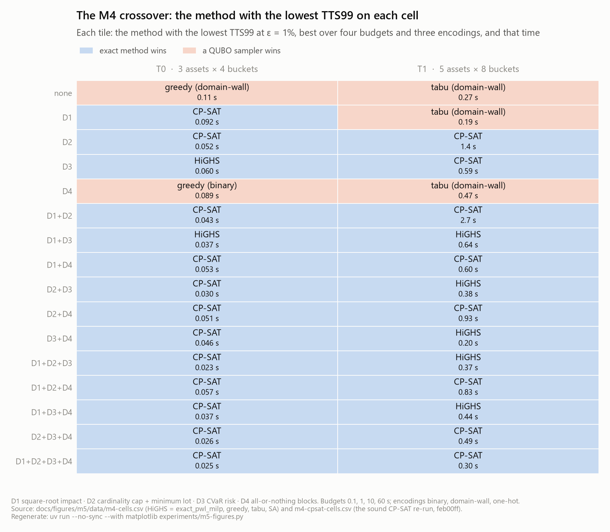

- **What is plotted.** A tile grid of the 32 M4 cells: rows are the 16 dial combinations, columns the tiers T0 and T1. Each tile names the method with the lowest TTS99 at ε = 1% on that cell, with that TTS99 on a second line; for samplers the encoding is in brackets. A blue wash marks a cell an exact method wins, an orange wash a cell a QUBO sampler wins.
- **Data.** `m4-cells.csv` for HiGHS (`exact_pwl_milp`) and the three samplers, `m4-cpsat-cells.csv` for the sound CP-SAT; the original CP-SAT rows of `m4-cells.csv` are ignored. For each solver its smallest TTS99 over the four budgets and, for samplers, three encodings; a solver with no finite TTS99 on a cell is out; ties go to the exact method (`fig_m4_crossover.py`).
- **How to read it.** Orange is where a heuristic reaches 1% of the optimum, with 99% confidence, sooner than an exact method proves it.
- **What it shows.** Five orange tiles out of 32, all at the 0.1 s budget and none with D2 or D3: T1 `none`, `D1`, `D4` (tabu on domain-wall, 0.27, 0.19 and 0.47 s) and T0 `none` (greedy on domain-wall, 0.11 s) and `D4` (greedy on binary, 0.089 s). CP-SAT wins 20 cells and HiGHS 7. This reproduces the M4 result's verdict from the CSVs (section 5.2).
- **What it does not show.** The margins (1.06 to 4.1 for the sampler wins; 1.16 to 1.2 × 10^5 the other way, plus four T1 cells where no sampler reaches 1%; section 5.2's tables), success rates, feasibility, and anything quantum: M5's cells are the eight T0 rows without D3.

### 9.2 Time to solution at T0: the classical methods against QAOA on the device

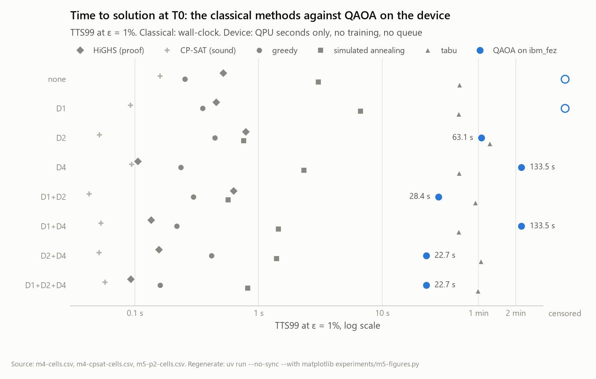

- **What is plotted.** One row per shared T0 cell; x is TTS99 at ε = 1% on a log scale from 0.03 s to 200 s, with a "censored" column beyond the axis. Six series: HiGHS (diamond) and the sound CP-SAT (plus) from M4, each at its best budget; greedy (circle), simulated annealing (square) and tabu (triangle) at 1,000 reads from the M5 store, each at its better encoding; QAOA on `ibm_fez` at reps = 2 (blue disc), labelled with its value. Within a row the classical markers are offset vertically so that equal times stay visible.
- **Data.** `m4-cells.csv`, `m4-cpsat-cells.csv`, `m5-p2-cells.csv` (`tts99_s_0.01`).
- **How to read it.** Left is faster. The classical times are wall-clock; the device's are QPU seconds only, with no training, routing or queue (decision D6), so the visible gap understates the real one (section 8.2).
- **What it shows.** CP-SAT at 0.043–0.16 s and greedy at 0.16–0.44 s on every cell; the device at 22.7 s (`D1+D2+D4`, `D2+D4`), 28.4 s (`D1+D2`), 63.1 s (`D2`) and 133.5 s (`D1+D4`, `D4`), censored on `none` and `D1`. Before the device's training and queue are counted, CP-SAT is 400 to 2,500 times faster than the device, greedy 55 to 610 times and annealing 16 to 93 times; tabu at 1,000 reads (42–74 s) sits right of the device on `D2`, `D1+D2`, `D2+D4` and `D1+D2+D4`, because 1,000 tabu reads are a long search (section 8.2). HiGHS's best-over-budgets values (0.09–0.79 s) are slower than CP-SAT's on every cell.
- **What it does not show.** The reps = 1 device values (section 8.2's table), bootstrap intervals (the device's TTS99 rests on 3 to 15 jobs per cell), and success rates.

### 9.3 At 1,000 reads: how often the optimum is found, and how many reads are feasible

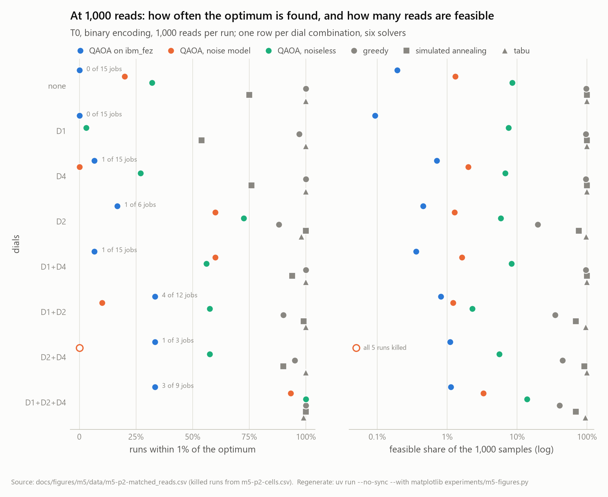

- **What is plotted.** Two dot-plot panels sharing their rows, the eight shared cells. Left: success at ε = 1% (share of runs), linear. Right: the feasible share of samples, log scale from 0.05% to 100%. Six series: QAOA on the device, under the noise model and noiseless (blue, orange, aqua discs), and greedy, annealing and tabu (gray circle, square, triangle). Each device marker is labelled "k of n jobs".
- **Data.** `m5-p2-matched_reads.csv`, binary encoding, every solver at 1,000 reads; killed runs from `m5-p2-cells.csv`. Samplers average 100 runs per cell, the noiseless circuit 20 runs per instance, the noise model 5, the device three jobs per instance. The noise model has no `D1` marker (24 qubits); its `D2+D4` cell, all 5 runs killed, is a hollow marker at zero success and at the floor.
- **How to read it.** Right is better in both panels; within a row the six markers are spread vertically in legend order so that ties stay visible.
- **What it shows.** The gray markers sit at 54% to 100% success (tabu 98–100%, greedy 88–100%, annealing 54–100%) and between 20% and 100% feasibility; the QAOA markers spread from 0 to 100% success and sit one to three orders of magnitude lower in feasibility, the device lowest (0.093% to 1.1%). The loss begins with feasibility, and it is there already without noise.
- **What it does not show.** Reps = 1 (section 8.1's table), time, and the instance-level spread behind each cell mean (figure 9.4).

### 9.4 Success and feasibility against circuit depth, per instance, on each backend

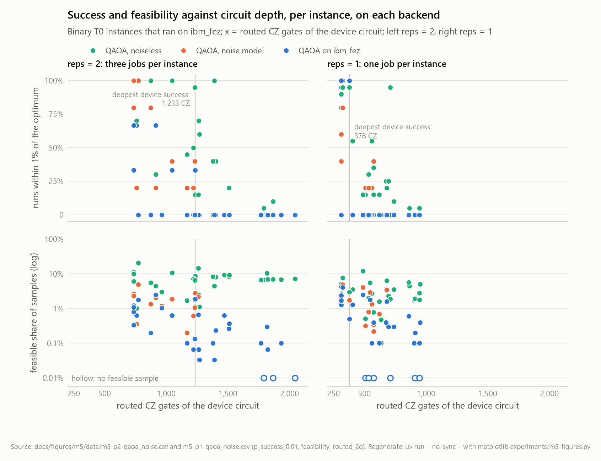

- **What is plotted.** A 2 × 2 grid sharing the x axis: the routed CZ count of each instance's device circuit (the live backend's routing), used for all three backends of that instance. Top row: success at ε = 1%. Bottom row: feasible share of samples, log scale; an instance with no feasible sample is drawn hollow at the 0.01% floor. Left column reps = 2 (30 device instances), right column reps = 1 (31). One point per instance and backend: noiseless (aqua), noise model (orange), device (blue). A vertical hairline marks the deepest circuit on which any device job found the optimum. In the success panels every point is offset vertically by its backend (noiseless up, device down, by 0.03) so that ties stay visible.
- **Data.** `m5-p2-qaoa_noise.csv` and `m5-p1-qaoa_noise.csv` (binary; `p_success_0.01`, `feasibility`, `routed_2q`). Noise-model points exist only for instances of at most 20 qubits whose runs finished: 14 at reps = 2 and 16 at reps = 1. A device point is the mean of the instance's jobs, so it reads 0, 1/3, 2/3 or 1 at reps = 2 and 0 or 1 at reps = 1.
- **How to read it.** Compare columns at equal x to see depth at equal circuit size, and the two columns' x ranges to see what one layer saves.
- **What it shows.** Every device success lies at or left of the hairline, 1,233 CZ at reps = 2 and 378 at reps = 1. The reps = 1 circuits sit at 313–952 gates against 735–2,044. Noiselessly, success falls with depth, because depth tracks the qubit count. On average the noise model lies between the noiseless circuit and the device in both columns (section 8.5), though not instance by instance: at reps = 2 it is below the device on 3 of its 14 instances, and at reps = 1 above the noiseless circuit on 5 of 16 and below the device on 3.
- **What it does not show.** Which instance is which (figures 9.6 and 9.8 name them); the qubit count, which moves with depth; domain-wall.

### 9.5 Feasible samples: the device against uniform random bitstrings

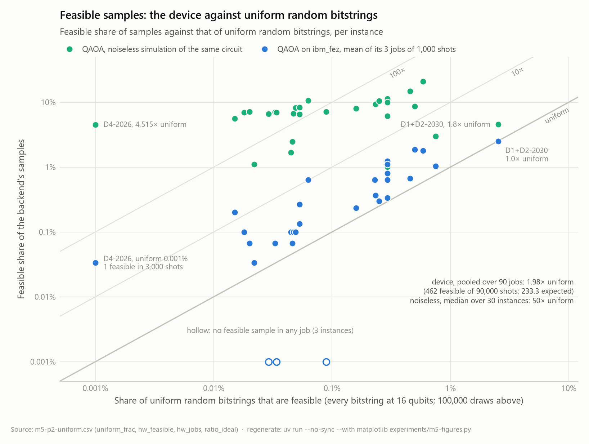

- **What is plotted.** One point per device instance and backend, log-log. x: the share of uniform random bitstrings that decode to a feasible schedule (exact at 16 qubits from all 65,536 bitstrings; 100,000 draws above). y: the feasible share of what the backend returned. Blue: the device, the mean over the instance's three jobs; hollow at the 0.001% floor when no job had a feasible sample (3 instances). Aqua: the noiseless simulation of the same circuit. The diagonal `y = x` is uniform randomness; two fainter diagonals mark 10 and 100 times it. Four points are labelled, and a note gives the pooled ratios.
- **Data.** `m5-p2-uniform.csv` (`uniform_frac`, `hw_feasible`, `hw_jobs`, `ratio_ideal`), produced by `experiments/m5-uniform-baseline.py` from the main store.
- **How to read it.** Height above the diagonal is the factor by which a backend beats random bitstrings at producing feasible schedules.
- **What it shows.** The device points sit just above the uniform line: a median 2.1 times it per instance and 1.98 pooled (462 feasible samples in 90,000 shots against 233.3 expected), with three instances at 10 to 33 times (`D4-2026`, `D1+D4-2027`, `D1+D4-2030`); the noiseless points sit a median 50 times above it (from 1.8 on `D1+D2-2030`, where about 2.5% of bitstrings are feasible by the 100,000-draw estimate, to 4,515 on `D4-2026`, where 0.001% are and one feasible device sample in 3,000 shots is already 33 times uniform).
- **What it does not show.** Success (section 6.8's table), reps = 1 (section 7.6's table: 3.0 times uniform), and the samplers, which would sit off the top of the chart at 300 to 380 times uniform (section 8.4).

### 9.6 Each instance on the device

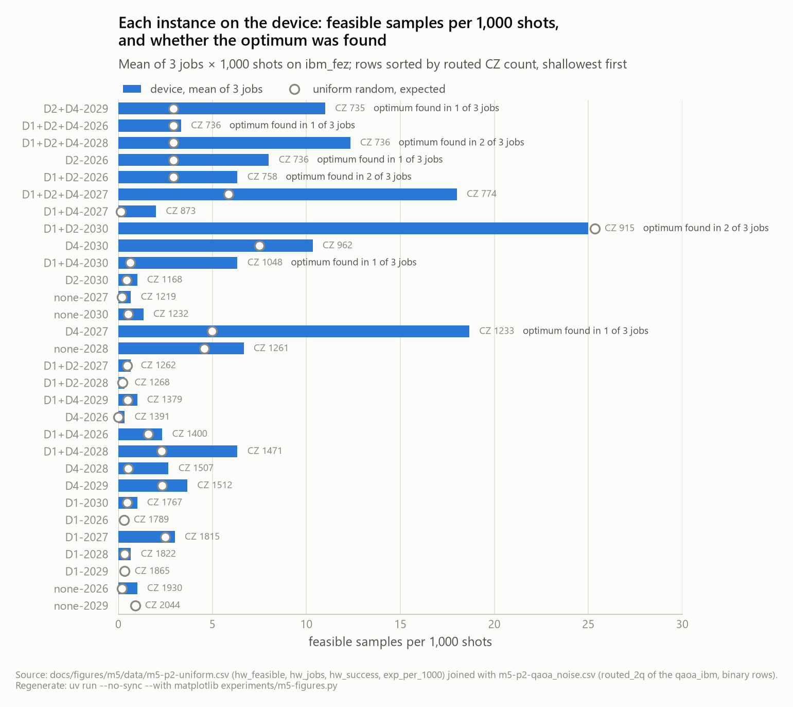

- **What is plotted.** One horizontal bar per device instance (reps = 2), sorted by the routed CZ count of its circuit, shallowest at the top (735, `D2+D4-2029`) to deepest (2,044, `none-2029`). The bar is the mean number of feasible samples per 1,000 shots over the instance's three jobs; the hollow gray marker on each row is the uniform-random expectation; the CZ count is printed right of each bar, and "optimum found in k of n jobs" marks the rows with a success.
- **Data.** `m5-p2-uniform.csv` (`hw_feasible`, `hw_jobs`, `hw_success`, `exp_per_1000`) joined with the `qaoa_ibm` rows of `m5-p2-qaoa_noise.csv` (`routed_2q`).
- **How to read it.** A bar near its marker is a device that does no better than random bits on that instance.
- **What it shows.** Feasible samples are a few per thousand everywhere (mean 5.1 against a uniform expectation of 2.6); the largest bar, 25.0 on `D1+D2-2030`, sits on its uniform expectation of 25.3. The eight instances with a success lie at 735 to 1,233 CZ gates, seven of them in the ten shallowest rows; from 1,261 gates down nothing is found, and three of those 16 instances returned no feasible sample in any job.
- **What it does not show.** Reps = 1 (figure 9.8), the noiseless circuit (figures 9.4 and 9.5), job-to-job spread (the per-job table in the M5 result's appendix).

### 9.7 The error-free fraction of a shot against two-qubit gates

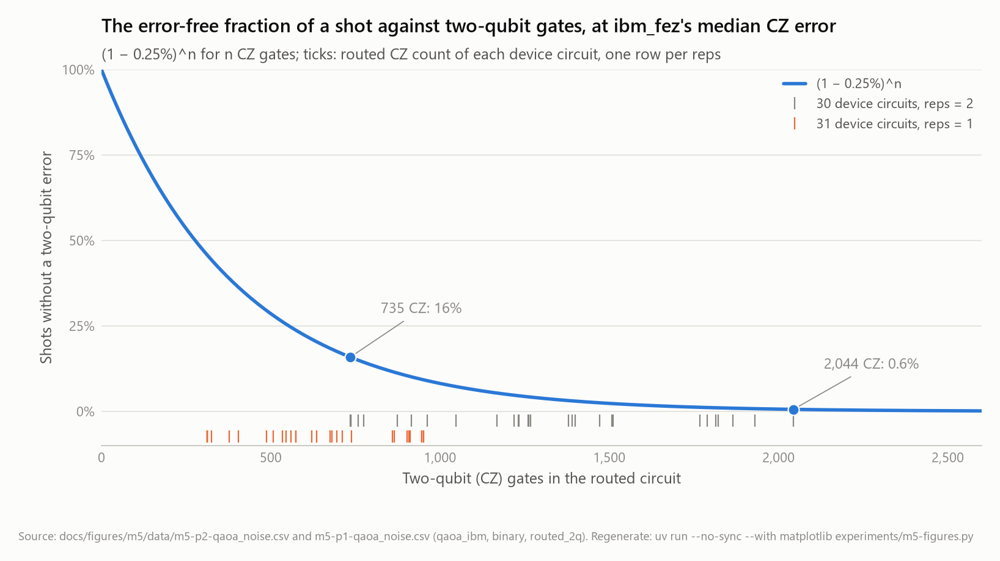

- **What is plotted.** The curve `(1 − 0.0025)^n`, the probability that a shot passes `n` CZ gates without a two-qubit error at `ibm_fez`'s median CZ error of 0.25%, from 0 to 2,600 gates. Two rugs below the axis mark the routed CZ counts of the device circuits: gray for the 30 reps = 2 circuits, orange for the 31 reps = 1 circuits. The shallowest and deepest reps = 2 circuits are labelled on the curve.
- **Data.** `m5-p2-qaoa_noise.csv` and `m5-p1-qaoa_noise.csv` (`routed_2q` of the `qaoa_ibm` rows); the 0.25% is the calibration median read after the first pass (properties last updated 2026-10-27 16:32) and again on 2026-10-28 (last updated 09:49).
- **How to read it.** The curve's height over a rug tick is the best case for that circuit: the share of shots in which the circuit could have run as designed.
- **What it shows.** 735 gates leave 16% of shots error-free and 2,044 leave 0.6%: the reps = 2 circuits span the stretch where the curve falls from one shot in six to one in 170. The reps = 1 circuits (313–952 gates) sit at 46% down to 9%. Section 7.8 shows that this fraction, with readout added, predicts the device's pooled feasibility to within about 25% at both depths; its per-instance ranking (Spearman 0.89–0.90) comes mostly from the instances' uniform feasible fractions.
- **What it does not show.** Single-qubit, idle and crosstalk errors, and readout (1.0–1.1% per qubit on the two calibrations, so a 16–24-qubit readout is wrong 15–23% of the time); the curve is an upper bound on the shots that survive.

### 9.8 Reps 1 against reps 2, instance by instance

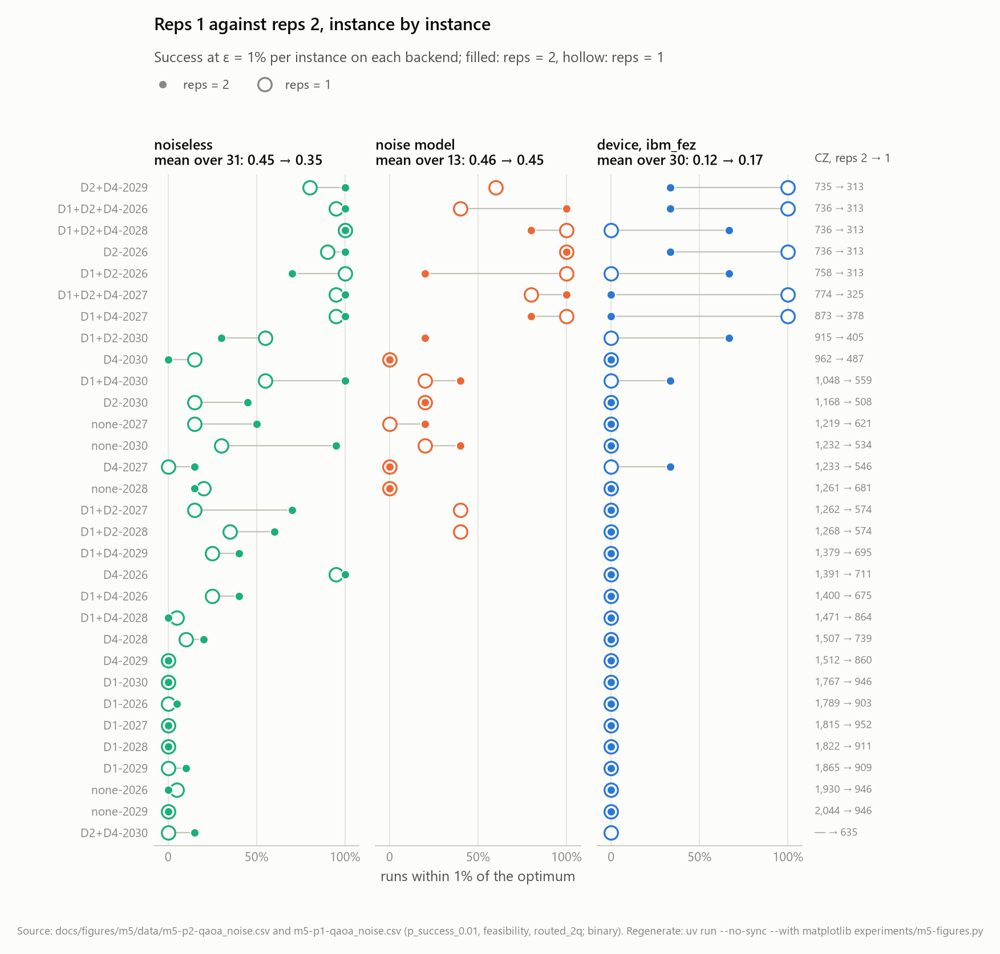

- **What is plotted.** Three dumbbell panels sharing their rows, one per backend: noiseless, noise model, device. One row per device instance at either depth (31: the 30 of reps = 2 and `D2+D4-2030`, which ran at reps = 1 only), sorted by the reps = 2 circuit's CZ count. x is success at ε = 1%; the filled marker is reps = 2, the larger hollow ring reps = 1, joined by a hairline (a filled dot inside a ring is a tie). Each panel's title gives the mean success over the instances present at both depths; the column right of the device panel gives the CZ counts, reps 2 → reps 1.
- **Data.** `m5-p2-qaoa_noise.csv`, `m5-p1-qaoa_noise.csv` (binary). Noise-model rows whose runs were all killed are left out (reps = 2: 3 instances; reps = 1: 1), so that panel has 13 instances at both depths.
- **How to read it.** A ring left of its dot is an instance where one layer did worse; right, better.
- **What it shows.** Noiselessly, one layer does worse on most instances: mean 0.45 → 0.35 over 31. Under the noise model, little change on the 13 shared instances (0.46 → 0.45). On the device, the mean over 30 rises from 0.12 to 0.17, all of it on the shallowest rows: the reps = 1 successes are four instances of 313–325 CZ gates and one of 378, where reps = 2 had succeeded on 8 instances of 735 to 1,233 gates. The CZ column shows the halving: 735–2,044 → 313–952.
- **What it does not show.** Feasibility (section 7.5's tables), and the unequal sample sizes: three device jobs per instance at reps = 2, one at reps = 1, so each reps = 1 device ring is a single job.

### 9.9 Training the angles: seconds per QUBO against qubit count

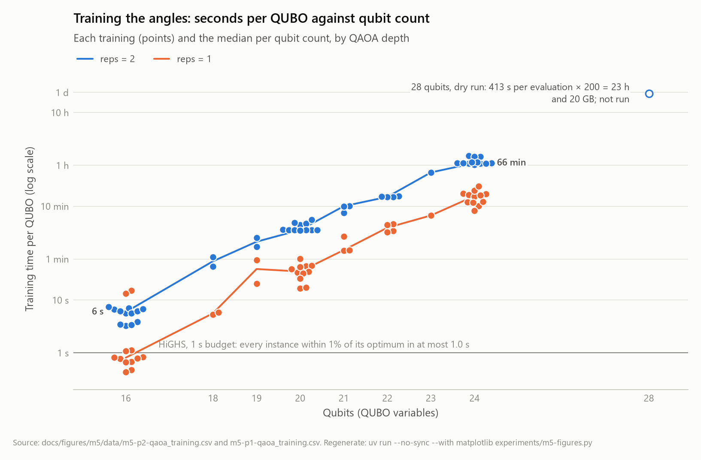

- **What is plotted.** Every training's wall-clock seconds (log y, labelled from 1 s to 1 d) against the QUBO's qubit count, blue for the 47 reps = 2 trainings and orange for the 47 reps = 1 trainings, with the median per qubit count joined by a line and points spread sideways where they would overlap. A hollow blue marker at 28 qubits is the dry run's estimate (413 s per evaluation × 200 = 23 h and 20 GB), not a training. A gray hairline at 1 s marks the classical reference: HiGHS, at its 1 s budget, has every one of these instances within 1% of its optimum in at most 1.0 s (cell means 0.24–0.40 s; one run stopped at the budget unproven, holding the optimum).
- **Data.** `m5-p2-qaoa_training.csv`, `m5-p1-qaoa_training.csv` (`n_vars`, `train_s`; 31 binary and 16 domain-wall QUBOs each, same marker).
- **How to read it.** A straight line on this axis is exponential growth; the gap to the hairline is the classical preparation's cost against a classical proof.
- **What it shows.** Exact-statevector training grows about 2.3 times per qubit at reps = 2 (6 s at 16 qubits, 66 min median at 24) and 2.4 times at reps = 1 (0.8 s to 16 min); reps = 1 is about five times cheaper (3.6 h against 17.3 h in all). Every one of the 94 trainings costs more than the HiGHS run on the same instance: 8 to 1.2 × 10^5 times more at reps = 2, 2 to 2.3 × 10^4 at reps = 1 against that rung's own HiGHS runs (1.2 at the least against the reps = 2 store's). Instance by instance is the fair reading: the fastest training, 0.43 s at reps = 1, is quicker than HiGHS's slowest runs on other instances.
- **What it does not show.** Memory (1.4 GB at 24 qubits), the evaluation counts (all 200 used on 45 of 47 reps = 2 trainings; at reps = 1, 46 stopped early, at 31–146, and one used all 200), and the CPU load of the machine during the runs.

### 9.10 Dynamic range and qubit count against the noiseless success

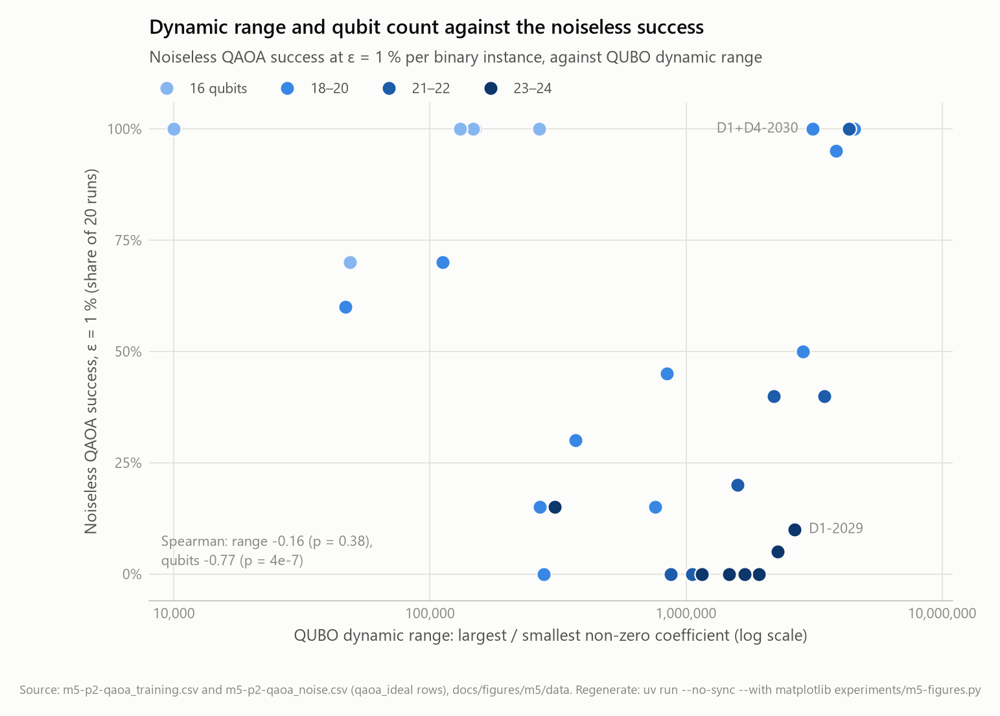

- **What is plotted.** One point per binary QUBO (31): x is the QUBO's dynamic range (largest over smallest non-zero coefficient, log scale), y the noiseless reps = 2 success at ε = 1% over 20 runs; the colour is the qubit count in four bins (16, 18–20, 21–22, 23–24), light to dark. Two points are labelled, and a note gives the Spearman correlations.
- **Data.** `m5-p2-qaoa_training.csv` (`dynamic_range`, `n_vars`) joined with the `qaoa_ideal` rows of `m5-p2-qaoa_noise.csv` on dials and seed.
- **How to read it.** If the range mattered, points would fall from left to right within a colour; if the qubit count matters, the colours separate vertically.
- **What it shows.** The colours separate: the light 16-qubit points sit at 100% but one (70%), the dark 23–24-qubit points at or near 0, whatever their range. Spearman: range −0.16 (p = 0.38), qubits −0.77 (p = 4 × 10⁻⁷). `D1+D4-2030` has one of the widest ranges and succeeds in every run on 19 qubits; `D1-2029`, with a similar range on 24 qubits, in 10%.
- **What it does not show.** The device (where range and success correlate at −0.44 through the circuit's size, section 6.11), reps = 1 (−0.24 and −0.82), and the dynamic range's possible effect on an analogue annealer, which is where a range of 10^6 would matter.

### 9.11 QPU seconds spent against the 300 s cap

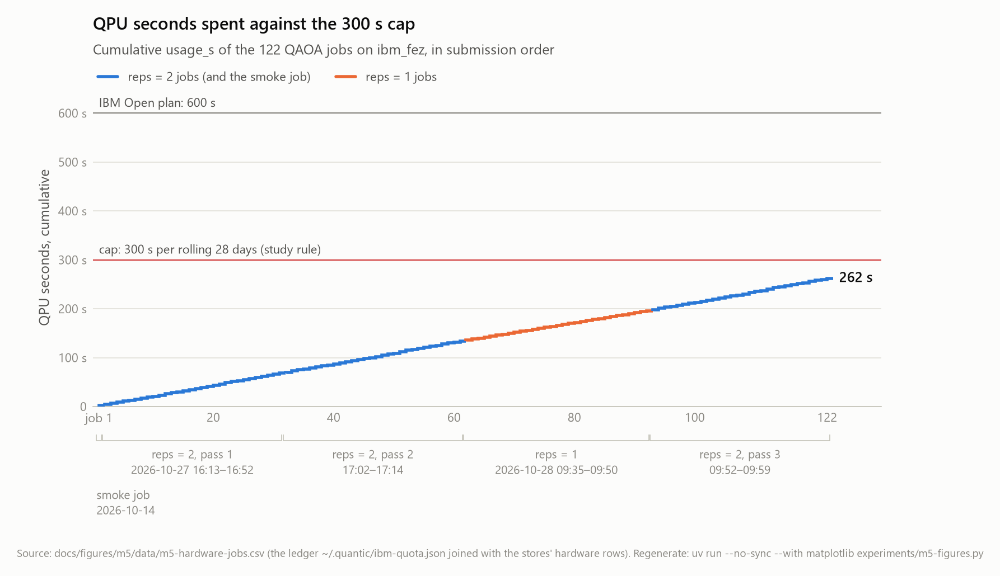

- **What is plotted.** The cumulative QPU seconds of the 122 ledger jobs in submission order, as a step that rises by each job's charge; blue for reps = 2 jobs and the smoke job, orange for the reps = 1 jobs. Two hairlines: the study's cap of 300 s per rolling 28 days (red) and IBM's Open-plan allowance of 600 s (gray). Brackets under the axis mark the five runs of the lane with their dates and submission windows: the smoke job (2026-10-14), reps = 2 passes 1 and 2 (2026-10-27 16:13–16:52 and 17:02–17:14), the reps = 1 lane (2026-10-28 09:35–09:50) and reps = 2 pass 3 (09:52–09:59).
- **Data.** `m5-hardware-jobs.csv` (the ledger joined with the stores' hardware rows by `experiments/m5-hardware-jobs.py`, which names each job's lane and pass).
- **How to read it.** The step's slope is the QPU charge per job; its end is the quota spent.
- **What it shows.** Every job cost 2 or 3 s against a per-job limit of 60 s (20 s for the smoke job; 57 down to 40 s for the last nine jobs of pass 3, as the cap's remainder shrank), and the total ends at 262 s, under the cap; IBM's own counter read the same 262 s after the last job. The cap never bound.
- **What it does not show.** Queue and wall time (the per-job table of the M5 result's appendix), and the rolling window: the smoke job's 2 s leave it on 2026-11-11 and the first two passes' 132 s on 2026-11-24.

## 10. Threats to validity and limitations

Everything that limits what the comparison can claim, with its size where it can be measured, the direction in which it could move the result, and whether it could overturn the verdict of section 8: that on the eight T0 cells without CVaR, gate-model QAOA on `ibm_fez` loses to every free classical method on quality at equal reads, and on time to the exact methods and greedy by 17 to 2,500 times on QPU seconds alone and by three to four orders of magnitude end to end. Some limits are of the comparison's scope rather than its validity; they are listed last, because they bound what the verdict is about rather than whether it holds.

### 10.1 Sample sizes on the device

| threat | size | direction | could it overturn the verdict? |
|---|---|---|---|
| three device jobs per instance at reps = 2, one at reps = 1 | device success 11 of 90 jobs (95% Clopper-Pearson interval 6.3–21%) and 5 of 31 (5.5–34%); on the 16-qubit instances 7 of 18 (17–64%) and 4 of 6 (22–96%) | either way, per instance; the per-cell TTS99 rests on 3 to 15 jobs, and its bootstrap intervals are wide (e.g. `D1+D2` at reps 2: 13–132 s; `m5-p2-cells.csv`) | no: the upper ends of the intervals (21% and 34%) are far below greedy's 99.5% on the same instances (600 runs; interval 98.5–99.9%) |
| the reps = 1 rung's single job per instance | its cell TTS99 values are two to five coin flips | either way | no; section 8.2 gives them for completeness and ranks nothing by them |
| the two rungs' device comparison mixes three jobs with one | the reps = 1 mean success (0.17) has about √3 times the noise of the reps = 2 mean (0.12) | either way | it could reverse the small difference between the rungs on the device; it cannot reverse either rung's distance from the samplers |

### 10.2 The device and its compilation

| threat | size | direction | could it overturn? |
|---|---|---|---|
| one device, two calibrations | the medians were the same on both days (CZ 0.25%, SX 0.03%, readout 1.0–1.1%), but the third pass found 183 feasible samples against 136 and 143, more than one shared rate allows (binomial p = 0.005): the device's state moved | a better day or a better device raises the device's numbers | not for this device: the parameter-free error model (section 7.8) puts the ceiling at the noiseless circuit, and a newer processor with a CZ error 3 to 7 times lower would be a different study (section 11) |
| routing: the gate on the fake twin, the lane on the live device; Qiskit `optimization_level = 3` with one fixed seed | where checked, twin and live counts agree within a few gates; routing multiplies the logical CZ count by 1.43 to 2.48 (median 1.66; `couplings.py`) | better routing lowers the CZ count | no: with no routing overhead at all, the reps = 2 circuits would carry 312 to 1,104 CZ gates, leaving 6% to 46% of shots error-free, which is the reps = 1 rung's regime, and the reps = 1 rung did not change the comparison |
| no error mitigation beyond the Sampler's defaults (M5 design, out of scope) | mitigation designed for expectation values (zero-noise extrapolation, readout correction) does not repair individual samples; dynamical decoupling and twirling were not tried | could raise the device's feasibility toward the noiseless circuit's | no: the noiseless circuit itself is the ceiling, 7.4% feasible and 0.51 mean success at reps 2, already 13 and 2 times below tabu (section 8.1) |
| QPU seconds reported as whole seconds by IBM | every job was charged 2 or 3 s, so a job's charge is known only to ±0.5 s | either way, about ±20% on any device TTS99 | no: the device's TTS99 is 150 to 2,500 times CP-SAT's |

### 10.3 The algorithm and its training

| threat | size | direction | could it overturn? |
|---|---|---|---|
| COBYLA's 200 evaluations | at reps = 2, 45 of the 47 trainings used all 200 (not converged); at reps = 1, 46 of 47 stopped early (converged) | better angles could raise the reps = 2 noiseless success | unlikely: the converged reps = 1 angles are worse than the unconverged reps = 2 ones, and the failure mode, feasibility, is the penalty encoding's, which no angle setting removes (section 6.6) |
| fixed `α = 0.25`, the linear-ramp start, no restarts, no angle transfer | not varied | unknown | not on this evidence; it bounds the claim to this CVaR-QAOA, not to every QAOA variant |
| penalty-encoded constraints | 2.3–14% feasible shots noiselessly at reps 2 | a constraint-preserving circuit would start from 100% feasible shots | this is the one change that could alter the noiseless comparison; it is a different algorithm, not a threat to this one's measurement (section 11) |
| the noiseless simulation's sampling | 20 runs of 1,000 shots per instance: a per-instance success has a binomial standard error up to 0.11 | either way, per instance | no; cell and pooled means are tighter |

### 10.4 What the caps and the kills left out

| threat | size | direction | could it overturn? |
|---|---|---|---|
| `max_qubits = 24` | 9 of 40 binary QUBOs (27–28 qubits, all with D2) and 24 of 40 domain-wall ones left out; 876 quantum tasks never planned | the excluded instances are larger, and QAOA's success falls with qubits (Spearman −0.77) | no: it flatters QAOA, if anything |
| the samplers' cells pool all five instances, QAOA's only those that fit | checked: on QAOA's own 30 device instances the samplers are as strong (tabu 1.00, greedy 0.995, annealing 0.83 against 0.86 on all 40; section 6.6) | the cap's subset is the easier one | no |
| killed noise-model runs | reps 2: 30 runs and one gate (3 instances out of the ladder, 1 instance off the device); reps 1: 5 runs (1 instance out of the ladder) | the ladder means count killed instances as 0, which biases the noise model's mean down | no: on the instances simulated in full, the noise model is still above the device on 9 of 14 (reps 2) and 7 of 16 (reps 1) |
| the smoke job | one instance paid four times at reps 2 (8 s; five times and 10 s with its reps = 1 job) | none on the results; the smoke job itself cost 2 s of quota | no |

### 10.5 The baselines and the comparison protocol

| threat | size | direction | could it overturn? |
|---|---|---|---|
| M4's time budgets against M5's matched reads | different estimators of TTS99 for the same samplers (section 4.6) | none systematic, except that matched reads make tabu slow: 1,000 tabu reads take 42 to 74 s | no: both are given side by side; greedy at 1,000 reads is 30 to 610 times faster than the device's QPU seconds and M4's best sampler 68 to 1,500 times; only tabu at 1,000 reads is slower than the device, on four cells, and the same tabu at a 0.1 s budget is faster on all |
| wall-clock depends on machine load | HiGHS on the same eight cells at the same 1 s budget took 0.46 to 2.7 times as long in one store as in the other (section 4.6) | either way | not against the exact methods, greedy or annealing (gaps of 9.5 to 2,500 on QPU seconds alone); the closest gap, 1.6 to tabu at M4's 0.1 s budget on one reps = 1 cell resting on two jobs, is within a factor of 3, but only on the QPU-only clock: end to end the device needs minutes |
| CP-SAT's presolve fix | it slows CP-SAT on T1 CVaR cells with blocks; on the shared T0 cells the sound CP-SAT is faster than the original on six of eight and at most 1.3 times slower on `D1+D4` and `D4` (best over budgets) | small on the shared cells | no; and HiGHS alone, at its best budget, is 45 to 1,300 times faster than the device's QPU seconds at reps = 2 and 17 to 300 times at reps = 1 |
| the uniform baseline's Monte Carlo precision | 100,000 draws at 18–24 qubits: a feasible share near 10^−5 rests on one or two hits, and where no draw was within 1% of the optimum the chance of success is counted as zero | the chance expectations (5.5 and 1.9 successes) are lower bounds, so the device's excess over chance may be smaller than stated | it could weaken the success excess over chance (2.0 and 2.7 times) toward none; it cannot touch the feasibility excess (p ≈ 10^−40) or the comparison with the samplers |
| the end-to-end clock of section 8.2 | built from the mean training of a cell's device instances and the lane's median 15–16 s of wall time per job | it is a construction, not a measurement of any single run | no: on the QPU-only clock alone the device already loses to CP-SAT by 150 to 2,500 times |

### 10.6 The limits of the scope

| limit | what it means |
|---|---|
| T0 only, and only the cells without CVaR | M5 measured the cells where M4's samplers already succeed and the exact methods prove optima in under a second. The CVaR cells, where the classical samplers fail hardest (section 5.4), need 260–296 qubits at T0 and were out of reach; T1–T3 likewise (section 8.9). The verdict says nothing about them. |
| gate-model QAOA on one Heron processor | the parent design's hardware target was an annealer, D-Wave Advantage2; it was re-scoped to IBM on 2026-10-09 because the owner has an IBM account only (M5 design, D1). Annealing hardware, with its different failure modes (analogue precision against dynamic ranges of 10^4 to 10^6 on M5's QUBOs, and cell medians up to 1.6 × 10^7 at T0 with CVaR and 8.8 × 10^9 at T1; embedding), is untested. |
| synthetic instances | both studies use the synthetic generator's instances (section 3.1), not market-calibrated ones; this limits what the numbers say about a real desk, not the comparison between solvers, which all ran on the same instances |
| a quota of 300 s per 28 days | the hardware sample (121 study jobs) is what the cap allowed; 38 s remain now, 40 s from 2026-11-11 and 172 s from 2026-11-24 |

None of the threats in 10.1 to 10.5 could turn a classical win into a quantum one on the cells measured. The closest the device comes: in success, a factor of 3.7 behind annealing and 4.3 behind tabu (reps = 1, mean cell success); in feasibility, a factor of about 84 behind greedy, pooled; in time on QPU seconds alone, 1.6 behind tabu at M4's 0.1 s budget and 9.5 behind annealing at 1,000 reads (both reps = 1 on `D2+D4`), 17 behind HiGHS (reps = 1 on `D2`), 30 behind greedy at 1,000 reads and 150 behind CP-SAT, and ahead of tabu at 1,000 reads on four cells, which is faster end to end on all. Every identified bias either favours QAOA already or is small against those factors, except machine load against the 1.6 on the QPU-only clock (10.5). The limits in 10.6 are where the open questions are.

## 11. What next

Ranked by what each step would settle against what it costs. The ranking follows from sections 8 and 10: the binding failure is the algorithm's feasibility before it is the device's noise; the unmeasured regions (CVaR cells, T2–T3, annealers) are where a quantum solver could still matter; and the IBM quota left is too small to settle anything new.

| rank | step | the question it answers | what it needs | what it costs |
|---|---|---|---|---|
| 1 | constraint-preserving QAOA, on the simulator | can a gate-model circuit that never leaves the feasible set match the classical samplers at 1,000 reads, noiselessly? | mixers that preserve the row sums of full liquidation and the per-entry value sets (XY or ring mixers on one-hot or domain-wall registers, Grover-type mixers over a feasible-state preparation); the existing trainer, harness and matched-reads report | design and code, then simulator time only; no quota |
| 2 | the classical study at T2–T3 | where do the exact methods stop proving optima in seconds, on the CVaR and D2 cells where the samplers fail hardest? | M4's harness with best-known references (T2–T3 have no closed bracket); CP-SAT's CVaR speed recovered by scaling its cut rows instead of disabling a presolve pass (section 5.7) | days of machine time; no quota |
| 3 | annealing hardware | does an annealer beat simulated annealing and tabu at matched reads or time on T0–T1, and how much of the QUBO survives its analogue precision? | a D-Wave Leap account (the owner has none); the QUBOs, encodings, matched-reads harness and quota ledger are ready (M5 result, "What next") | the account's quota; a new spec for embedding and the dynamic range |
| 4 | a lower-error gate device | does the reps = 2 circuit carry its noiseless performance when most shots are error-free? | a processor whose median CZ error is 3 to 7 times below `ibm_fez`'s 0.25% (0.034–0.094% for the reps = 2 circuits to keep half their shots error-free; section 8.6) | an account with access; about 66 s of QPU per pass over the 30 instances at today's job cost |
| 5 | training beyond 24 qubits | can QAOA angles be produced for instances a statevector cannot hold? | fixed or transferred angle schedules, or training on the device | gives up the exact CVaR; on the device, 50–200 jobs per instance (M5 design, D3) |
| 6 | the IBM quota that remains | — | — | 38 s now (40 s from 2026-11-11), about 14 jobs: too few to settle any question above; recommended: do not spend it |

### 11.1 Constraint-preserving circuits first

The penalty encoding is where QAOA loses before any noise: 2.3–14% feasible shots noiselessly at reps = 2 (section 6.6), against 69–100% for annealing and 95–100% for tabu at the same reads. A circuit whose mixer moves only between feasible schedules starts every shot as a candidate, and removes the feasibility gap that dominates every comparison in section 8. The study's own data bound what to expect from it: on the 16-qubit instances the feasible space holds 12 or 24 schedules, so even a uniform distribution over feasible schedules would find the optimum in about a twelfth to a twenty-fourth of shots, and a 1,000-shot run would essentially always contain it; the test is on the larger instances, where tabu succeeds in every run and greedy in 99.5% (section 6.6). The cost of the change is depth: mixers that preserve a sum constraint cost more two-qubit gates per layer than the transverse field. So this step should be judged noiselessly first, against the samplers at matched reads; only if it matches them there is a device run worth the quota.

### 11.2 Depth and error budgets

The parameter-free model of section 7.8 turns the device into arithmetic: it returns its noiseless circuit's output in the fraction of shots free of any CZ or readout error and uniform bits in the rest, to within about 25% on the pooled feasible share (it overestimates by 23–27%). That fraction is `(1 − p_cz)^CZ × (1 − p_ro)^qubits`. At this device's medians, keeping half the shots free of a two-qubit error allows at most 276 CZ gates (212 at 16 qubits with readout); the reps = 2 circuits (735–2,044 gates) would need a CZ error of 0.094% to 0.034%, and the readout term alone costs 15–23% of shots at 16–24 qubits (1.0–1.1% per qubit). Any future gate-model run should be planned against this budget before it is submitted: the model predicts its feasibility from the routed CZ count and the calibration, at no quota cost.

### 11.3 Annealing, the parent design's target

The parent design aimed M5 at D-Wave's Advantage2 (section 2.5). Everything but the account is ready: the QUBOs (including the CVaR ones), the three encodings, the matched-reads protocol, and a quota ledger whose logic carries over. What to measure first is the dynamic range, not the speed: from 1.0 × 10^4 for the smallest M5 QUBO to cell medians of up to 1.6 × 10^7 at T0 with CVaR and 8.8 × 10^9 at T1 (section 3.6), against the few bits of effective precision an analogue annealer resolves, so an annealer will see a coarsened QUBO, and that should be measured before its samples are compared with simulated annealing's. Dense embedding holds about 230 logical variables, so the T0 and T1 cells without CVaR fit under binary and no CVaR cell fits at eight zeta bits under any encoding (section 3.7): the cells where the classical samplers fail hardest stay out of an annealer's reach too, unless the CVaR gadget is made smaller.

### 11.4 The classical track at T2–T3

M4's own recommendation stands (section 5.10): inside T0–T1 the exact methods prove optima in seconds, so a quantum solver could only compete beyond them, where brackets stop closing. That study needs no quantum access, and it tells any future quantum study where to look: on the CVaR and D2 cells at T2–T3, where the exact methods' times grow fastest (HiGHS up to 34 s on `T1-D1+D2`, CP-SAT up to 3,052 s on `T1-D3+D4`) and the samplers already fail at T1.

### 11.5 What not to do

- **More shots, more passes or more depth on this device for this algorithm.** Three passes moved the device's numbers by a few points and the verdict not at all (section 6.13); one fewer layer traded noiseless performance for device survival at a net that does not reach the samplers (section 7.8).
- **Error mitigation aimed at expectation values.** The study needs individual feasible samples, not a better estimate of an expectation; mitigation of that kind does not create feasible bitstrings (section 10.2).
- **Spending the remaining 38 s.** About 14 jobs could not separate the two rungs on the device (section 10.1). After 2026-11-24, when the first 132 s of study jobs leave the window, two more reps = 1 passes (62 s each) would give that rung three jobs per instance like reps = 2; that is worth doing only if the depth question itself matters for a decision, which section 11.1 suggests it does not.

## 12. Appendix: provenance, reproduction, data, glossary

### 12.1 Provenance

| study | config | commit | lock hash | store (not committed) | report | logs | ran |
|---|---|---|---|---|---|---|---|
| M4 crossover | `experiments/m4-crossover.toml` | `4d420cf` | `207fa6f1…0c919d` | `D:\CC\quantic-study\results\m4-crossover.duckdb`, 37.7 GB | `…\results\m4-report` | `…\results\m4-crossover.log` | 2026-10-02 20:21 → 2026-10-08 05:40, 110.6 h of running |
| M4 CP-SAT re-run | `experiments/m4-cpsat-rerun.toml` | `feb00ff` | same as M4 | `…\results\m4-cpsat-rerun.duckdb`, 2.4 MB | `…\results\m4-cpsat-report` | `…\results\m4-cpsat-rerun.log` | 2026-10-08 18:21 → 18:29 |
| M5 smoke | `results\m5-smoke.toml` (in `D:\CC\quantic-m5`, never committed) | `55c1009` | `dd349336…6e610f` | `D:\CC\quantic-m5\results\m5-smoke.duckdb`, 3 MB | — | `…\results\m5-smoke*.log` | job submitted 2026-10-14 20:04, collected 2026-10-22 |
| M5, reps = 2 | `experiments/m5-qaoa.toml` | `b8c1244` | `dd349336…6e610f` | `D:\CC\quantic-m5\results\m5-qaoa.duckdb`, 80 MB, with the angle cache `m5-qaoa.angles\` | `…\results\m5-report` (three passes; `m5-report-2pass` kept) | `m5-qaoa*.log` (simulation), `m5-hw-1.log` to `m5-hw-3.log` (passes 1–3) | simulation 2026-10-12 → 10-24; hardware 2026-10-27 and 10-28 |
| M5, reps = 1 | `experiments/m5-qaoa-p1.toml` | `d9a3de6` | same as M5 | `D:\CC\quantic-m5p1\results\m5-qaoa-p1.duckdb`, 29 MB, angle cache `m5-qaoa-p1.angles\` | `…\results\m5-report-p1` | `m5-qaoa-p1.log`, `m5-p1-hw-1.log` | simulation 2026-10-27 → 10-28; hardware 2026-10-28 09:35–09:50 |

All runs on one machine: Windows 11 (10.0.26200), Intel Core i9-9900 at 3.10 GHz, 63.9 GB, Python 3.11, from clean working trees (`--allow-dirty` never used). Packages, as the lock files pin them: OR-Tools 9.15.6755, DuckDB 1.5.6, dwave-samplers 1.8.0, dimod 0.12.22 (M4 design, section 11); and for M5 also qiskit 2.5.2, qiskit-aer 0.17.2, qiskit-ibm-runtime 0.50.0, numpy 2.4.6, scipy 1.17.1 (M5 result, "What was run"). The full lock hashes are in the result documents. The day-by-day run history (launches, pauses, kills, the owner's decisions) is in the study ledger `.superpowers/sdd/2026-10-09-m5-qaoa-ibm/progress.md`, which is not committed.

### 12.2 Reproduction

| what | command (from the repository root unless stated) |
|---|---|
| a study store | `quantic bench run <config> --store <path>` from the study's commit; the hardware lane needs a saved IBM account (`QiskitRuntimeService.save_account`) and the owner's go-ahead, and produces new device data, not the same numbers; the smoke store cannot be rebuilt this way, since its config was never committed |
| a report | `quantic bench report <store> --out <dir> [--commit <sha>] [--ledger ~/.quantic/ibm-quota.json]` |
| the uniform-random baseline | `.venv/Scripts/python.exe experiments/m5-uniform-baseline.py <store> <out.csv>` |
| the per-job hardware table | `.venv/Scripts/python.exe experiments/m5-hardware-jobs.py docs/figures/m5/data/m5-hardware-jobs.csv --ledger ~/.quantic/ibm-quota.json reps2=<store> reps1=<store> smoke=<store>` |
| the figures' data | copy these 26 tables into `docs/figures/m5/data/`: from the M4 report, `cells`, `crossover_{0.1,1,10,60}s` and `dial_effects` as `m4-*`; from the CP-SAT re-run's report, `cells` and `crossover_{0.1,1,10,60}s` as `m4-cpsat-*`; from the reps = 2 report, `cells`, `crossover_1s`, `crossover_3600s`, `matched_reads`, `qaoa_noise`, `qaoa_training` and `quota` as `m5-p2-*`; from the reps = 1 report, `cells`, `crossover_1s`, `matched_reads`, `qaoa_noise` and `qaoa_training` as `m5-p1-*`; then the two uniform baselines (`m5-p2-uniform.csv`, `m5-p1-uniform.csv`) and the per-job table (`m5-hardware-jobs.csv`) |
| the figures | `uv run --no-sync --with matplotlib experiments/m5-figures.py [--only <name> ...]` |
| the M5 result's appendix | `.venv/Scripts/python.exe experiments/m5-result-appendix.py docs/superpowers/specs/2026-10-27-m5-qaoa-result.md --uniform … --report … --uniform-p1 … --report-p1 … --jobs …` |
| this document's computations | the scripts in `experiments/m4_m5_comparison/` (their `README.md` maps each to its sections) |

### 12.3 The quota ledger, run by run

| run of the lane | submissions (local time) | jobs | QPU seconds | queue, median (max) | feasible / shots | jobs within 1% |
|---|---|---|---|---|---|---|
| smoke | 2026-10-14 20:04 | 1 | 2 | 40,980 s (a maintenance window) | 1 / 1,000 | 0 |
| reps = 2, pass 1 | 2026-10-27 16:13–16:52 | 30 | 66 | 1.9 s (668 s) | 136 / 30,000 | 5 |
| reps = 2, pass 2 | 2026-10-27 17:02–17:14 | 30 | 66 | 1.3 s (5.7 s) | 143 / 30,000 | 3 |
| reps = 1 | 2026-10-28 09:35–09:50 | 31 | 62 | 1.5 s (1.8 s) | 242 / 31,000 | 5 |
| reps = 2, pass 3 | 2026-10-28 09:52–09:59 | 30 | 66 | 1.4 s (3.5 s) | 183 / 30,000 | 3 |
| **total** | | **122** | **262** | | | |

(`m5-hardware-jobs.csv`.) Every job ran on `ibm_fez`, cost 2 or 3 s against a per-job limit of 60 s (20 s for the smoke job; 57 down to 40 s for the last nine jobs of pass 3, as the cap's remainder shrank), and ended `done`; IBM's own counter read 262 s after the last job, matching the ledger. The window rolls: the smoke job's 2 s leave it on 2026-11-11, passes 1 and 2 (132 s) on 2026-11-24, the reps = 1 lane and pass 3 (128 s) on 2026-11-25. Every job, with its id, instance, routed CZ count, queue and result, is listed in the M5 result's appendix "Every hardware job".

### 12.4 Where the data are

| table | rows | content |
|---|---|---|
| `docs/figures/m5/data/m4-cells.csv` | 1,440 | every M4 report cell: tier × dials × solver × encoding × budget, all metrics of section 4.3 (CP-SAT here is the original, unsound one) |
| `m4-cpsat-cells.csv` | 128 | the sound CP-SAT re-run's cells |
| `m4-crossover_{0.1,1,10,60}s.csv`, `m4-cpsat-crossover_*.csv` | 32 each | the M4 crossover tables (section 5.3 prints the T0 rows) |
| `m4-dial_effects.csv` | 100 | M4's factorial dial effects (section 5.9) |
| `m5-p2-cells.csv`, `m5-p1-cells.csv` | 90, 38 | every M5 report cell, each rung |
| `m5-p2-matched_reads.csv`, `m5-p1-matched_reads.csv` | 82, 30 | QAOA and samplers at 1,000 reads (sections 6.6, 7.5, 8.1) |
| `m5-p2-qaoa_noise.csv`, `m5-p1-qaoa_noise.csv` | 104, 95 | per instance and backend: runs, success, feasibility, routed depth and CZ, QPU seconds (sections 6.7, 7.5) |
| `m5-p2-qaoa_training.csv`, `m5-p1-qaoa_training.csv` | 47 each | per trained QUBO: qubits, dynamic range, seconds, CVaR, evaluations |
| `m5-p2-uniform.csv`, `m5-p1-uniform.csv` | 30, 31 | the uniform-random baseline per device instance |
| `m5-p2-quota.csv` | 122 | the quota ledger as the report writes it |
| `m5-hardware-jobs.csv` | 122 | the ledger joined with the stores: lane, pass, instance, QPU and queue seconds, routed CZ, feasible samples, success |
| `m5-p2-crossover_1s.csv`, `m5-p2-crossover_3600s.csv`, `m5-p1-crossover_1s.csv` | 8 each | HiGHS at 1 s, and the samplers' 1,000-read runs formatted as a crossover table |

The per-instance tables in full (the uniform baselines, the noise ladder of both rungs, the training of both rungs, every hardware job) are in the M5 result's appendix, regenerated by `experiments/m5-result-appendix.py`; this document prints the cell-level tables and the per-instance ones its argument needs.

### 12.5 Figures

| figure | file | module |
|---|---|---|
| 9.1 | `docs/figures/m5/m4_crossover.png` | `experiments/m5_figures/fig_m4_crossover.py` |
| 9.2 | `tts_t0.png` | `fig_tts_t0.py` |
| 9.3 | `matched_reads.png` | `fig_matched_reads.py` |
| 9.4 | `noise_ladder.png` | `fig_noise_ladder.py` |
| 9.5 | `uniform_baseline.png` | `fig_uniform_baseline.py` |
| 9.6 | `hardware_per_instance.png` | `fig_hardware_per_instance.py` |
| 9.7 | `error_free.png` | `fig_error_free.py` |
| 9.8 | `reps_compare.png` | `fig_reps_compare.py` |
| 9.9 | `training_cost.png` | `fig_training_cost.py` |
| 9.10 | `dynamic_range.png` | `fig_dynamic_range.py` |
| 9.11 | `qpu_ledger.png` | `fig_qpu_ledger.py` |

Shared style and helpers: `experiments/m5_figures/style.py`; driver: `experiments/m5-figures.py`.

### 12.6 Glossary

| term | meaning |
|---|---|
| Almgren–Chriss | the desk reference: the continuous textbook schedule per asset, rounded to the lot grid, never repaired (section 3.8) |
| angle key | the hash under which a QUBO's trained QAOA angles are cached (section 6.1) |
| bracket | a proven interval `[lower, upper]` on an instance's optimum, from the piecewise-linear MILP; closed when no wider than `1e-6 × max(1, \|upper\|)` (section 4.2) |
| cell | a tier crossed with a dial combination, such as `T0-D2`; a report cell further splits by solver, encoding, budget and read count (section 4.3) |
| censored | a TTS99 with no success in any run, given as a lower bound where the runs had a budget and as "censored" where they did not (section 4.3) |
| CP-SAT | OR-Tools' constraint solver, an exact method here; "sound" is the re-run with the presolve fix `78fc519` (section 5.7) |
| CVaR | conditional value at risk, the D3 risk model, in Rockafellar–Uryasev form with an explicit `ζ` (section 3.2) |
| CVaR-QAOA | QAOA whose angles minimise the mean energy of the best `α` fraction of the distribution, `α = 0.25` here (section 6.1) |
| CZ | the controlled-Z gate, `ibm_fez`'s native two-qubit gate; "routed CZ" is the count after mapping onto the device |
| device | IBM's `ibm_fez`, a 156-qubit Heron r2 processor (section 6.2) |
| dial | one of four switches of hardness: D1 square-root impact, D2 cardinality cap and venue minimum, D3 CVaR risk, D4 all-or-nothing blocks (section 3.3) |
| domain-wall, one-hot, binary | the three integer encodings of a lot count into bits (section 3.4) |
| dynamic range | the largest over the smallest non-zero coefficient of a QUBO (section 3.6) |
| end-to-end clock | this document's device time: training plus the lane's wall time per job times the jobs a 99% chance of success needs (section 8.2) |
| energy gap | `(best energy − QUBO minimum) / max(1, \|QUBO minimum\|)` (section 4.2) |
| encoding regret | `(true objective of the QUBO minimum's schedule − lower) / \|lower\|` (section 4.2) |
| error-free fraction | the share of shots that pass a circuit without a two-qubit (and, with readout, measurement) error at the calibration's median rates (sections 6.9, 7.8) |
| feasibility | for samplers and QAOA, the share of samples that decode to a schedule satisfying every constraint; for exact solvers, the share of runs that return a feasible schedule; nothing is repaired (section 4.3) |
| gap | `(total − lower) / \|lower\|` for a feasible run on a closed bracket (section 4.3) |
| gate, simulator gate | a 32-shot noise-model run of the exact routed circuit that must pass before a hardware task may use the quota (section 6.3) |
| greedy | steepest descent from random starts, the cheapest QUBO sampler (section 5.1) |
| HiGHS | the MILP solver behind `exact_pwl_milp`, through `scipy.optimize.milp` |
| instance | a cell at one generator seed, such as `T0-D2-2030` (section 4.1) |
| lane | the hardware lane, which submits, records, waits for and collects IBM jobs one at a time (section 6.3) |
| ledger | the quota ledger, `~/.quantic/ibm-quota.json` (section 6.3) |
| matched reads | the M5 protocol: every sampler and QAOA backend draws 1,000 samples per run (section 4.6) |
| noise ladder | the same angles run noiselessly, under the noise model and on the device (section 6.7) |
| noise model | Aer's simulation of the device from its fake twin `FakeFez` (section 6.2) |
| pass | one run of the hardware lane over all runnable tasks of a rung (section 6.5) |
| QAOA | the quantum approximate optimisation algorithm: alternating layers of the problem's phase and a mixer (section 6.1) |
| QPU seconds | IBM's charge for a job (`job.usage()`), the device's time in TTS99 (decision D6) |
| QUBO | a quadratic unconstrained binary optimisation problem, `z'Qz + c` (section 3.4) |
| reps | the number of QAOA layers; the two rungs are reps = 2 and reps = 1 |
| run key, task identity | the hash that names a computation with and without the code that runs it (section 4.4) |
| simulated annealing, tabu | the two other QUBO samplers, from `dwave-samplers` (section 5.1) |
| success at ε | a run's best feasible schedule is within ε of the optimum; ε = 1% throughout (section 4.3) |
| tier | a problem size: T0 3 × 4, T1 5 × 8, T2 8 × 8, T3 30 × 12 assets × buckets (section 2.3) |
| TTS99 | `t_run × ln 0.01 / ln(1 − p)`, the time for repeated runs to succeed with 99% probability (section 4.3) |
| uniform baseline | the same decoder and scorer applied to uniform random bitstrings (section 6.8) |
| zeta bits | the width of the binary grid that carries CVaR's `ζ` and its auxiliaries; 8 in the studies (section 3.5) |
